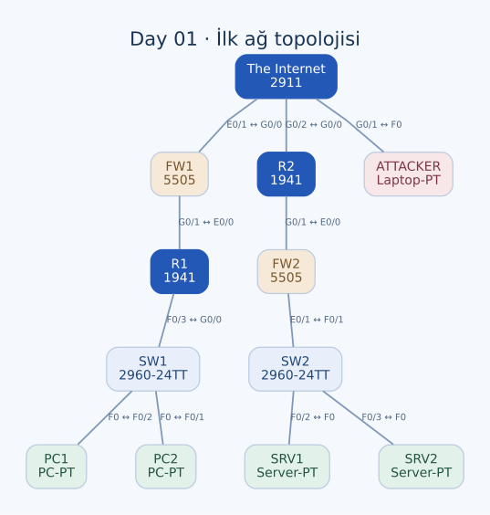

# Day 01 — Packet Tracer'a Giriş ve İlk Topoloji

Bu labda Packet Tracer çalışma alanını kullanarak iki şube, bu şubeleri birbirine bağlayan bir dış ağ ve dış ağdaki bir istemciden oluşan topolojiyi kurdum. Önceliğim cihazların rollerini tanımak, doğru portları seçmek ve ağın fiziksel bağlantılarını oluşturmak oldu.

| Alan | Açıklama |
| --- | --- |
| Lab dosyası | [Day 01 Lab - Packet Tracer Introduction.pkt](../../Day%2001%20Lab%20-%20Packet%20Tracer%20Introduction.pkt) |
| Konu | Ağ cihazları, topoloji oluşturma ve otomatik kablo seçimi |
| Ortam | Cisco Packet Tracer 9.0.1 |
| Kapsam | Cihaz yerleşimi ve kablolama; uçtan uca IP erişimi bu aşamanın hedefi değil |

## Amaç

İlk hedefim, bir ağ diyagramındaki router, switch, firewall, PC ve server simgelerini Packet Tracer'daki gerçek cihazlarla eşleştirmekti. Ardından cihazları çalışma alanına yerleştirip bağlantıları **Automatically Choose Connection Type** seçeneğiyle oluşturdum.

Bu çalışma, ileride yapacağım adresleme ve yönlendirme labları için temel oluşturuyor: Bir topolojinin çizilmiş olması, cihazların IP seviyesinde haberleşmeye hazır olduğu anlamına gelmiyor.

## Topoloji ve cihazlar



| Cihaz | Model | Topolojideki rolü |
| --- | --- | --- |
| R1, R2 | Cisco 1941 | Şube bağlantılarındaki router'lar |
| The Internet | Cisco 2911 | Dış ağı temsil eden merkezi router |
| SW1, SW2 | Cisco 2960-24TT | İstemci ve sunucuları yerel ağa bağlayan switch'ler |
| FW1, FW2 | Cisco ASA 5505 | Firewall cihazlarının topolojideki yerleşimi |
| PC1, PC2 | PC-PT | Birinci yerel ağdaki istemciler |
| SRV1, SRV2 | Server-PT | İkinci yerel ağdaki sunucular |
| ATTACKER | Laptop-PT | Dış ağdaki istemciyi temsil eden laptop |

Görevde şube router'ları için Cisco 2911 belirtilmiş olsa da kaydettiğim topolojide R1 ve R2 **1941** modelinde. Dış ağı temsil eden cihaz ise 2911. Cihazları aynı adla etiketlemek model farkını ortadan kaldırmıyor; bu ayrımı envanterde korudum.

`ATTACKER` etiketi yalnızca cihazın senaryodaki rolünü gösteriyor. Bu labda saldırı trafiği, güvenlik testi veya firewall kuralı yapılandırması yok.

### Bağlantı planı

| Birinci uç | İkinci uç | Kablo türü |
| --- | --- | --- |
| PC2 — FastEthernet0 | SW1 — FastEthernet0/1 | Copper straight-through |
| PC1 — FastEthernet0 | SW1 — FastEthernet0/2 | Copper straight-through |
| SW1 — FastEthernet0/3 | R1 — GigabitEthernet0/0 | Copper straight-through |
| R1 — GigabitEthernet0/1 | FW1 — Ethernet0/0 | Copper straight-through |
| FW1 — Ethernet0/1 | The Internet — GigabitEthernet0/0 | Copper straight-through |
| The Internet — GigabitEthernet0/1 | ATTACKER — FastEthernet0 | Copper crossover |
| The Internet — GigabitEthernet0/2 | R2 — GigabitEthernet0/0 | Copper crossover |
| R2 — GigabitEthernet0/1 | FW2 — Ethernet0/0 | Copper straight-through |
| FW2 — Ethernet0/1 | SW2 — FastEthernet0/1 | Copper crossover |
| SW2 — FastEthernet0/2 | SRV1 — FastEthernet0 | Copper straight-through |
| SW2 — FastEthernet0/3 | SRV2 — FastEthernet0 | Copper straight-through |

Topolojide toplam **12 ağ cihazı/uç cihaz ve 11 veri bağlantısı** bulunuyor. Fiziksel çalışma alanındaki güç dağıtım nesnesini ağın iletim yoluna dahil etmedim.

## Yaptığım işlemler

1. Router, switch, firewall, istemci ve sunucu modellerini cihaz listesinden seçip çalışma alanına ekledim.
2. Cihazları iki yerel ağ ve ortak dış ağ ilişkisini gösterecek şekilde yerleştirdim.
3. `R1`, `SW1`, `FW1`, `SRV1` gibi görüntü adlarıyla cihazların diyagramdaki rollerini belirginleştirdim.
4. Otomatik bağlantı seçeneğiyle kullanılabilir portları ve kablo türlerini eşleştirdim.
5. Oluşan bağlantıları port bazında kontrol edip topolojiyi kaydettim.

Packet Tracer'da cihazın altındaki görüntü adını değiştirmek ile IOS üzerinde `hostname` tanımlamak ayrı işlemler. Bu labdaki R1 ve R2'nin görüntü adları farklı olsa da IOS hostname değerleri hâlâ `Router`; switch'lerde de `Switch`. Sonraki lablarda CLI üzerinden cihaz isimlendirmesini ayrıca yapıyorum.

## Cihazların görevleri

**Switch**, aynı yerel ağdaki cihazların Ethernet üzerinden birbirine bağlanmasını sağlar. Örneğin PC1 ve PC2, SW1'in farklı erişim portlarında; SRV1 ve SRV2 ise SW2'de bulunuyor.

**Router**, farklı IP ağları arasında iletim yapacak cihazdır. Topolojide bir router bulunması tek başına bu görevin çalıştığını göstermez; ilgili arayüzlerde adresleme, arayüzlerin etkinleştirilmesi ve gereken yönlendirme bilgileri de olmalıdır.

**Firewall**, tanımlanan güvenlik politikasına göre trafiği denetleyen cihazdır. ASA'yı diyagrama eklemek, ağın otomatik olarak güvenli hâle geldiği anlamına gelmez. Hangi portun hangi güvenlik bölgesine ait olduğu ve hangi trafiğin geçeceği ayrıca tasarlanır.

**Server ve PC**, bu topolojinin uç cihazlarıdır. Server'ın adı, üzerinde bir uygulama servisinin yapılandırıldığını veya erişilebilir olduğunu tek başına kanıtlamaz.

## Konfigürasyonun durumu

Bu dosyada istemcilere ve sunuculara atanmış IPv4 adresleri bulunmuyor. Router arayüzlerinde de IP adresi yok; router Ethernet arayüzleri `shutdown` durumunda. Dolayısıyla topoloji, henüz çalışır bir şubeler arası IP ağı olarak değerlendirilmemeli.

ASA cihazlarında başlangıç ayarları bulunuyor:

```text
interface Ethernet0/0
 switchport access vlan 2
!
interface Ethernet0/1
 switchport access vlan 1
!
interface Vlan1
 nameif inside
 security-level 100
 ip address 192.168.1.1 255.255.255.0
!
interface Vlan2
 nameif outside
 security-level 0
 ip address dhcp
```

Bu başlangıç değerlerini şubeler için hazırlanmış bir IP veya güvenlik planı olarak kullanmadım. Örneğin FW1'in `Ethernet0/1` bağlantısı dış ağı temsil eden router'a giderken varsayılan ASA tanımında VLAN 1 `inside` olarak adlandırılıyor. Fiziksel çizim ile mantıksal inside/outside tasarımının ayrıca uyumlandırılması gerekiyor.

Her iki ASA'da aynı varsayılan `192.168.1.1/24` inside adresinin bulunması da iki şube için bilinçli olarak hazırlanmış bir adresleme planı anlamına gelmiyor.

## Karşılaştığım ayrımlar

| Konu | Bu labdan çıkardığım sonuç |
| --- | --- |
| Kablonun takılması | Fiziksel topolojinin kurulmasıdır; IP erişimi için yeterli değildir. |
| Cihaz etiketi | Diyagramın okunmasını kolaylaştırır; IOS hostname ayarıyla aynı değildir. |
| Otomatik bağlantı seçimi | İlk topolojiyi kurmayı kolaylaştırır; kablo seçiminin mantığını ayrıca öğrenmek gerekir. |
| Firewall yerleşimi | Güvenlik cihazının yerini gösterir; politika ve güvenlik bölgesi yapılandırmasının yerine geçmez. |
| Model seçimi | Port sayısı ve cihaz özellikleri modele bağlıdır; görevdeki model ile kullandığım modeli ayrı kontrol etmeliyim. |

## Öğrendiklerim

- Bir ağ diyagramını cihaz ve port seviyesinde somut bir topolojiye dönüştürdüm.
- Router, switch, firewall ve uç cihaz rollerini aynı senaryo içinde ayırt ettim.
- Görüntü adı, cihaz modeli ve IOS hostname değerinin farklı bilgiler olduğunu öğrendim.
- Fiziksel bağlantı, IP konfigürasyonu ve güvenlik politikasının birbirini tamamlayan ayrı aşamalar olduğunu gördüm.
- Kablo seçimini otomatik yapabilsem de cihazların Ethernet arayüzlerinin özelliklerini anlamam gerektiğini fark ettim.

## Sonuç

İki yerel ağı dış ağ üzerinden ilişkilendiren topolojiyi cihaz ve kablo düzeyinde kurdum. Bu labın çıktısı, **adresleme ve yönlendirme çalışmalarına temel olacak bir ağ yerleşimi**. Uçtan uca ping başarısı veya uygulanmış firewall politikası bu çalışmanın çıktısı değil.

[Lab kataloğuna dön](../../README.md) · [Sonraki lab: Connecting Devices](day-02-connecting-devices.md)
