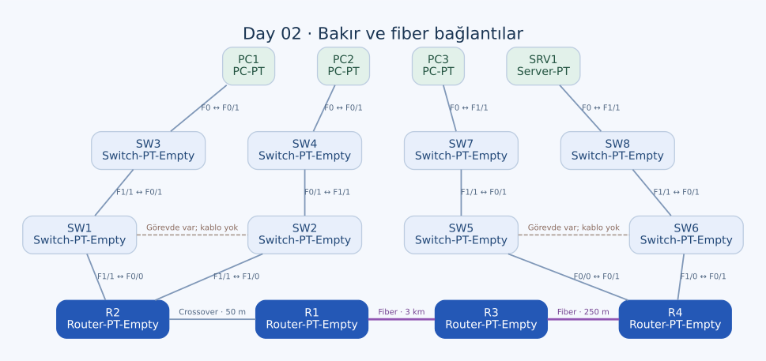

# Day 02 — Cihazları Bağlama ve Doğru Kabloyu Seçme

Bu labda otomatik kablo seçiminin arkasındaki mantığa odaklandım. Router, switch ve uç cihazların portlarını uygun bakır veya fiber bağlantılarla eşleştirdim; kablo seçiminde port türünün, mesafenin ve Auto MDI-X desteğinin etkisini ele aldım.

| Alan | Açıklama |
| --- | --- |
| Lab dosyası | [Day 02 Lab - Connecting Devices.pkt](../../Day%2002%20Lab%20-%20Connecting%20Devices.pkt) |
| Konu | Straight-through, crossover, fiber, MDI/MDI-X ve mesafe |
| Ortam | Cisco Packet Tracer 9.0.1 |
| Lab varsayımı | Auto MDI-X kapalı veya desteklenmiyor |

## Amaç

Amacım, topoloji üzerindeki bağlantı etiketlerini okuyarak uygun arayüz ve kabloyu seçmekti. Bu kez yalnızca iki cihazı bağlamak yeterli değildi; **neden o kabloyu kullandığımı** açıklayabilmem gerekiyordu.

Üç mesafe özellikle önemliydi: R1–R2 arasında 50 metre, R1–R3 arasında 3 kilometre ve R3–R4 arasında 250 metre. Bu örnekler, portların birbirine uyumlu olmasının yanında fiziksel ortamın taşıma mesafesini de düşünmemi sağladı.

## Topoloji ve cihazlar

| Cihaz grubu | Model | Adet |
| --- | --- | --- |
| R1, R2, R3, R4 | Router-PT-Empty | 4 |
| SW1–SW8 | Switch-PT-Empty | 8 |
| PC1, PC2, PC3 | PC-PT | 3 |
| SRV1 | Server-PT | 1 |

Modüler router'larda bakır FastEthernet ve fiber GigabitEthernet arayüzleri bulunuyor. Port adındaki `GigabitEthernet` ifadesi tek başına ortamın bakır olduğunu söylemez; bu topolojide bazı GigabitEthernet portları fiber modüllere ait.

## Kablo seçiminin mantığı

Klasik 10/100 Mbps bakır Ethernet'te PC ve router portlarını **MDI**, switch portlarını **MDI-X** olarak ele aldım. Auto MDI-X varsayım gereği kullanılmadığında seçim şöyle:

| Uçların ilişkisi | Örnek | Kablo |
| --- | --- | --- |
| MDI ↔ MDI-X | PC–switch, router–switch | Straight-through |
| MDI ↔ MDI | Router–router | Crossover |
| MDI-X ↔ MDI-X | Switch–switch | Crossover |

Straight-through kablo, pinleri iki uçta aynı sırayla bağlar. Crossover, ilgili gönderme ve alma çiftlerini çaprazlar. Dolayısıyla “aynı cihazsa crossover” kuralının asıl dayanağı cihazın adı değil, portların gönderme/alma düzenidir.

Auto MDI-X desteklendiğinde portlar gerekli eşleşmeyi otomatik yapabilir. Bu labda bu kolaylığı kullanmadan seçim yaptım. Ayrıca klasik 10/100 Ethernet çift düzenini 1000BASE-T'ye aynen taşımamak gerekiyor; bakır Gigabit Ethernet dört çiftin tamamını kullanır.

## Bağlantı tablosu

### Bakır bağlantılar

| Birinci uç | İkinci uç | Kablo | Gerekçe |
| --- | --- | --- | --- |
| PC1 — FastEthernet0 | SW3 — FastEthernet0/1 | Straight-through | Uç cihaz–switch |
| PC2 — FastEthernet0 | SW4 — FastEthernet0/1 | Straight-through | Uç cihaz–switch |
| SW3 — FastEthernet1/1 | SW1 — FastEthernet0/1 | Crossover | Switch–switch |
| SW2 — FastEthernet0/1 | SW4 — FastEthernet1/1 | Crossover | Switch–switch |
| SW1 — FastEthernet1/1 | R2 — FastEthernet0/0 | Straight-through | Switch–router |
| SW2 — FastEthernet1/1 | R2 — FastEthernet1/0 | Straight-through | Switch–router |
| R2 — FastEthernet2/0 | R1 — FastEthernet0/0 | Crossover | Router–router, 50 metre |
| R4 — FastEthernet0/0 | SW5 — FastEthernet0/1 | Straight-through | Router–switch |
| R4 — FastEthernet1/0 | SW6 — FastEthernet0/1 | Straight-through | Router–switch |
| SW5 — FastEthernet1/1 | SW7 — FastEthernet0/1 | Crossover | Switch–switch |
| SW6 — FastEthernet1/1 | SW8 — FastEthernet0/1 | Crossover | Switch–switch |
| PC3 — FastEthernet0 | SW7 — FastEthernet1/1 | Straight-through | Uç cihaz–switch |
| SRV1 — FastEthernet0 | SW8 — FastEthernet1/1 | Straight-through | Uç cihaz–switch |

### Fiber bağlantılar

| Birinci uç | İkinci uç | Mesafe etiketi | Tercihin gerekçesi |
| --- | --- | --- | --- |
| R1 — GigabitEthernet3/0 | R3 — GigabitEthernet2/0 | 3 km | Uzun mesafe için fiber; gerçek tasarımda uygun single-mode optik |
| R3 — GigabitEthernet3/0 | R4 — GigabitEthernet3/0 | 250 m | Bakır Ethernet kanal mesafesini aşan hat; uygun optikle multimode düşünülebilir |

## Mesafeyi nasıl değerlendirdim?

**50 metrelik R1–R2 hattında** bakır bağlantı kullandım. Bu mesafe, kullanılan FastEthernet bakır bağlantı için tipik 100 metrelik kanal sınırının içinde.

**250 metrelik R3–R4 hattında** fiber kullandım. Ancak “250 metre olduğuna göre her multimode modül uygundur” sonucu çıkarılamaz. Örneğin Cisco'nun 1000BASE-SX tablosunda fiber türüne göre 220 metre ve 550 metre gibi farklı erişim değerleri bulunuyor. Optik modül ve fiber sınıfı birlikte seçilmeli.

**3 kilometrelik R1–R3 hattında** gerçek bir kurulum için single-mode fiber ve bu mesafeyi karşılayan optik modül seçmek daha uygun. Örneğin Cisco'nun 1000BASE-LX/LH modülleri, uygun single-mode hatlarda 10 kilometreye kadar erişim sağlayabiliyor. Bu bir ürün örneği; tüm fiber arayüzlerin aynı mesafeyi desteklediği anlamına gelmiyor.

Packet Tracer bu labda single-mode/multimode ayrımını gerçek optik bütçesiyle modellemiyor. Kaydettiğim iki fiber bağlantı da uygulama içinde aynı fiber türüyle temsil ediliyor. Bu gösterimi, 3 kilometrelik gerçek bir multimode hattın onaylandığı şeklinde yorumlamıyorum.

## Yaptığım işlemler ve konfigürasyon sınırı

1. Bağlantı etiketlerinden hangi cihazların komşu olacağını belirledim.
2. Router'larda kullanılacak bakır ve fiber arayüzleri ayırt ettim.
3. PC–switch ve router–switch hatlarında straight-through kullandım.
4. Switch–switch ve 50 metrelik router–router bakır hattında crossover kullandım.
5. 250 metre ve 3 kilometre olarak belirtilen hatları fiber portlarla bağladım.

Bu labda IP adresleme veya routing konfigürasyonu yapmadım. Router arayüzlerinde IP adresi yok ve arayüzler `shutdown` durumunda. Bu nedenle çalışmanın sonucunu ping ile çalışan bir ağ olarak değil, **kablolama pratiği** olarak değerlendiriyorum.

## Eksik kalan bağlantılar

Topoloji üzerindeki görev etiketlerinde bulunan iki bağlantı, kaydettiğim çalışmada henüz yok:

| Görevdeki bağlantı | Kayıtlı durum | Tamamlarken gereken seçim |
| --- | --- | --- |
| SW1–SW2 | Doğrudan kablo yok | Boş bakır portlar arasında crossover |
| SW5–SW6 | Doğrudan kablo yok | Boş bakır portlar arasında crossover |

Mevcut topolojide **15 veri bağlantısı** var: 13 bakır ve 2 fiber. Bu iki eksik bağlantıyı varmış gibi göstermedim. Görselde kesikli çizgiler, görevde yer alan fakat henüz bağlanmamış hatları gösteriyor.

Ek switch bağlantıları eklendiğinde oluşabilecek Layer 2 döngü davranışı, kablo seçiminden ayrı bir konu. Bu labın odağı uygun fiziksel bağlantıyı kurmak; STP davranışını sonraki switching lablarında ele alıyorum.

## Kontrol ederken dikkat ettiğim noktalar

| Kontrol | Neyi ayırt ediyorum? |
| --- | --- |
| Portun ortam türü | Bakır kablonun fiber porta takılamaması |
| Kablo türü | Auto MDI-X yokken gönderme/alma çiftlerinin eşleşmesi |
| Mesafe | Kablo ve optik modülün hat uzunluğunu karşılaması |
| Arayüzün idari durumu | Doğru kabloya rağmen router portunun shutdown kalabilmesi |
| Görev etiketleri | Çizimde istenen hat ile gerçekten bağladığım hattın aynı olması |

## Öğrendiklerim

- Kablo seçiminin cihaz isimlerinden çok arayüzlerin elektriksel özelliklerine dayandığını öğrendim.
- Auto MDI-X desteğinin klasik straight-through/crossover zorunluluğunu nasıl değiştirdiğini anladım.
- Port hızının, fiziksel ortamın ve desteklenen mesafenin ayrı bilgiler olduğunu gördüm.
- Fiber seçiminde single-mode/multimode yanında optik modül ve fiber sınıfının da önemli olduğunu öğrendim.
- Bir topolojiyi kontrol ederken yalnızca bağladığım kabloları değil, eksik kalan görev bağlantılarını da listelemem gerektiğini gördüm.

## Sonuç

Bakır ve fiber bağlantılarda port uyumluluğunu, mesafeyi ve kablo türünü birlikte değerlendirdim. Kayıtlı çalışmamda iki switch bağlantısı eksik kaldı; bu nedenle tüm kablolama görevini tamamlanmış saymıyorum. IP konfigürasyonu ve uçtan uca erişim ise bu labın dışında.

## Kaynak

- [Cisco — Gigabit Ethernet SFP modülleri ve mesafe tabloları](https://www.cisco.com/c/en/us/products/collateral/interfaces-modules/gigabit-ethernet-gbic-sfp-modules/datasheet-c78-366584.html)

[Önceki lab](day-01-packet-tracer-introduction.md) · [Lab kataloğu](../../README.md) · [Sonraki lab: OSI Model](day-03-osi-model.md)
