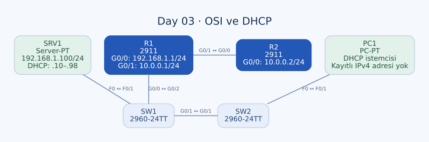

# Day 03 — OSI Modeli ve DHCP Trafiğini Anlamak

Bu labda hazır bir ağ topolojisini kullanarak protokolleri OSI katmanlarıyla ilişkilendirdim. Ana çalışma, Packet Tracer'ın Simulation Mode ekranında bir paketin yalnızca IP adreslerinden ibaret olmadığını; uygulama, taşıma, ağ ve Ethernet bilgilerinin birlikte taşındığını anlamaktı. Uygulama katmanı trafiği için DHCP üzerinden adres alma sürecine odaklandım.

| Alan | Açıklama |
| --- | --- |
| Lab dosyası | [Day 03 Lab - OSI Model.pkt](../../labs/Day%2003%20Lab%20-%20OSI%20Model.pkt) |
| Konu | OSI katmanları, encapsulation, DHCP ve Simulation Mode |
| Ortam | Cisco Packet Tracer 9.0.1 |
| Temel görev | Ağdaki trafiği katmanlarıyla açıklamak; PC1'in DHCP adres alma sürecini incelemek |

## Amaç

Amacım, “Bu protokol hangi katmanda?” sorusunu ezberden cevaplamak yerine, pakette hangi bilginin ne işe yaradığını açıklamaktı. DHCP bunun için iyi bir örnek: Uygulama katmanında çalışan bir protokol, ağ üzerinde taşınırken UDP, IP ve Ethernet'e ihtiyaç duyuyor.

Bu labda yeni bir routing tasarımı kurmadım. Router arayüzleri, OSPF ve sunucu servisleri hazır konfigürasyonun parçaları; bunları trafiği anlamak için kullandım.

## Topoloji



| Cihaz | Model | Rol |
| --- | --- | --- |
| PC1 | PC-PT | DHCP ile adres alacak istemci |
| SRV1 | Server-PT | DHCP sunucusu; aynı zamanda HTTP/HTTPS servisleri açık |
| SW1, SW2 | Cisco 2960-24TT | İstemci ve sunucuyu aynı yerel ağda birleştiren switch'ler |
| R1 | Cisco 2911 | LAN gateway'i ve R2'ye bağlantı |
| R2 | Cisco 2911 | `10.0.0.0/24` hattındaki diğer router |

### Fiziksel bağlantılar

| Birinci uç | İkinci uç | Kablo |
| --- | --- | --- |
| PC1 — FastEthernet0 | SW2 — FastEthernet0/1 | Straight-through |
| SW2 — GigabitEthernet0/1 | SW1 — GigabitEthernet0/1 | Crossover |
| SRV1 — FastEthernet0 | SW1 — FastEthernet0/1 | Straight-through |
| R1 — GigabitEthernet0/0 | SW1 — GigabitEthernet0/2 | Straight-through |
| R1 — GigabitEthernet0/1 | R2 — GigabitEthernet0/0 | Crossover |

PC1 ile SRV1 farklı switch'lerde olsa da aralarında bir router yok. İki switch aynı Layer 2 alanını birbirine bağlıyor; DHCP istemcisi ile sunucu aynı LAN'da.

## Adresleme ve DHCP ayarları

| Cihaz / arayüz | IPv4 | Maske | Gateway |
| --- | --- | --- | --- |
| R1 — GigabitEthernet0/0 | `192.168.1.1` | `255.255.255.0` | LAN gateway'i |
| R1 — GigabitEthernet0/1 | `10.0.0.1` | `255.255.255.0` | R2 yönü |
| R2 — GigabitEthernet0/0 | `10.0.0.2` | `255.255.255.0` | R1 yönü |
| SRV1 — FastEthernet0 | `192.168.1.100` | `255.255.255.0` | `192.168.1.1` |
| PC1 — FastEthernet0 | DHCP | Adresle birlikte öğrenilecek | DHCP seçeneğiyle öğrenilecek |

### Sunucudaki DHCP havuzu

| Ayar | Değer |
| --- | --- |
| Servis | Açık |
| Havuz adı | `serverPool` |
| Ağ | `192.168.1.0/24` |
| Başlangıç adresi | `192.168.1.10` |
| Bitiş adresi | `192.168.1.98` |
| Maksimum istemci sayısı | 89 |
| Default gateway | `192.168.1.1` |
| DNS seçeneği | `0.0.0.0`; kullanılabilir bir DNS sunucusu tanımlanmamış |

Kaydettiğim durumda PC1'in DHCP seçeneği açık, fakat IPv4 adresi ve gateway alanları boş. Sunucunun kayıtlı kira listesi de boş. Dolayısıyla PC1'e kesin olarak `.10` veya başka bir adres verilmiş olduğunu söylemiyorum. `.10`, havuzun başlangıcı; başarılı bir DHCP alışverişinde verilecek adres o andaki sunucu durumuna bağlı.

## Katmanları nasıl eşleştirdim?

| OSI katmanı | Temel sorumluluk | Bu labdaki karşılığı |
| --- | --- | --- |
| 7 — Application | Uygulama protokolünün kuralları | DHCP mesajları; sunucunun HTTP servisi |
| 6 — Presentation | Verinin gösterimi ve kodlanması | Bu çalışmada ayrı bir protokol olarak yapılandırmadım |
| 5 — Session | İletişim oturumunun yönetimi | Bu çalışmada ayrı bir protokol olarak yapılandırmadım |
| 4 — Transport | Süreçler arası taşıma ve portlar | DHCP'nin kullandığı UDP |
| 3 — Network | IP adresleme ve ağlar arası iletim | IPv4; router'lardaki OSPF kontrol trafiği |
| 2 — Data Link | Yerel linkte çerçeve iletimi | Ethernet MAC adresleri; ARP ile IP–MAC eşleştirme |
| 1 — Physical | Bitlerin fiziksel ortamda taşınması | Bakır Ethernet bağlantıları |

ARP, IPv4 adresini yerel Ethernet teslimatında kullanılacak MAC adresiyle ilişkilendirir; UDP/TCP üzerinden taşınmaz. Bu nedenle onu DHCP gibi uygulama katmanı protokolü olarak değerlendirmedim. ICMP de bir taşıma katmanı protokolü değil, IP ile ilişkili ağ katmanı protokolüdür.

OSI'nin yedi katmanını, TCP/IP modelinde her biri için ayrı bir başlık varmış gibi düşünmemek gerekiyor. Özellikle uygulama, sunum ve oturum sorumlulukları pratik TCP/IP uygulamalarında birlikte ele alınabiliyor.

## DHCP ile uygulama katmanı trafiği

PC1'in komut isteminden adres bırakma ve yeniden adres isteme adımları:

```text
ipconfig /release
ipconfig /renew
ipconfig /all
```

`/release`, mevcut bir DHCP kirası varsa bırakır. `/renew`, istemcinin durumuna göre adres edinme veya yenileme sürecini başlatır. Adresi olmayan bir istemcinin ilk edinim sürecini **DORA** sırasıyla açıklayabiliyorum:

| Aşama | Mesaj | Anlamı |
| --- | --- | --- |
| 1 | DHCP Discover | İstemci, kullanılabilir DHCP sunucusu arar. |
| 2 | DHCP Offer | Sunucu bir adres ve ilgili ağ ayarlarını teklif eder. |
| 3 | DHCP Request | İstemci seçtiği teklifi ve istediği adresi bildirir. |
| 4 | DHCP ACK | Sunucu kirayı onaylar. |

İlk Discover mesajında istemcinin henüz kullanılabilir IPv4 adresi olmadığı için kaynak `0.0.0.0`, hedef `255.255.255.255` olabilir. DHCP istemci portu **UDP 68**, sunucu portu **UDP 67**. Ethernet yayın adresi `FFFF.FFFF.FFFF` üzerinden mesaj aynı broadcast alanına yayılır.

Offer ve ACK mesajlarının her durumda aynı şekilde broadcast gönderildiğini varsaymıyorum; istemcinin durumu ve broadcast bayrağına göre unicast veya broadcast kullanılabilir. Yenileme süreci de her seferinde sıfırdan Discover ile başlamak zorunda değildir.

### Bu topolojide mesajın yolu

PC1'in yayın çerçevesi önce SW2'ye, oradan iki switch arasındaki bağlantıyla SW1'e ulaşır. SRV1 aynı LAN'da olduğu için DHCP isteğini alabilir. R1'in DHCP relay olarak yapılandırılması gerekmiyor; sunucuya ulaşmak için router üzerinden başka bir subnet'e geçilmiyor.

R1'in diğer arayüzüne bağlı R2, bu Layer 2 broadcast alanının parçası değil. Router, sıradan Ethernet broadcast çerçevesini diğer IP ağına switch gibi kopyalamaz.

## Encapsulation: tek mesaj, birden fazla katman

Bir DHCP mesajını şu kapsülleme ilişkisiyle okuyorum:

| İçerik | Taşıdığı bilgi |
| --- | --- |
| DHCP verisi | Mesaj türü, istenen/teklif edilen adres ve seçenekler |
| UDP başlığı | Kaynak ve hedef portlar |
| IPv4 başlığı | Kaynak ve hedef IP adresleri |
| Ethernet çerçevesi | Yerel linkteki kaynak ve hedef MAC adresleri |
| Fiziksel iletim | Çerçevenin bitlerinin kablo üzerinde taşınması |

“DHCP Layer 7 protokolüdür” demek, diğer katmanların kullanılmadığı anlamına gelmiyor. Uygulama verisi alt katmanların hizmetini kullanarak hedefe taşınıyor.

## Hazır router konfigürasyonu

R1 ve R2'de OSPF process 1 kullanılıyor. Bu ayarları bu labda sıfırdan oluşturulmuş bir OSPF çalışması olarak ele almıyorum; ağda neden routing kontrol trafiği bulunabileceğini açıklayan hazır ayarlar bunlar.

```text
! R1
router ospf 1
 log-adjacency-changes
 network 10.0.0.0 0.0.0.255 area 0
 network 192.168.1.0 0.0.0.255 area 0
!
! R2
router ospf 1
 log-adjacency-changes
 network 10.0.0.0 0.0.0.255 area 0
```

OSPF, IP protokol numarası 89 ile taşınır; DHCP'nin UDP portlarıyla aynı mekanizmayı kullanmaz. Bu ayrım, Simulation Mode'da görülen farklı paket türlerini birbirinden ayırırken önemli.

## Simulation Mode için inceleme sırası

1. DHCP ve ARP gibi ilgili protokolleri filtreleyip olay listesini sadeleştirmek.
2. PC1'de `/release` ve `/renew` işlemlerini uygulamak.
3. İlk mesajın kaynak/hedef IP ve MAC adreslerini incelemek.
4. Switch'lerde gelen port ile iletilen portları karşılaştırmak.
5. SRV1'in teklifindeki IP, maske ve gateway seçeneklerini kontrol etmek.
6. ACK sonrasında PC1'in adresini `ipconfig /all` ile kontrol etmek.

Bu sıra, beklenen protokol davranışını kontrol etmek için kullandığım çerçeve. Kaydettiğim dosyada tamamlanmış DHCP kiralama sonucu bulunmadığı için son adımın çıktısını doldurulmuş bir adres tablosu gibi sunmuyorum.

## Öğrendiklerim

- Bir uygulama katmanı protokolünü, onu taşıyan UDP/IP/Ethernet bilgilerinden ayırmayı öğrendim.
- DHCP'nin yalnızca adres değil, maske ve gateway gibi seçenekler de sağladığını anladım.
- Aynı LAN'daki DHCP alışverişinde router'ın mutlaka relay rolü üstlenmesi gerekmediğini gördüm.
- Broadcast alanı ile IP ağları arasında yönlendirme yapılan alanın farklı kavramlar olduğunu öğrendim.
- Hazır OSPF konfigürasyonu ile bu labın asıl konusu olan katman analizini birbirine karıştırmamam gerektiğini gördüm.

## Sonuç

Labı, paketleri katman ve sorumluluklarına göre okumak için kullandım. Ağda DHCP sunucusu hazır ve PC1 DHCP modunda; ancak kayıtlı son durumda istemcinin adres edinimi tamamlanmış görünmüyor. Bu nedenle teknik açıklamayı DORA süreci, kapsülleme ve gerçek konfigürasyon üzerinden kurdum.

## Kaynaklar

- [RFC 2131 — Dynamic Host Configuration Protocol](https://datatracker.ietf.org/doc/html/rfc2131/)
- [RFC 2328 — OSPF Version 2](https://www.rfc-editor.org/rfc/rfc2328)

[Önceki lab](day-02-connecting-devices.md) · [Lab kataloğu](../../README.md) · [Sonraki lab: Basic Device Security](day-04-basic-device-security.md)
