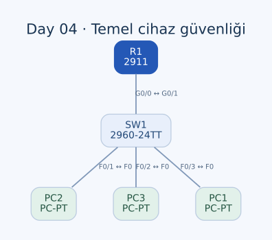

# Day 04 — Temel Cihaz Güvenliği ve IOS CLI

Bu labda router ve switch üzerinde cihaz isimlendirmesi, privileged EXEC erişimi, parola saklama biçimleri ve konfigürasyonun kalıcı olarak kaydedilmesi üzerinde çalıştım. `enable password`, `service password-encryption` ve `enable secret` komutlarını aynı senaryoda karşılaştırdım.

| Alan | Açıklama |
| --- | --- |
| Lab dosyası | [Day 04 Lab - Basic Device Security.pkt](../../labs/Day%2004%20Lab%20-%20Basic%20Device%20Security.pkt) |
| Konu | IOS modları, hostname, enable parolaları ve startup-config |
| Ortam | Cisco Packet Tracer 9.0.1 |
| Cihazlar | Cisco 2911 R1, Cisco 2960-24TT SW1 ve üç PC |

## Amaç

İlk hedefim cihazları CLI üzerinden `R1` ve `SW1` olarak adlandırmaktı. Ardından privileged EXEC moduna geçişi parolayla korudum, parolanın konfigürasyonda nasıl saklandığını inceledim ve daha sonra `enable secret` tanımladım.

Labın önemli soruları şunlardı: İki enable parolası birlikte tanımlandığında hangisi geçerli olur? Konfigürasyonda görülen `7` ve `5` sayıları neyi belirtir? Çalışan konfigürasyon nasıl başlangıç konfigürasyonuna aktarılır?

## Topoloji



| Birinci uç | İkinci uç | Kablo |
| --- | --- | --- |
| R1 — GigabitEthernet0/0 | SW1 — GigabitEthernet0/1 | Straight-through |
| SW1 — FastEthernet0/1 | PC2 — FastEthernet0 | Straight-through |
| SW1 — FastEthernet0/2 | PC3 — FastEthernet0 | Straight-through |
| SW1 — FastEthernet0/3 | PC1 — FastEthernet0 | Straight-through |

Bu labda IPv4 adresleme yapmadım. PC'ler topolojide bulunsa da çalışma doğrudan R1 ve SW1'in CLI ekranlarında yürütüldü; ağ üzerinden SSH/Telnet erişimi kurulmadı.

## IOS modları

| Mod | Prompt örneği | Bu labdaki kullanım |
| --- | --- | --- |
| User EXEC | `R1>` | İlk erişim; `enable` ile üst moda geçiş |
| Privileged EXEC | `R1#` | `show`, `write memory`, `copy` gibi işlemler |
| Global configuration | `R1(config)#` | Hostname ve enable parola ayarları |

`enable`, privileged EXEC moduna; `configure terminal`, global configuration moduna geçiriyor. `exit` bir üst seviyeye veya EXEC oturumundan çıkışa hizmet eder. `end`, konfigürasyon modundan doğrudan privileged EXEC'e dönmek için kullanılabilir.

İlk denemelerde global configuration modunda doğrudan `show run` kullanmaya çalıştım. Buradaki sorun komutun kendisinden çok bulunduğum moddu. R1'de EXEC moduna dönerek, SW1'de ise `do show running-config` kullanarak konfigürasyonu görüntüledim. `do`, konfigürasyon modunu terk etmeden EXEC komutu çalıştırmamı sağladı.

## 1. Hostname tanımlama

```text
Router> enable
Router# configure terminal
Router(config)# hostname R1
```

```text
Switch> enable
Switch# configure terminal
Switch(config)# hostname SW1
```

Bu kez yalnızca Packet Tracer üzerindeki görüntü etiketini değiştirmedim; IOS hostname değerini de ayarladım. Böylece prompt'tan hangi cihazda işlem yaptığımı görebildim.

## 2. Düz metin enable password

Her iki cihazda lab yönergesindeki `CCNA` parolasını tanımladım:

```text
enable password CCNA
```

`service password-encryption` etkin değilken bu parola running-config içinde açık metin olarak saklanır. Privileged EXEC erişimini parolayla sınırlandırmak, konfigürasyon dosyasındaki parolanın da güvenli biçimde saklandığı anlamına gelmiyor.

User EXEC moduna dönüp yeniden `enable` kullanarak modlar arasındaki geçişi çalıştım. Bu aşamada henüz secret tanımlı olmadığından enable erişimini `enable password` belirler.

## 3. service password-encryption

```text
service password-encryption
```

Bu ayardan sonra labdaki `enable password` satırı şu biçimde saklanıyor:

```text
enable password 7 08026F6028
```

Buradaki `7`, parolanın uzunluğu veya yetki seviyesi değil, saklama türü. Type 7 geri çözülebilen bir gizleme yöntemi; parolanın konfigürasyonda ilk bakışta okunmasını engellese de güçlü bir parola koruması sağlamıyor.

Ayrıca bu komut yönetim trafiğini şifrelemiyor. Konfigürasyon dosyasındaki parola gösterimini değiştirmek ile SSH gibi bir protokolle ağdaki yönetim oturumunu korumak farklı işler.

## 4. enable secret ve öncelik

Her iki cihazda ikinci parola olarak `Cisco` tanımladım:

```text
enable secret Cisco
```

Labdaki IOS sürümleri bu secret'ı Type 5 biçiminde saklıyor. Kaydettiğim iki cihazda ilgili satırlar aynı:

```text
service password-encryption
enable secret 5 $1$mERr$YlCkLMcTYWwkF1Ccndtll.
enable password 7 08026F6028
```

**enable secret, aynı seviyedeki enable password tanımına göre önceliklidir.** Dolayısıyla bu son konfigürasyonda privileged EXEC erişiminde geçerli enable parolası `Cisco`; eski `CCNA` tanımı konfigürasyonda dursa da aynı geçişte alternatif parola gibi kullanılmaz.

Bu labda gördüğüm Type 5, MD5 tabanlı bir parola hash'idir. Type 7'den farklı olarak geri çözülebilen bir şifreleme değildir; ancak Type 5 de güncel bir güvenlik tercihi sayılmaz. Destekleyen cihazlarda Type 8/9 gibi daha güçlü parola saklama seçenekleri değerlendirilir. Buradaki amaç, labın kullandığı eski IOS davranışını doğru anlamak.

## 5. Konfigürasyonu kaydetme

R1'de farklı kaydetme komutlarını çalıştım:

```text
write
write memory
copy running-config startup-config
show startup-config
```

SW1'de de `write` ile kaydedip `show startup-config` üzerinden başlangıç ayarlarını kontrol ettim.

| Konfigürasyon | İşlevi |
| --- | --- |
| Running-config | Cihazın o anda kullandığı çalışma ayarları |
| Startup-config | Normal açılışta yüklenecek kayıtlı ayarlar |

Kaydettiğim dosyada hem R1'in hem SW1'in running-config ve startup-config içerikleri eşleşiyor. Hostname, `service password-encryption`, Type 7 enable password ve Type 5 enable secret başlangıç konfigürasyonlarında da mevcut.

Bu, ayarların başlangıç konfigürasyonuna aktarılmış olduğunu gösteriyor. Ayrı bir reload testi çıktısı tutmadığım için yeniden başlatma sonucunu ayrıca ölçülmüş bir test olarak eklemiyorum.

## Konfigürasyon özeti

Aşağıdaki bloklar, yaptığım temel ayarları yeniden uygulamak için gereken komutları bir araya getiriyor. `CCNA` ve `Cisco`, bu eğitim labının örnek parolaları.

### R1

```text
enable
configure terminal
hostname R1
enable password CCNA
service password-encryption
enable secret Cisco
end
copy running-config startup-config
```

### SW1

```text
enable
configure terminal
hostname SW1
enable password CCNA
service password-encryption
enable secret Cisco
end
copy running-config startup-config
```

## Kontroller ve sonuçları

| Kontrol | Son konfigürasyondaki durum |
| --- | --- |
| Hostname | R1 ve SW1 olarak ayarlanmış |
| Enable password saklama türü | İki cihazda da Type 7 |
| Enable secret saklama türü | İki cihazda da Type 5 |
| Parola önceliği | Enable secret geçerli |
| Başlangıç konfigürasyonuna kayıt | İki cihazda da running/startup eşleşiyor |
| Konsol/VTY kullanıcı doğrulaması | Bu labda ayrıca yapılandırılmadı |
| SSH erişimi | Bu labda kurulmadı |

`enable secret` ayarı, cihazın bütün yönetim erişimini tek başına güvenceye almıyor. Konsol erişimi, yerel kullanıcılar, VTY hatları ve SSH gibi başlıklar bu çalışmanın devamında ele alınacak ayrı konular.

## Öğrendiklerim

- IOS komutunun hangi modda çalıştırıldığının komutun kendisi kadar önemli olduğunu öğrendim.
- Görüntü etiketi yerine gerçek hostname ayarını CLI üzerinden yaptım.
- Enable password ile enable secret arasındaki öncelik ilişkisini anladım.
- Parola türü numarası, hash ve geri çözülebilen gizleme arasındaki farkları ayırdım.
- Running-config'i düzenlemek ile bu değişikliği startup-config'e kaydetmenin ayrı adımlar olduğunu öğrendim.

## Sonuç

R1 ve SW1'in isimlerini ve privileged EXEC parola ayarlarını yapılandırıp başlangıç konfigürasyonlarına kaydettim. Bu labın en önemli kazanımı, “parola var”, “parola konfigürasyonda gizlenmiş” ve “yönetim erişimi güvenli” ifadelerinin aynı anlama gelmediğini anlamak oldu.

## Kaynaklar

- [Cisco 2960 — Switch erişimi ve enable parola önceliği](https://www.cisco.com/c/en/us/td/docs/switches/lan/catalyst2960/software/release/12-2_53_se/configuration/guide/2960scg/swauthen.html)
- [Cisco — Protecting Secrets on Cisco Network Devices](https://www.cisco.com/c/en/us/about/trust-center/resilient-infrastructure/protecting-secrets.html)

[Önceki lab](day-03-osi-model.md) · [Lab kataloğu](../../README.md) · [Sonraki lab: Ethernet LAN Switching](day-06-ethernet-lan-switching.md)
