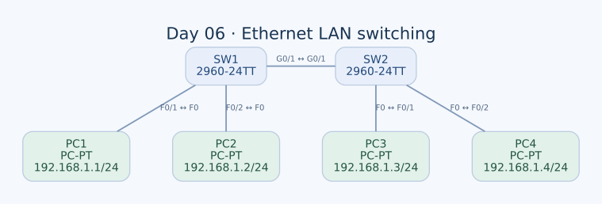

# Day 06 — Ethernet LAN Switching, ARP ve MAC Öğrenme

Bu labda iki switch'e bağlı dört PC üzerinden Ethernet iletimini çalıştım. Önce ARP ve MAC tabloları boşken PC1'in PC3'e ulaşması için hangi mesajlara ihtiyaç duyulduğunu açıkladım; ardından switch'lerde MAC adreslerini görüntüleme ve dinamik kayıtları temizleme komutlarını kullandım.

| Alan | Açıklama |
| --- | --- |
| Lab dosyası | [Day 06 Lab - Ethernet LAN Switching.pkt](../../Day%2006%20Lab%20-%20Ethernet%20LAN%20Switching.pkt) |
| Konu | ARP, broadcast, MAC öğrenme, flooding ve unicast forwarding |
| Ortam | Cisco Packet Tracer 9.0.1 |
| Başlangıç varsayımı | Switch MAC tabloları ve PC ARP tabloları boş |

## Amaç

Amacım, “Switch paketi hedefe gönderir” ifadesinin arkasındaki kararları adım adım anlamaktı. Switch IP adresine göre değil Ethernet çerçevesinin hedef MAC adresine göre iletim yapıyor; uç cihaz ise aynı ağdaki hedefin MAC adresini öğrenmek için ARP kullanıyor.

Özellikle iki soruya odaklandım: Switch MAC adresini hangi alandan öğrenir? Hedef MAC henüz tabloda yoksa çerçeveye ne olur?

## Topoloji ve adresleme



| Birinci uç | İkinci uç | Kablo |
| --- | --- | --- |
| PC1 — FastEthernet0 | SW1 — FastEthernet0/1 | Straight-through |
| PC2 — FastEthernet0 | SW1 — FastEthernet0/2 | Straight-through |
| SW1 — GigabitEthernet0/1 | SW2 — GigabitEthernet0/1 | Crossover |
| PC3 — FastEthernet0 | SW2 — FastEthernet0/1 | Straight-through |
| PC4 — FastEthernet0 | SW2 — FastEthernet0/2 | Straight-through |

İki switch de Cisco 2960-24TT. Dört PC aynı `192.168.1.0/24` subnet'inde ve VLAN 1 içindeki erişim portlarında bulunuyor.

| PC | IPv4 / prefix | Ethernet MAC adresi | Bağlı switch / port |
| --- | --- | --- | --- |
| PC1 | `192.168.1.1/24` | `00D0.D3AD.9CAB` | SW1 — FastEthernet0/1 |
| PC2 | `192.168.1.2/24` | `0060.5C56.14D3` | SW1 — FastEthernet0/2 |
| PC3 | `192.168.1.3/24` | `0004.9A6E.D870` | SW2 — FastEthernet0/1 |
| PC4 | `192.168.1.4/24` | `0001.647B.3119` | SW2 — FastEthernet0/2 |

PC'lerde default gateway tanımlı değil. Bu labda bütün uçlar aynı subnet'te olduğu için birbirlerine ulaşmak üzere router'a ihtiyaç duymuyorlar. Switch'lerin de Layer 2 iletim yapabilmek için yönetim IP adresine ihtiyacı yok.

## ARP tablosu ile MAC tablosunun farkı

| Tablo | Nerede kullanılıyor? | Eşleştirdiği bilgi |
| --- | --- | --- |
| ARP tablosu | PC'nin IPv4 iletişiminde | Yerel linkteki IPv4 adresi → MAC adresi |
| MAC adres tablosu | Switch'in Ethernet iletiminde | VLAN + MAC adresi → çıkış portu |

PC1, `192.168.1.3` için hangi MAC adresine çerçeve göndereceğini ARP ile öğrenir. SW1 ise bu hedef MAC'e hangi porttan ulaşılacağını kendi MAC tablosunda arar. Bunlar aynı tablo veya aynı öğrenme işlemi değil.

## İlk ping: PC1'den PC3'e

Başlangıçta ilgili tabloların boş olduğunu varsayarak mesaj sırasını şöyle açıklıyorum.

### 1. PC1 hedefin yerel subnet'te olduğunu belirler

PC1'in adresi `192.168.1.1/24`, hedef `192.168.1.3`. Maske uygulandığında ikisi de `192.168.1.0/24` ağına ait. Bu nedenle PC1 paketi bir gateway'e değil, doğrudan PC3'ün MAC adresine teslim etmek ister.

### 2. ARP Request yayınlanır

PC1 hedef MAC'i henüz bilmediği için ARP isteği oluşturur:

```text
ARP sorusu: 192.168.1.3 adresi hangi MAC adresinde?
Ethernet kaynak MAC: 00D0.D3AD.9CAB
Ethernet hedef MAC: FFFF.FFFF.FFFF
```

SW1 bu çerçeveyi FastEthernet0/1 portundan alır. Kaynak MAC'i okuyarak **PC1'in FastEthernet0/1 arkasında olduğunu öğrenir**. Ardından broadcast çerçevesini aynı VLAN'daki diğer iletime uygun portlara yayar; giriş portuna geri göndermez.

Topolojide bu yayın PC2'ye ve switch'ler arası bağlantı üzerinden SW2'ye gider. SW2 de PC1'in MAC'ini GigabitEthernet0/1 üzerinde öğrenir ve yayını PC3 ile PC4'e iletir.

PC2 ve PC4 ARP isteğini alır, ancak aranan IP onların adresi olmadığı için bu isteğe hedef olarak yanıt vermez. PC3 kendi IP'sini gördüğü için cevap verir.

### 3. ARP Reply unicast döner

PC3, PC1'e kendi MAC adresini bildirir:

```text
192.168.1.3 → 0004.9A6E.D870
Ethernet kaynak MAC: 0004.9A6E.D870
Ethernet hedef MAC: 00D0.D3AD.9CAB
```

SW2, PC3'ün kaynak MAC'ini FastEthernet0/1 üzerinde öğrenir. PC1'in hangi portta olduğunu önceki ARP isteğinden bildiği için cevabı GigabitEthernet0/1 üzerinden SW1'e iletir. SW1, PC3'ü kendi GigabitEthernet0/1 portunda öğrenir ve çerçeveyi PC1'e bağlı FastEthernet0/1'e gönderir.

Buradaki önemli nokta, switch'in PC3 adresini ARP mesajının açıklamasını okuyarak değil, gelen Ethernet çerçevesinin **kaynak MAC alanından** öğrenmesidir.

### 4. ICMP Echo Request ve Echo Reply

ARP çözümlemesinden sonra PC1, ICMP isteğini PC3'ün MAC adresine unicast çerçeve içinde gönderebilir. Gerekli MAC kayıtları artık iki switch'te de öğrenildiğinden, normal iletim yolu PC1, SW1, SW2 ve PC3 üzerinden geçer. PC2 ve PC4'ün portlarına bu bilinen unicast trafiğinin kopyalanması gerekmez.

| Mesaj | PC2 alır mı? | PC3 alır mı? | PC4 alır mı? |
| --- | --- | --- | --- |
| PC1'in ARP Request'i | Evet, broadcast | Evet, broadcast | Evet, broadcast |
| PC3'ün PC1'e ARP Reply'ı | Hayır, normal öğrenme sonrası unicast yolunda değil | Gönderen | Hayır |
| PC1'in ICMP Echo Request'i | Hayır | Evet | Hayır |
| PC3'ün ICMP Echo Reply'ı | Hayır | Gönderen | Hayır |

Tablo, belirtilen boş başlangıç durumu ve ARP ile öğrenme sırası için beklenen davranışı gösteriyor; kaydedilmiş bir paket yakalama çıktısı değil.

## Öğrenme sonrası beklenen MAC eşleşmeleri

PC1–PC3 ve PC2–PC4 gibi switch'ler arasından geçen trafik üretildiğinde, her switch'in dört PC'nin adresini de öğrenmesini bekliyorum:

| PC / MAC | SW1'de öğrenileceği port | SW2'de öğrenileceği port |
| --- | --- | --- |
| PC1 — `00D0.D3AD.9CAB` | FastEthernet0/1 | GigabitEthernet0/1 |
| PC2 — `0060.5C56.14D3` | FastEthernet0/2 | GigabitEthernet0/1 |
| PC3 — `0004.9A6E.D870` | GigabitEthernet0/1 | FastEthernet0/1 |
| PC4 — `0001.647B.3119` | GigabitEthernet0/1 | FastEthernet0/2 |

SW1'in aynı GigabitEthernet portunda PC3 ve PC4'ün MAC adreslerini görmesi normal. O portun arkasında tek bir uç cihaz değil, başka bir switch ve onun istemcileri bulunuyor.

Yalnızca PC1–PC3 arasında trafik oluşturmak, diğer iki PC'nin kaynak MAC'lerinin de mutlaka öğrenileceği anlamına gelmez. Switch bir MAC'i öğrenebilmek için o kaynak MAC'e sahip bir çerçeve almalı.

## Kullandığım komutlar

İki switch'te MAC tablosunu görüntüleyip dinamik kayıtları temizledim:

```text
enable
show mac address-table
clear mac address-table dynamic
show mac address-table
```

`show mac address-table`, MAC, VLAN, kayıt türü ve port bilgisini görmemi sağlıyor. `clear mac address-table dynamic` ise dinamik öğrenilmiş kayıtları kaldırıyor; portların access ayarlarını veya PC'lerin ARP tablolarını silmiyor.

Switch'lerde görüntüleme ve temizleme işlemleri mevcut. Tam komut çıktıları ve ping yanıt istatistikleri kaydedilmediği için yukarıdaki eşleşmeleri alınmış bir `show` çıktısı gibi sunmadım.

### Trafik ve ARP kontrolü için komutlar

PC1 üzerinde:

```text
ping 192.168.1.3
arp -a
```

PC2 üzerinde:

```text
ping 192.168.1.4
arp -a
```

Bu komutlar, iki switch üzerinden geçen trafik oluşturmak ve uçların ARP eşleşmelerini kontrol etmek için kullanılabilir. `arp -a` ile switch MAC tablosunu değil, çalıştırıldığı PC'nin ARP önbelleğini görüyorum.

## MAC tablosu temizlenince ne değişir?

MAC tablosunun temizlenmesi, uçların hedef MAC adresini unuttuğu anlamına gelmez. PC1'in ARP kaydı hâlâ geçerliyse yeni ICMP isteği doğrudan PC3'ün MAC'ine adreslenebilir. Fakat SW1 bu hedefi artık tablosunda bulamadığı için çerçeveyi **unknown unicast flooding** ile yayabilir.

Dolayısıyla her yeni flooding olayından önce mutlaka bir ARP Request oluşması gerekmez. ARP broadcast ile unknown unicast flooding farklı nedenlerle oluşur:

| Durum | Neden yayılır? | Ethernet hedefi |
| --- | --- | --- |
| ARP Request | Uç cihaz hedef IP'nin MAC karşılığını arıyor | Broadcast MAC |
| Unknown unicast | Switch, çerçevenin hedef MAC'ini tablosunda bulamıyor | Belirli bir unicast MAC |
| Known unicast | Hedef MAC'in portu tabloda biliniyor | Belirli bir unicast MAC; yalnızca ilgili çıkış |

Temizlikten sonraki ilk kaynak çerçeveleriyle öğrenme yeniden başlar. Dinamik tablonun yeniden dolması, temizleme komutunun çalışmadığı anlamına gelmez.

## Switch konfigürasyonundan önemli noktalar

İki switch'in kullanılan portlarında şu ayarlar var:

```text
interface FastEthernet0/1
 switchport mode access
 switchport nonegotiate
!
interface FastEthernet0/2
 switchport mode access
 switchport nonegotiate
!
interface GigabitEthernet0/1
 switchport mode access
 switchport nonegotiate
```

Switch'ler arası bağlantı da access modunda; bir trunk yapılandırılmamış. Bu labda yalnızca VLAN 1 taşındığı için çok VLAN'lı trunk konfigürasyonuna ihtiyaç duyulmamış.

Konfigürasyonda `no spanning-tree vlan 1` ve `no cdp run` da bulunuyor. Bu başlangıç ayarlarıyla çalışma ARP ve Ethernet iletimine odaklanıyor. Topolojide tek switch'ler arası hat var; Layer 2 döngüsü yok. STP'nin bu labda kapalı olması, yedekli topolojilerde de kapatılması gerektiği anlamına gelmiyor.

## Öğrendiklerim

- Switch'in kaynak MAC'ten öğrendiğini, hedef MAC'e göre ilettiğini netleştirdim.
- ARP tablosu ile switch MAC tablosunun farklı sorunları çözdüğünü anladım.
- Broadcast, unknown unicast flooding ve known unicast forwarding arasındaki farkı açıkladım.
- Bir switch portunda birden fazla uzak PC'nin MAC adresinin görülebileceğini öğrendim.
- MAC tablosunu temizlemenin ARP önbelleğini temizlemediğini ve sonraki trafiğin farklı bir başlangıç durumu oluşturduğunu gördüm.
- Aynı subnet'teki iletişimde router ve default gateway bulunmasının zorunlu olmadığını bu topoloji üzerinden anladım.

## Sonuç

İki switch'li LAN'da ilk ARP isteğinden bilinen unicast iletime kadar olan öğrenme sürecini adım adım açıkladım. Switch'lerde MAC tablosunu görüntüleme ve temizleme pratiği yaptım. Bundan sonraki switching çalışmalarında yalnızca “ping çalışıyor mu?” sorusuna değil, çerçevenin neden belirli bir porttan çıktığına da bakıyorum.

## Kaynaklar

- [RFC 826 — Address Resolution Protocol](https://www.rfc-editor.org/rfc/rfc826)
- [Cisco — MAC adres öğrenimi ve Ethernet iletimi](https://www.cisco.com/c/en/us/solutions/collateral/enterprise/cisco-on-cisco/cs-en-08022017-sdn-thesis.html)

[Önceki lab](day-04-basic-device-security.md) · [Lab kataloğu](../../README.md) · [Sonraki lab: IPv4 Addresses](day-08-ipv4-addresses.md)
