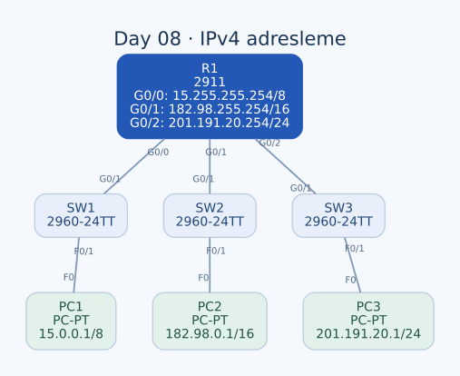

# Day 08 — IPv4 Adresleme ve Üç Ağı Bir Router ile Bağlama

Bu labda bir router'ın üç Ethernet arayüzünü farklı IPv4 ağlarına yerleştirdim. PC'lere IP, subnet maskesi ve default gateway tanımladım; `/8`, `/16` ve `/24` ağlarında adresin ağ ve host bölümlerini karşılaştırdım. Çalışmanın ana konusu, doğru adres atamak kadar adresi maskesiyle birlikte yorumlamaktı.

| Alan | Açıklama |
| --- | --- |
| Lab dosyası | [Day 08 Lab - IPv4 Addresses.pkt](../../labs/Day%2008%20Lab%20-%20IPv4%20Addresses.pkt) |
| Konu | IPv4, subnet maskesi, broadcast, gateway ve router arayüzleri |
| Ortam | Cisco Packet Tracer 9.0.1 |
| Cihazlar | Bir Cisco 2911, üç Cisco 2960-24TT ve üç PC |

## Amaç

R1'in hostname değerini ayarlamak, arayüzlerini incelemek, üç arayüze uygun IP adreslerini vermek ve arayüzleri etkinleştirmekle başladım. Daha sonra her PC'yi kendi yerel ağına yerleştirip gateway olarak R1'in o ağa bakan adresini kullandım.

Üç ağ da R1'e doğrudan bağlı. Bu nedenle bu labda statik rota veya dinamik yönlendirme protokolü yapılandırmadım. Uzak LAN'a iletim için gereken ağ bilgisi, kullanılan router arayüzleri çalıştığında doğrudan bağlı ağlardan oluşuyor.

## Topoloji



| Birinci uç | İkinci uç | Kablo |
| --- | --- | --- |
| R1 — GigabitEthernet0/0 | SW1 — GigabitEthernet0/1 | Straight-through |
| R1 — GigabitEthernet0/1 | SW2 — GigabitEthernet0/1 | Straight-through |
| R1 — GigabitEthernet0/2 | SW3 — GigabitEthernet0/1 | Straight-through |
| SW1 — FastEthernet0/1 | PC1 — FastEthernet0 | Straight-through |
| SW2 — FastEthernet0/1 | PC2 — FastEthernet0 | Straight-through |
| SW3 — FastEthernet0/1 | PC3 — FastEthernet0 | Straight-through |

Switch'ler kendi LAN'larında Ethernet iletimini sağlıyor. Üç ayrı ağın birbirine ulaşması R1 üzerinden gerçekleşiyor. SW1, SW2 ve SW3 diyagramdaki görüntü adları; switch'lerin IOS hostname değerleri bu çalışmada `Switch` olarak kalmış.

## Adresleme planı

| Cihaz / arayüz | IPv4 adresi | Subnet maskesi | Prefix | Default gateway |
| --- | --- | --- | --- | --- |
| R1 — G0/0 | `15.255.255.254` | `255.0.0.0` | `/8` | — |
| PC1 — F0 | `15.0.0.1` | `255.0.0.0` | `/8` | `15.255.255.254` |
| R1 — G0/1 | `182.98.255.254` | `255.255.0.0` | `/16` | — |
| PC2 — F0 | `182.98.0.1` | `255.255.0.0` | `/16` | `182.98.255.254` |
| R1 — G0/2 | `201.191.20.254` | `255.255.255.0` | `/24` | — |
| PC3 — F0 | `201.191.20.1` | `255.255.255.0` | `/24` | `201.191.20.254` |

### Ağ, host ve broadcast adresleri

| Ağ | Host bit sayısı | Kullanılabilir host aralığı | Broadcast | Kullanılabilir host sayısı |
| --- | --- | --- | --- | --- |
| `15.0.0.0/8` | 24 | `15.0.0.1`–`15.255.255.254` | `15.255.255.255` | 16.777.214 |
| `182.98.0.0/16` | 16 | `182.98.0.1`–`182.98.255.254` | `182.98.255.255` | 65.534 |
| `201.191.20.0/24` | 8 | `201.191.20.1`–`201.191.20.254` | `201.191.20.255` | 254 |

Bu ağlarda kullanılabilir host sayısını `2^(host bit sayısı) − 2` ile hesapladım. Ağ adresinde host bitleri sıfır, directed broadcast adresinde ise bir oluyor. Bu hesap buradaki normal çok erişimli subnet'ler için geçerli; `/31` gibi özel durumları kapsamıyor.

Prefix uzunluğu, adresin ilk kaç bitinin ağ bölümüne ait olduğunu gösteriyor. Örneğin PC1 ile gateway'inin son üç okteti birbirinden oldukça farklı görünse de `/8` maskesiyle ikisi de `15.0.0.0` ağında. Gateway'in PC ile aynı subnet'te olup olmadığını yalnızca son oktete bakarak belirleyemem.

Adresler tarihsel A/B/C sınıf örneklerini hatırlatsa da iletim kararını kullanılan maskeye göre değerlendiriyorum. Ayrıca bu örnek adresler RFC 1918 özel adres bloklarından seçilmemiş; bu çalışma, izole labdaki adresleme alıştırması.

## R1 konfigürasyonu

Önce cihazı isimlendirip arayüz listesini inceledim:

```text
enable
configure terminal
hostname R1
do show ip interface brief
```

Ardından üç arayüzü adresledim ve etkinleştirdim:

```text
interface GigabitEthernet0/0
 description ## to SW1 ##
 ip address 15.255.255.254 255.0.0.0
 no shutdown
!
interface GigabitEthernet0/1
 description ## to SW2 ##
 ip address 182.98.255.254 255.255.0.0
 no shutdown
!
interface GigabitEthernet0/2
 description ## to SW3 ##
 ip address 201.191.20.254 255.255.255.0
 no shutdown
```

`description`, bağlantının nereye gittiğini konfigürasyonda görmemi sağladı. `ip address`, arayüzün ağ üyeliğini tanımlıyor. `no shutdown` ise arayüzün idari olarak kapalı tutulmasını kaldırıyor; kablo ve karşı uçla ilgili bir sorun varsa bu komut tek başına bağlantıyı çalışır hâle getirmez.

### Broadcast adresiyle karıştırdığım nokta

G0/1 için önce `182.98.255.255 255.255.0.0` adresini denedim; ardından `182.98.255.254` olarak düzelttim. `/16` ağında son 16 bit host bölümünü oluşturduğu için `.255.255`, bütün host bitlerinin bir olduğu broadcast adresi.

Doğru çıkarım, “Sonu 255 olan her IP kullanılamaz” değil. Adresin host veya broadcast olması **maskeye bağlı**. Bu topolojide `182.98.255.254/16` kullanılabilir bir host adresi ve ilgili subnet'in son kullanılabilir adresi.

## PC ayarları ve default gateway

Her PC'de Desktop → IP Configuration ekranından statik IPv4 ayarlarını girdim. PC1 için örnek:

```text
IP address:      15.0.0.1
Subnet mask:     255.0.0.0
Default gateway: 15.255.255.254
```

PC2 ve PC3 için aynı işlemi adresleme tablosundaki değerlerle yaptım. Gateway, herhangi bir router adresi değil, PC'nin **kendi yerel ağından ulaşabildiği router arayüzü** olmalı. PC1'in gateway alanına R1'in `201.191.20.254` adresini yazmak bu nedenle doğru olmazdı.

## PC1'den başka bir LAN'a paket gönderimi

PC1, PC2'nin `182.98.0.1` adresini kendi `/8` ağıyla karşılaştırdığında hedefin yerel olmadığını belirler. Ethernet teslimatı için PC2'nin MAC'ini doğrudan aramak yerine gateway'i `15.255.255.254` için ARP çözümlemesi yapar.

Çerçeve R1'e ulaştığında router hedef IP'yi kendi yönlendirme tablosunda arar. `182.98.0.0/16` doğrudan bağlı ağ olduğunda çıkış G0/1 olur. R1 bu kez PC2'nin yerel MAC adresini çözümleyip yeni Ethernet çerçevesi oluşturur. Yanıtın geri dönüşünde PC2 kendi gateway'ini kullanır.

Bu örnek, uçtan uca IP hedefi ile ilk Ethernet çerçevesinin hedef MAC adresinin aynı cihaza ait olmak zorunda olmadığını gösteriyor.

## Kontrol ve kaydetme

Kullandığım başlıca kontroller:

```text
show ip interface brief
show running-config
write memory
show startup-config
```

R1'in kayıtlı running-config ve startup-config içerikleri eşleşiyor. Üç IP adresi ve arayüz açıklamaları iki konfigürasyonda da mevcut. Kullanılan fiziksel arayüzlerde `shutdown` satırı yok; Vlan1 ise IP'siz ve kapalı.

| Kontrol | Değerlendirdiğim nokta |
| --- | --- |
| `show ip interface brief` | Doğru arayüz, IP adresi ve canlı status/protocol bilgisi |
| `show running-config` | Maskeler, açıklamalar ve arayüz ayarları |
| `show startup-config` | Değişikliklerin başlangıç konfigürasyonunda bulunması |
| `show ip route` | Kullanılan arayüzler çalışırken üç doğrudan bağlı ağın görünmesi |
| PC1 → PC2 / PC3 ping | Gateway ve iki yönlü LAN erişimi |

PC1'den test edilecek hedefler:

```text
ping 182.98.0.1
ping 201.191.20.1
```

Bu iki ping labın erişim ölçütü. Tam ping çıktıları saklanmadığından sayısal başarı oranı eklemedim. Konfigürasyonda üç PC'nin IP, maske ve gateway değerleri planla uyumlu.

## Öğrendiklerim

- IP adresini her zaman subnet maskesiyle birlikte yorumlamam gerektiğini öğrendim.
- `/8`, `/16` ve `/24` ağlarında host alanının ve broadcast adresinin nasıl değiştiğini hesapladım.
- Broadcast adresini arayüze vermekle kullanılabilir son host adresini vermek arasındaki farkı gördüm.
- Gateway'in, PC'nin aynı subnet'teki router arayüzü olması gerektiğini netleştirdim.
- Tek router'a doğrudan bağlı ağlar için ayrıca statik rota yazmanın gerekmediğini anladım.
- Arayüzün adreslenmesi, idari olarak açılması ve konfigürasyonun kaydedilmesini ayrı adımlar olarak uyguladım.

## Sonuç

Üç farklı prefix uzunluğuna sahip LAN'ı R1 üzerinde adresledim, PC gateway'lerini ayarladım ve router konfigürasyonunu kaydettim. Bu labda en önemli düzeltmem, `/16` broadcast adresi olan `182.98.255.255` yerine kullanılabilir `182.98.255.254` adresini seçmek oldu.

[Önceki lab](day-06-ethernet-lan-switching.md) · [Lab kataloğu](../../README.md) · [Sonraki lab: Interface Configuration](day-09-interface-configuration.md)
