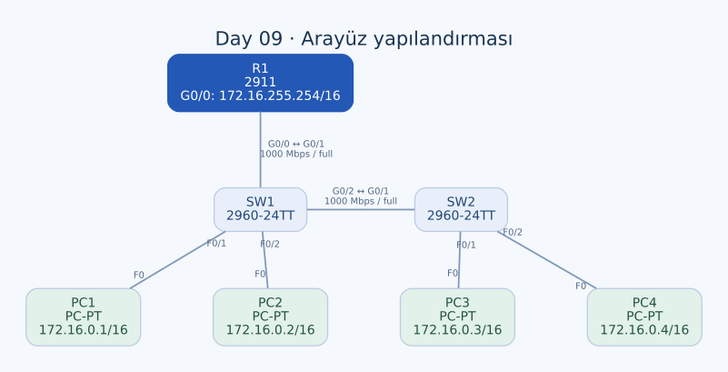

# Day 09 — Arayüz Yapılandırması, Speed ve Duplex

Bu labda bir router ve iki switch üzerinde arayüzleri isimlendirme, hız/duplex ayarlama ve kullanılmayan portları kapatma pratiği yaptım. Önceki labdaki IP adresleme çalışmasını bu kez arayüz yönetimiyle birleştirdim; bağlantının iki ucunu birlikte değerlendirmenin önemine odaklandım.

| Alan | Açıklama |
| --- | --- |
| Lab dosyası | [Day 09 Lab - Interface Configuration.pkt](../../labs/Day%2009%20Lab%20-%20Interface%20Configuration.pkt) |
| Konu | Arayüz açıklamaları, speed, duplex, interface range ve shutdown |
| Ortam | Cisco Packet Tracer 9.0.1 |
| Ağ | `172.16.0.0/16` |
| Cihazlar | Bir Cisco 2911, iki Cisco 2960-24TT ve dört PC |

## Amaç

R1, SW1 ve SW2'nin hostname değerlerini ayarladım. R1 ile PC'leri aynı subnet'te adresledim; ağ cihazları arasındaki hatlarda hız ve duplex değerlerini elle tanımladım. Kullanılan portlara bağlantı açıklaması, boş portlara da kullanım dışı açıklaması ekledim.

Son adım, bu ayarları başlangıç konfigürasyonuna kaydetmekti. Bir bağlantıda yalnızca tek uçtaki ayara bakmak yerine karşı uçtaki değerle eşleştirmeye çalıştım.

## Topoloji ve adresleme



| Birinci uç | İkinci uç | Kablo |
| --- | --- | --- |
| R1 — GigabitEthernet0/0 | SW1 — GigabitEthernet0/1 | Straight-through |
| SW1 — GigabitEthernet0/2 | SW2 — GigabitEthernet0/1 | Crossover |
| SW1 — FastEthernet0/1 | PC1 — FastEthernet0 | Straight-through |
| SW1 — FastEthernet0/2 | PC2 — FastEthernet0 | Straight-through |
| SW2 — FastEthernet0/1 | PC3 — FastEthernet0 | Straight-through |
| SW2 — FastEthernet0/2 | PC4 — FastEthernet0 | Straight-through |

| Cihaz | IPv4 / prefix | Default gateway |
| --- | --- | --- |
| R1 — G0/0 | `172.16.255.254/16` | — |
| PC1 | `172.16.0.1/16` | `172.16.255.254` |
| PC2 | `172.16.0.2/16` | `172.16.255.254` |
| PC3 | `172.16.0.3/16` | `172.16.255.254` |
| PC4 | `172.16.0.4/16` | `172.16.255.254` |

Tüm maskeler `255.255.0.0`. PC'ler aynı subnet'te olduğundan birbirleriyle iletişimleri için R1 üzerinden yönlendirme yapmaları gerekmez. Gateway alanının dolu olması, her paketin mutlaka router'a gideceği anlamına gelmiyor.

## Hız ve duplex: son durum

| Bağlantı / port grubu | Hız ayarı | Duplex ayarı | Açıklama |
| --- | --- | --- | --- |
| R1 G0/0 ↔ SW1 G0/1 | İki uçta `1000` | İki uçta `full` | Router–switch hattı |
| SW1 G0/2 ↔ SW2 G0/1 | İki uçta `1000` | İki uçta `full` | Switch'ler arası hat |
| SW1 F0/1–2 | Varsayılan auto | Varsayılan auto | PC1 ve PC2 portları |
| SW2 F0/1–2 | `100` | `full` | PC3 ve PC4 portlarında elle ayar |
| PC Ethernet portları | Auto | Auto | Kayıtlı çalışma değerleri 100 Mbps/full |

`speed`, hat hızını; `duplex`, iki yöndeki iletimin nasıl yürütüleceğini belirliyor. Full-duplex bağlantı iki yönde eşzamanlı iletime izin verir. Hızın aynı olması, duplex ayarının da mutlaka uyumlu olduğu anlamına gelmez.

### 100 Mbps'ten 1 Gbps'e geçiş

İlk aşamada ağ cihazları arasındaki GigabitEthernet portlarını `speed 100` ve `duplex full` olarak ayarladım. Daha sonra SW2 G0/1, SW1 G0/1–2 ve R1 G0/0 portlarını `speed 1000` ile güncelledim.

Son konfigürasyon iki cihazlar arası hattın da uçlarında **1000 Mbps/full** gösteriyor. İlk denemelerde kullanılan 100 Mbps değerini son ayar gibi yazmamak gerekiyor; arayüz adının GigabitEthernet olması da o portun her zaman 1 Gbps'e ayarlı olduğu anlamına gelmiyor.

## R1 konfigürasyonu

```text
enable
configure terminal
hostname R1
interface GigabitEthernet0/0
 description ## to SW1 ##
 ip address 172.16.255.254 255.255.0.0
 speed 1000
 duplex full
 no shutdown
!
interface range GigabitEthernet0/1 - 2
 description ## not in use ##
 shutdown
```

R1'de G0/0 kullanılıyor; G0/1 ve G0/2 boş. Aynı ayarı birden çok porta uygulamak için `interface range` kullanabildim. Range seçimi sırasında yanlışlıkla çalışan uplink'i kapsamak, bağlantıyı kesebileceğinden aralıkla port tablosunu birlikte kontrol ettim.

## SW1 konfigürasyonu

```text
hostname SW1
interface GigabitEthernet0/1
 description ## to R1 ##
 speed 1000
 duplex full
!
interface GigabitEthernet0/2
 description ## to SW2 ##
 speed 1000
 duplex full
!
interface range FastEthernet0/1 - 2
 description ## to end hosts ##
!
interface range FastEthernet0/3 - 24
 description ## not in use ##
 shutdown
```

SW1'de iki GigabitEthernet uplink ve iki FastEthernet erişim portu kullanılıyor. F0/3–24 arasındaki 22 boş FastEthernet portunu kapattım. PC1 ve PC2'ye bağlı portlarda elle hız/duplex ayarı bulunmuyor.

## SW2 konfigürasyonu

```text
hostname SW2
interface GigabitEthernet0/1
 description ## to SW1 ##
 speed 1000
 duplex full
!
interface range FastEthernet0/1 - 2
 description ## to end hosts ##
 speed 100
 duplex full
!
interface range FastEthernet0/3 - 24
 description ## not in use ##
 shutdown
!
interface GigabitEthernet0/2
 description ## not in use ##
 shutdown
```

SW2'de G0/1 uplink, F0/1 ve F0/2 istemci portu. F0/3–24 ile boş G0/2 kapalı.

### İstemci portlarında dikkat ettiğim fark

Yönerge, manuel speed/duplex ayarını diğer ağ cihazlarına bağlı portlarda istiyordu. Benim son konfigürasyonumda SW2'nin PC portları da 100/full olarak sabitlenmiş; SW1'deki PC portları auto kalmış. Bu farkı aynı ayarlar varmış gibi göstermedim.

PC3 ve PC4 tarafında autonegotiation açık. Gerçek 10/100 Ethernet bağlantılarında bir tarafı auto, diğer tarafı 100/full bırakmak duplex mismatch oluşturabilir. Bu dosyanın kayıtlı çalışma değerleri 100/full olsa da bunu bütün donanımlarda aynı davranışın oluşacağı şeklinde genelleyemem.

PC'leri auto kullanmaya devam ederken switch tarafını da auto yapmak istersem SW2'de uygulanacak değişiklik şu olur:

```text
! Ek düzenleme seçeneği; kayıtlı son konfigürasyonda uygulanmış değil.
interface range FastEthernet0/1 - 2
 speed auto
 duplex auto
```

Bu seçenek, gerçek cihazda uç ayarlarını uyumlandırmak için düşünülebilir. Kaydettiğim çalışmadaki 100/full ayarını tarihsel olarak değiştirmiyor.

## Açıklama, idari durum ve bağlantı durumu

`description ## not in use ##`, portun neden kullanılmadığını anlatıyor; tek başına portu kapatmıyor. Kapatma işlemi `shutdown` ile yapılıyor. Tersine, `no shutdown` portu idari olarak açıyor; karşı uç, kablo ve anlaşma durumu hâlâ ayrıca kontrol edilmeli.

| Görülecek durum | Nasıl yorumluyorum? |
| --- | --- |
| Administratively down / disabled | Port konfigürasyonla kapatılmış olabilir. |
| Not connected / down | Kablo, karşı uç veya bağlantı koşulları kontrol edilmeli. |
| Connected / up | Link var; doğru VLAN, IP ve duplex ayrıca incelenmeli. |

Kullanılmayan portları kapatmakla management SVI'ını kapatmak farklı işlemler. Bu labda switch'lerin Vlan1 arayüzleri de IP'siz ve shutdown; fiziksel erişim portlarının durumu bu SVI durumundan ayrı.

## Kontrol komutları ve kalıcılık

Switch'lerde kullandığım temel kontroller:

```text
show interfaces status
show running-config
show startup-config
```

R1 üzerinde arayüz adreslerini ve ayrıntılarını kontrol ederken şu komutları kullanıyorum:

```text
show ip interface brief
show interfaces GigabitEthernet0/0
```

Switch'e özgü bir `show interfaces status` kullanımının router'da aynı şekilde bulunacağını varsaymamak gerekiyor. Ayrıca konfigürasyon modundayken EXEC komutları için `do` kullandım; örneğin `do show interfaces status` ve `do write`.

R1, SW1 ve SW2'nin son running-config/startup-config içerikleri eşleşiyor. Sonradan yapılan 1 Gbps değişiklikleri de başlangıç konfigürasyonlarında var. Bu çalışmada sayısal performans ölçümü veya hata sayacı çıktısı tutmadım; açıklamalar kayıtlı ayarlara ve arayüz kontrolüne dayanıyor.

## Öğrendiklerim

- Arayüzün desteklediği hızla o anda yapılandırılan hızın farklı bilgiler olduğunu öğrendim.
- İki uçtaki speed/duplex ayarlarını birlikte kontrol etmem gerektiğini gördüm.
- `interface range` ile çok sayıda portu yönetmeyi ve kullanılan uplink'leri aralık dışında tutmayı çalıştım.
- Açıklama yazmanın, portu kapatmanın ve canlı link durumunu kontrol etmenin farklı işlemler olduğunu anladım.
- PC portlarını elle ayarlamanın da karşı uçla uyum gerektirdiğini fark ettim.
- Sonradan yapılan değişiklikleri tekrar kaydetmenin önemini uyguladım.

## Sonuç

Cihazlar arası bağlantıları son durumda 1 Gbps/full olarak eşleştirdim, arayüzleri açıklamalarla belgeledim ve boş portları kapattım. PC adresleri aynı `/16` ağında, cihaz konfigürasyonları da başlangıç ayarlarına kaydedilmiş durumda. İstemci portlarında auto ile manuel ayarın karıştığı SW2 tarafı, bu labdaki ek değerlendirme noktam oldu.

## Kaynak

- [Cisco — Ethernet hız, duplex ve autonegotiation davranışı](https://www.cisco.com/c/en/us/support/docs/lan-switching/ethernet/10561-3.html)

[Önceki lab](day-08-ipv4-addresses.md) · [Lab kataloğu](../../README.md) · [Sonraki lab: Configuring Static Routes](day-11-configuring-static-routes.md)
