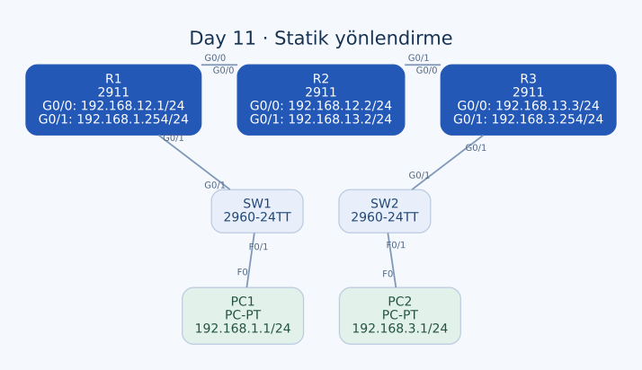

# Day 11 — Statik Yönlendirme Yapılandırması

Bu labda üç router üzerinden iki ayrı LAN'ı birbirine bağladım. Önce router ve PC adreslerini ayarladım, ardından doğrudan bağlı olmayan LAN'lar için statik rotalar tanımladım. Çalışmanın ana konusu, hedef ağı doğru komşuyla eşleştirmek ve yanıt paketinin dönüş yolunu da düşünmekti.

| Alan | Açıklama |
| --- | --- |
| Lab dosyası | [Day 11 Lab - Configuring Static Routes.pkt](../../Day%2011%20Lab%20-%20Configuring%20Static%20Routes.pkt) |
| Konu | Statik rota, next hop, çıkış arayüzü ve dönüş yolu |
| Ortam | Cisco Packet Tracer 9.0.1 |
| Cihazlar | Üç Cisco 2911, iki Cisco 2960-24TT ve iki PC |
| Erişim hedefi | PC1 ile PC2'nin iki yönde haberleşmesi |

## Amaç

R1'in arkasındaki `192.168.1.0/24` ağı ile R3'ün arkasındaki `192.168.3.0/24` ağı arasında erişim kurmak istedim. Aradaki R2 transit router olarak çalışıyor. Router'lar başlangıçta yalnızca kendi bağlı ağlarını bilebildiği için uzak LAN'lara nasıl ulaşacaklarını ayrıca tanımlamam gerekti.

Switch'lerde özel bir konfigürasyon istenmiyordu. Bu çalışmada VLAN veya dinamik yönlendirme protokolü kurmadım; adresleme ve elle yazılan rotalar üzerinde durdum.

## Topoloji



| Birinci uç | İkinci uç |
| --- | --- |
| PC1 — FastEthernet0 | SW1 — FastEthernet0/1 |
| SW1 — GigabitEthernet0/1 | R1 — GigabitEthernet0/1 |
| R1 — GigabitEthernet0/0 | R2 — GigabitEthernet0/0 |
| R2 — GigabitEthernet0/1 | R3 — GigabitEthernet0/0 |
| R3 — GigabitEthernet0/1 | SW2 — GigabitEthernet0/1 |
| SW2 — FastEthernet0/1 | PC2 — FastEthernet0 |

Bu dosyadaki altı bağlantının tamamı copper straight-through. Router'lar arasındaki hatlar da bu şekilde kaydedilmiş; Day 02'deki Auto MDI-X kullanılmadığı varsayımını bütün sonraki lablara otomatik olarak taşımıyorum.

## Adresleme planı

Tüm IPv4 maskeleri `255.255.255.0` (`/24`).

| Cihaz / arayüz | IPv4 adresi | Ağ | Gateway / komşu |
| --- | --- | --- | --- |
| PC1 — F0 | `192.168.1.1` | `192.168.1.0/24` | Gateway: `192.168.1.254` |
| R1 — G0/1 | `192.168.1.254` | `192.168.1.0/24` | PC1 LAN'ı |
| R1 — G0/0 | `192.168.12.1` | `192.168.12.0/24` | R2: `192.168.12.2` |
| R2 — G0/0 | `192.168.12.2` | `192.168.12.0/24` | R1: `192.168.12.1` |
| R2 — G0/1 | `192.168.13.2` | `192.168.13.0/24` | R3: `192.168.13.3` |
| R3 — G0/0 | `192.168.13.3` | `192.168.13.0/24` | R2: `192.168.13.2` |
| R3 — G0/1 | `192.168.3.254` | `192.168.3.0/24` | PC2 LAN'ı |
| PC2 — F0 | `192.168.3.1` | `192.168.3.0/24` | Gateway: `192.168.3.254` |

Transit ağların adları fiziksel komşuların etiketleriyle birebir aynı olmak zorunda değil. Burada R2–R3 hattının ağı `192.168.13.0/24`; doğru bilgi, iki arayüzdeki IP ve maskeden geliyor.

## Router arayüzleri

### R1

```text
hostname R1
interface GigabitEthernet0/0
 description ## to R2 ##
 ip address 192.168.12.1 255.255.255.0
 no shutdown
!
interface GigabitEthernet0/1
 description ## to SW1 ##
 ip address 192.168.1.254 255.255.255.0
 no shutdown
```

### R2

```text
hostname R2
interface GigabitEthernet0/0
 description ## to R1 ##
 ip address 192.168.12.2 255.255.255.0
 no shutdown
!
interface GigabitEthernet0/1
 description ## to R3 ##
 ip address 192.168.13.2 255.255.255.0
 no shutdown
```

### R3

```text
hostname R3
interface GigabitEthernet0/0
 description ## to R2 ##
 ip address 192.168.13.3 255.255.255.0
 no shutdown
!
interface GigabitEthernet0/1
 description ## to SW2 ##
 ip address 192.168.3.254 255.255.255.0
 no shutdown
```

Üç router'da da kullanılmayan G0/2 arayüzü IP'siz ve shutdown durumda. PC'lerde ise IP ve maske yanında gateway değerini de tanımladım; yalnızca router rotalarını yazmak, uzak ağdaki PC'nin yanıtını otomatik olarak doğru yola göndermez.

## Statik rota tanımları

Kullandığım temel sözdizimi:

```text
ip route <hedef ağ> <subnet maskesi> <next-hop IP veya çıkış arayüzü>
```

Hedef ağ, ulaşmak istediğim uzak LAN. Next hop ise hedefteki PC değil, paketi bir sonraki adımda teslim edeceğim komşu router.

| Router | Hedef | Kayıtlı iletim seçimi | Gerekçesi |
| --- | --- | --- | --- |
| R1 | `192.168.3.0/24` | Next hop `192.168.12.2` | PC2 ağı R2 yönünde |
| R2 | `192.168.1.0/24` | Çıkış `GigabitEthernet0/0` | PC1 ağı R1 yönünde |
| R2 | `192.168.3.0/24` | Next hop `192.168.13.3` | PC2 ağı R3 yönünde |
| R3 | `192.168.1.0/24` | Next hop `192.168.13.2` | PC1 ağı R2 yönünde |

### Uyguladığım rotalar

R1 üzerinde:

```text
ip route 192.168.3.0 255.255.255.0 192.168.12.2
```

R2 üzerinde:

```text
ip route 192.168.1.0 255.255.255.0 GigabitEthernet0/0
ip route 192.168.3.0 255.255.255.0 192.168.13.3
```

R3 üzerinde:

```text
ip route 192.168.1.0 255.255.255.0 192.168.13.2
```

Doğrudan bağlı ağlar için aynı ağları tekrar statik olarak yazmadım. Örneğin R1'in PC1 LAN'ına ulaşması için uzak bir next hop gerekmiyor; o LAN kendi G0/1 arayüzünde.

## Çıkış arayüzü ile next hop arasındaki fark

R2'nin PC1 ağına rotasında yalnızca G0/0 belirtilmiş. Ethernet üzerinde bu tanım, router'ın hedef PC adresi için o bağlantıda ARP yapmasına yol açabilir. PC1 ise R1'in diğer arayüzündeki LAN'da bulunuyor. İletimin çalışabilmesi bu durumda R1'in Proxy ARP yanıtı vermesine bağlı olabilir.

Bu nedenle arayüz belirten rotayı, doğrudan bağlı bir ağla aynı şey olarak düşünmüyorum. Router'ın bir ağı hangi yönde arayacağını bilmesiyle doğru komşu MAC'ini çözebilmesi ayrı konular.

R2'de açık bir next hop kullanmak istediğimde alternatif şu olur:

```text
! Alternatif düzenleme; bu dosyada uygulanmış son rota bu değil.
no ip route 192.168.1.0 255.255.255.0 GigabitEthernet0/0
ip route 192.168.1.0 255.255.255.0 192.168.12.1
```

Hem arayüz hem next hop yazan fully specified rota biçimi de kullanılabilir. Bu raporda ise son konfigürasyondaki arayüz tabanlı tanımı ve next-hop tabanlı diğer rotaları ayrı gösterdim.

## Paket ve dönüş yolu

PC1, `192.168.3.1` adresinin kendi subnet'i dışında olduğunu belirleyip çerçeveyi gateway'i R1'e gönderir. R1 paketi R2'ye, R2 R3'e, R3 de doğrudan bağlı PC2 LAN'ına iletecek şekilde yapılandırılmıştır.

Yanıt paketinde kaynak ve hedef yönü tersine döner. PC2'nin gateway'i R3, PC1 ağını R2 üzerinden biliyor; R2'nin de PC1 ağına R1 yönünde rotası var. Gidiş yolunu kurup dönüş yolunu unutsaydım ping'in isteği hedefe ulaşsa bile başarılı yanıt alamazdım.

Bu konfigürasyon **iki uç LAN arasındaki erişimi** hedefliyor. Örneğin R1'de R2–R3 transit ağına, R3'te de R1–R2 transit ağına ayrı rota yok. PC1–PC2 için gerekli yolların bulunması, bütün router arayüzlerine her kaynaktan ping atılabileceği anlamına gelmiyor. Router'dan yapılan testte seçilen kaynak IP ve dönüş rotası da kontrol edilmeli.

## Kontroller ve açık kalan kayıt adımı

Konfigürasyon sırasında `show ip interface brief`, `show ip route` ve konfigürasyon modundan `do show ...` komutlarıyla ilerledim.

| Kontrol | Bakılacak bilgi |
| --- | --- |
| `show ip interface brief` | Arayüz IP'leri ve canlı durumları |
| `show running-config` | Dört statik rota satırının doğru cihazda bulunması |
| `show ip route` | Uygun koşullarda doğrudan bağlı ve statik rotaların tabloya girmesi |
| `show arp` | Next hop veya arayüz rotası için yapılan MAC çözümlemesi |
| PC1 → PC2 ping | Uçtan uca gidiş ve dönüş yolu |

PC1 üzerinde hedef test:

```text
ping 192.168.3.1
```

Tam ping yanıtları kaydedilmediğinden başarı yüzdesi belirtmedim. Ayrıca son dosyada rotalar running-config'te bulunurken üç router'ın startup-config kayıtlarında bu statik rotalar henüz yok. R2'nin startup-config hostname değeri de hâlâ `Router`.

Bu, arayüzleri kaydettikten sonra eklediğim rotaların ayrıca kaydedilmesi gerektiğini gösteriyor. Kontrollerden sonra üç router'da tamamlanması gereken adım:

```text
end
copy running-config startup-config
show startup-config
```

Bu son kaydetme adımını, dosyada zaten uygulanmış gibi değerlendirmiyorum. Packet Tracer dosyasını kaydetmek, IOS çalışma ayarlarını başlangıç konfigürasyonuna kopyalamakla aynı işlem değil.

## Öğrendiklerim

- Uzak LAN'a rota yazarken hedef ağ ile next-hop adresini ayırmayı öğrendim.
- Her router'ın kendi yönlendirme kararını verdiğini; yalnızca uç router'ları ayarlamanın yeterli olmadığını gördüm.
- Başarılı iki yönlü iletişim için dönüş rotalarını da planladım.
- Ethernet üzerinde yalnızca çıkış arayüzü belirten rotanın ARP bağımlılığını anladım.
- PC testleriyle router kaynaklı testlerin farklı dönüş yolu gerektirebileceğini öğrendim.
- Arayüz konfigürasyonunu kaydetmiş olmanın sonradan eklenen rotaları da kaydettiğim anlamına gelmediğini fark ettim.

## Sonuç

Router ve PC adreslerini yapılandırıp iki LAN arasında gerekli dört statik rotayı çalışma konfigürasyonlarına ekledim. R2'nin arayüz tabanlı rotası ve statik rotaların başlangıç konfigürasyonlarına aktarılmamış olması bu labın önemli ek notları. Çalışmayı kalıcı biçimde tamamlamak için erişimi kontrol edip son rotaları da kaydetmek gerekiyor.

## Kaynaklar

- [Cisco — Statik rotalarda next-hop IP kullanımı](https://www.cisco.com/c/en/us/support/docs/dial-access/floating-static-route/118263-technote-nexthop-00.html)
- [Cisco — Konfigürasyon dosyalarının yönetimi](https://www.cisco.com/c/en/us/td/docs/routers/ios-xe/system-management/system-management/m_cm-config-files-0.html)

[Önceki lab](day-09-interface-configuration.md) · [Lab kataloğu](../../README.md) · [Sonraki lab: Troubleshooting Static Routes](day-11-troubleshooting-static-routes.md)
