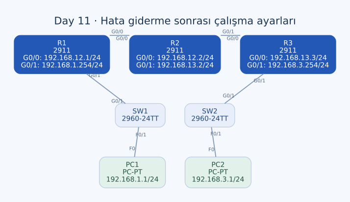

# Day 11 — Statik Yönlendirme Hatalarını Giderme

Bu labda PC1 ile PC2'nin haberleşmesini engelleyen üç ayrı konfigürasyon hatasını ele aldım. R1'de yanlış next-hop adresini, R2'de yanlış çıkış arayüzünü ve R3'te transit ağa uymayan IPv4 adresini düzelttim. Aynı bağlantı sorununun farklı cihazlarda farklı nedenlerden kaynaklanabileceğini çalıştım.

| Alan | Açıklama |
| --- | --- |
| Lab dosyası | [Day 11 Lab - Troubleshooting Static Routes.pkt](../../Day%2011%20Lab%20-%20Troubleshooting%20Static%20Routes.pkt) |
| Konu | Statik rota teşhisi, next hop, arayüz seçimi ve subnet uyumu |
| Ortam | Cisco Packet Tracer 9.0.1 |
| Cihazlar | Üç Cisco 2911, iki Cisco 2960-24TT ve iki PC |
| Görev | Her router'daki bir hatayı bulmak ve iki PC arasında erişim sağlamak |

## Topoloji ve beklenen adresler



| Birinci uç | İkinci uç |
| --- | --- |
| PC1 — FastEthernet0 | SW1 — FastEthernet0/1 |
| SW1 — GigabitEthernet0/1 | R1 — GigabitEthernet0/1 |
| R1 — GigabitEthernet0/0 | R2 — GigabitEthernet0/0 |
| R2 — GigabitEthernet0/1 | R3 — GigabitEthernet0/0 |
| R3 — GigabitEthernet0/1 | SW2 — GigabitEthernet0/1 |
| SW2 — FastEthernet0/1 | PC2 — FastEthernet0 |

Altı bağlantı da copper straight-through. SW1 ve SW2, Packet Tracer'daki cihaz etiketleri; IOS hostname değerleri `Switch`. Bu labda switch konfigürasyonlarını değiştirerek bir routing hatasını çözmeye çalışmadım.

Tüm maskeler `/24` (`255.255.255.0`). Aşağıdaki tablo düzeltmelerden sonraki çalışma ayarlarını gösteriyor:

| Cihaz / arayüz | IPv4 adresi | Görevi / komşusu |
| --- | --- | --- |
| PC1 — F0 | `192.168.1.1` | Gateway: `192.168.1.254` |
| R1 — G0/1 | `192.168.1.254` | PC1 LAN'ı |
| R1 — G0/0 | `192.168.12.1` | R2'ye bağlantı |
| R2 — G0/0 | `192.168.12.2` | R1'e bağlantı |
| R2 — G0/1 | `192.168.13.2` | R3'e bağlantı |
| R3 — G0/0 | `192.168.13.3` | R2'ye bağlantı |
| R3 — G0/1 | `192.168.3.254` | PC2 LAN'ı |
| PC2 — F0 | `192.168.3.1` | Gateway: `192.168.3.254` |

## Teşhis yaklaşımım

Önce arayüz adreslerini ve gerçek komşulukları karşılaştırdım. Ardından her router'ın uzak LAN'a hangi rota ile gittiğini kontrol ettim. Sorunu yalnızca “statik rota var mı?” sorusuna indirgemedim; rotanın işaret ettiği komşunun doğru IP'de ve doğru arayüzde bulunması da gerekiyor.

Kullandığım temel kontroller:

```text
show ip interface brief
show ip route
show running-config
show running-config | include ip route
```

Konfigürasyon modundayken aynı incelemeleri `do show ...` ile yaptım. Arayüzlerin IP bilgisi, rotanın hedefi ve kablonun gittiği cihazı aynı anda değerlendirmek üç hatayı birbirinden ayırmamı sağladı.

## Hataların özeti

| Cihaz | Yanlış değer | Düzeltme | Hata sınıfı |
| --- | --- | --- | --- |
| R1 | PC2 ağı için next hop `192.168.12.3` | `192.168.12.2` | Yanlış komşu adresi |
| R2 | PC2 ağı için çıkış `GigabitEthernet0/0` | `GigabitEthernet0/1` | Yanlış yön / arayüz |
| R3 | G0/0 adresi `192.168.23.3/24` | `192.168.13.3/24` | Transit subnet uyumsuzluğu |

## R1 — Yanlış next hop

R1, PC2 ağına gitmek için doğrudan bağlı komşusu R2'ye ulaşmalı. R2'nin bu hat üzerindeki IP adresi `192.168.12.2`; eski statik rotada ise `192.168.12.3` yazıyordu. Bu topolojide `.12.3` adresine sahip bir arayüz yok.

Uyguladığım değişiklik:

```text
configure terminal
no ip route 192.168.3.0 255.255.255.0 192.168.12.3
ip route 192.168.3.0 255.255.255.0 192.168.12.2
```

Burada hedef ağ zaten doğruydu; değiştirdiğim bölüm paketin teslim edileceği komşuydu. Yanlış IP aynı bağlı subnet'in içinde göründüğünden statik rota tanımının bulunması, o next hop'a gerçekten erişilebildiğini garanti etmiyor. Ethernet üzerinde o adresin MAC karşılığını çözebilmek de gerekiyor.

## R2 — Yanlış çıkış arayüzü

R2'nin G0/0 arayüzü R1'e, G0/1 arayüzü R3'e bağlı. PC2 ağı R3'ün arkasında olmasına rağmen eski rota G0/0'ı işaret ediyordu.

Uyguladığım değişiklik:

```text
configure terminal
no ip route 192.168.3.0 255.255.255.0 GigabitEthernet0/0
ip route 192.168.3.0 255.255.255.0 GigabitEthernet0/1
```

Hedef prefix ve maske değişmedi; iletim yönü düzeltildi. Eski rotanın varlığı, trafiğin doğru komşuya gönderildiği anlamına gelmiyordu.

### Ethernet'te arayüz tabanlı rota

Son konfigürasyonda R2'nin bu rotası hâlâ yalnızca çıkış arayüzünü belirtiyor. Ethernet'te bu kullanım, uzak hedef için ilgili segmentte ARP yapılmasına ve R3'ün Proxy ARP davranışına bağlı olabilir. Bu nedenle doğru yön seçimiyle MAC çözümlemesini birbirinden ayırıyorum.

Next hop'u açıkça belirtmek istersem uygulanabilecek alternatif:

```text
! Alternatif; kaydettiğim çalışmada uygulanmış değil.
no ip route 192.168.3.0 255.255.255.0 GigabitEthernet0/1
ip route 192.168.3.0 255.255.255.0 192.168.13.3
```

Bu alternatif, labda yaptığım düzeltmenin tarihini değiştirmiyor. Asıl düzeltmem yanlış G0/0 yerine doğru G0/1'i kullanmaktı.

## R3 — Yanlış arayüz adresi

R2'nin R3'e bakan arayüzü `192.168.13.2/24`. R3 tarafındaki eski `192.168.23.3/24` adresi ise aynı fiziksel bağlantıda farklı bir subnet oluşturuyordu. Doğru değer `192.168.13.3/24`.

Uyguladığım değişiklik:

```text
configure terminal
interface GigabitEthernet0/0
 ip address 192.168.13.3 255.255.255.0
```

R3'ün PC1 ağına rotası `192.168.13.2` next hop'unu kullanıyor. Bu nedenle yanlış arayüz adresi, yalnızca komşuya ping atmayı değil dönüş rotasının next-hop çözümlemesini de etkiliyordu. Rota satırına bakarken o rotanın dayandığı bağlı subnet'i de kontrol etmem gerektiğini gördüm.

## Son yönlendirme ayarları

| Router | Uzak ağ | Son tanım |
| --- | --- | --- |
| R1 | `192.168.3.0/24` | Next hop `192.168.12.2` |
| R2 | `192.168.1.0/24` | Next hop `192.168.12.1` |
| R2 | `192.168.3.0/24` | Çıkış `GigabitEthernet0/1` |
| R3 | `192.168.1.0/24` | Next hop `192.168.13.2` |

R1'in LAN arayüzü G0/1, transit arayüzü G0/0. R3'te de G0/0 transit, G0/1 LAN tarafı. Bu portları isimlerinden değil bağlantı tablosundan kontrol ediyorum; sonraki lablarda aynı router adları farklı arayüzlerle kullanılabiliyor.

## Gidiş ve dönüş yolu

PC1 uzak hedefi kendi gateway'i R1'e teslim eder. İstek R2 ve R3 üzerinden PC2 LAN'ına ulaşacak şekilde yapılandırılmıştır. Yanıt için PC2, R3'ü gateway olarak kullanır; R3 ve R2'nin PC1 ağına dönüş rotaları bulunur.

İletişimi kontrol ederken iki yönü de ayrı kaydetmek gerekir:

PC1 üzerinde:

```text
ping 192.168.3.1
```

PC2 üzerinde:

```text
ping 192.168.1.1
```

Router kaynaklı bir ping'de kullanılacak kaynak adresi farklı olabilir. Bu yüzden bir transit arayüz testini, iki uç PC arasındaki testle aynı dönüş yolu varmış gibi yorumlamıyorum.

## Ek bulgu — Başlangıç konfigürasyonlarında eski hatalar var

Üç düzeltme de running-config'te mevcut. Ancak son dosyadaki startup-config kayıtları hâlâ eski değerleri taşıyor:

| Cihaz | Startup-config'te kalan değer |
| --- | --- |
| R1 | Next hop `192.168.12.3` |
| R2 | PC2 ağı için G0/0 çıkışı |
| R3 | G0/0 üzerinde `192.168.23.3/24` |

Düzeltmeleri yaptıktan sonra çalışma ayarlarını başlangıç ayarlarına kopyalama adımı açık kalmış. Bu kayıtlar normal açılışta esas alındığında hatalar geri dönebilir. Ayrı bir reload sonucu kaydı yok.

Erişimi kontrol ettikten sonra üç router'da da tamamlanması gereken işlem:

```text
end
copy running-config startup-config
show startup-config
```

Bu komutları burada tamamlama adımı olarak not ediyorum; dosyadaki başlangıç konfigürasyonlarının zaten düzeltilmiş olduğunu söylemiyorum.

## Kontrol özeti

| Başlık | Son durum |
| --- | --- |
| R1 next hop | Çalışma konfigürasyonunda düzeltildi |
| R2 çıkış arayüzü | Çalışma konfigürasyonunda düzeltildi |
| R3 transit IP | Çalışma konfigürasyonunda düzeltildi |
| PC IP ve gateway ayarları | İlgili LAN'larla uyumlu |
| R2'nin ARP davranışı | Arayüz tabanlı rota nedeniyle ayrıca kontrol edilmeli |
| İki yönlü ping sonuçları | Tam çıktı kaydı bulunmuyor |
| Startup-config | Üç eski hata hâlâ kayıtlı |

## Öğrendiklerim

- Aynı erişim belirtisinin üç ayrı konfigürasyon hatasından kaynaklanabileceğini gördüm.
- Next hop'u, çıkış portunu ve karşı uç subnet'ini birlikte kontrol etmeyi öğrendim.
- Konfigürasyonda bir rota bulunmasının tek başına doğru iletim kanıtı olmadığını anladım.
- Gidiş ve dönüş yolunu ayrı ayrı değerlendirdim.
- Düzeltmenin çalışma konfigürasyonuna uygulanmasıyla kalıcı olarak kaydedilmesini birbirinden ayırdım.

## Sonuç

Üç router'daki hataları farklı nedenleriyle teşhis edip çalışma ayarlarını düzelttim. Labın açık kalan kısmı, iki yönlü erişim sonucunu kaydetmek ve düzeltilmiş ayarları startup-config'e aktarmak. Böylece sorun giderme yalnızca anlık konfigürasyon değişikliğiyle sınırlı kalmayacak.

## Kaynak

- [Cisco — Statik rotalarda next-hop IP kullanımı](https://www.cisco.com/c/en/us/support/docs/dial-access/floating-static-route/118263-technote-nexthop-00.html)

[Önceki lab](day-11-configuring-static-routes.md) · [Lab kataloğu](../../README.md) · [Sonraki lab: Life of a Packet](day-12-life-of-a-packet.md)
