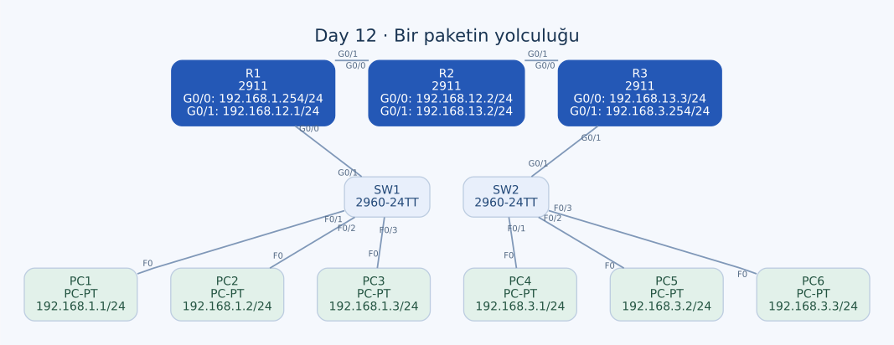

# Day 12 — Bir Paketin Yolculuğu: IP, MAC ve Router Geçişleri

Bu labda bir ICMP paketinin ağ boyunca ilerleyişini, geçtiği her Ethernet bağlantısındaki kaynak ve hedef MAC adresleriyle birlikte açıkladım. Aynı LAN'daki iletişimi, üç router üzerinden başka bir LAN'a yapılan iletişimle karşılaştırdım. En önemli ayrım, uçtan uca IP hedefiyle her bağlantıda kullanılan yerel teslimat adresinin farklı sorumluluklar taşımasıydı.

| Alan | Açıklama |
| --- | --- |
| Lab dosyası | [Day 12 Lab - Life of a Packet.pkt](../../Day%2012%20Lab%20-%20Life%20of%20a%20Packet.pkt) |
| Konu | Encapsulation, next hop, ARP, Ethernet MAC adresleri ve IPv4 TTL |
| Ortam | Cisco Packet Tracer 9.0.1 |
| Cihazlar | Üç Cisco 2911, iki Cisco 2960-24TT ve altı PC |
| Senaryolar | PC1 → PC4, PC1 → PC3 ve PC4 → PC1 |

## Amaç

Her senaryoda önce hedefin aynı subnet'te olup olmadığını belirledim. Sonra hangi cihazın hangi arayüzüne teslimat yapılacağını yazdım. Böylece MAC adreslerini yalnızca cihaz adına göre değil, **cihaz + arayüz** olarak takip ettim.

Bu labda NAT yapılandırılmamış. Dolayısıyla yönlendirilen bir ICMP isteğinin kaynak ve hedef IPv4 adresleri yol boyunca korunurken router geçişlerinde Ethernet kaynak/hedef MAC adresleri değişiyor. IPv4 başlığının TTL gibi diğer alanları ise değişebilir.

## Topoloji



| Birinci uç | İkinci uç | Kablo |
| --- | --- | --- |
| SW1 — GigabitEthernet0/1 | R1 — GigabitEthernet0/0 | Straight-through |
| R1 — GigabitEthernet0/1 | R2 — GigabitEthernet0/0 | Crossover |
| R2 — GigabitEthernet0/1 | R3 — GigabitEthernet0/0 | Crossover |
| R3 — GigabitEthernet0/1 | SW2 — GigabitEthernet0/1 | Straight-through |
| SW1 — FastEthernet0/1 | PC1 — FastEthernet0 | Straight-through |
| SW1 — FastEthernet0/2 | PC2 — FastEthernet0 | Straight-through |
| SW1 — FastEthernet0/3 | PC3 — FastEthernet0 | Straight-through |
| SW2 — FastEthernet0/1 | PC4 — FastEthernet0 | Straight-through |
| SW2 — FastEthernet0/2 | PC5 — FastEthernet0 | Straight-through |
| SW2 — FastEthernet0/3 | PC6 — FastEthernet0 | Straight-through |

Önceki Day 11 topolojisine benziyor, ancak R1'in port yerleşimi farklı: **G0/0 LAN'a, G0/1 R2'ye bağlı.** Aynı router adlarını görüp önceki labın arayüzlerini buraya taşımadım.

## IP ve etkin MAC adresleri

Tüm IPv4 maskeleri `255.255.255.0` (`/24`). PC1–PC3 gateway olarak `192.168.1.254`, PC4–PC6 ise `192.168.3.254` kullanıyor.

| Cihaz | Arayüz | IPv4 adresi | Etkin MAC adresi |
| --- | --- | --- | --- |
| PC1 | FastEthernet0 | `192.168.1.1` | `00D0.BA11.1111` |
| PC2 | FastEthernet0 | `192.168.1.2` | `000A.4122.2222` |
| PC3 | FastEthernet0 | `192.168.1.3` | `0010.1133.3333` |
| R1 | GigabitEthernet0/0 | `192.168.1.254` | `0000.01AA.AAAA` |
| R1 | GigabitEthernet0/1 | `192.168.12.1` | `0000.01BB.BBBB` |
| R2 | GigabitEthernet0/0 | `192.168.12.2` | `0000.01CC.CCCC` |
| R2 | GigabitEthernet0/1 | `192.168.13.2` | `0000.01DD.DDDD` |
| R3 | GigabitEthernet0/0 | `192.168.13.3` | `0000.01EE.EEEE` |
| R3 | GigabitEthernet0/1 | `192.168.3.254` | `0000.01FF.FFFF` |
| PC4 | FastEthernet0 | `192.168.3.1` | `000C.8544.4444` |
| PC5 | FastEthernet0 | `192.168.3.2` | `0002.1655.5555` |
| PC6 | FastEthernet0 | `192.168.3.3` | `0001.4266.6666` |

Bu topolojide MAC adresleri kolay takip edilebilecek biçimde ayarlanmış. Router arayüzlerinde `mac-address` satırları var; kullanılan MAC, cihazın fabrika adresi olan BIA ile aynı olmak zorunda değil.

R1'den örnek:

```text
interface GigabitEthernet0/0
 mac-address 0000.01aa.aaaa
 ip address 192.168.1.254 255.255.255.0
!
interface GigabitEthernet0/1
 mac-address 0000.01bb.bbbb
 ip address 192.168.12.1 255.255.255.0
```

Bu nedenle bir paketin MAC alanını doldururken ilgili arayüzün **etkin adresini** esas aldım. Bir router'ın bütün portları için tek bir MAC adresi kullanmadım.

## Yönlendirme konfigürasyonu

| Router | Uzak ağ | Next hop |
| --- | --- | --- |
| R1 | `192.168.3.0/24` | `192.168.12.2` |
| R1 | `192.168.13.0/24` | `192.168.12.2` |
| R2 | `192.168.1.0/24` | `192.168.12.1` |
| R2 | `192.168.3.0/24` | `192.168.13.3` |
| R3 | `192.168.1.0/24` | `192.168.13.2` |
| R3 | `192.168.12.0/24` | `192.168.13.2` |

İlgili konfigürasyon satırları:

```text
! R1
ip route 192.168.3.0 255.255.255.0 192.168.12.2
ip route 192.168.13.0 255.255.255.0 192.168.12.2
!
! R2
ip route 192.168.1.0 255.255.255.0 192.168.12.1
ip route 192.168.3.0 255.255.255.0 192.168.13.3
!
! R3
ip route 192.168.1.0 255.255.255.0 192.168.13.2
ip route 192.168.12.0 255.255.255.0 192.168.13.2
```

Bu dosyada iki uç LAN yanında uzak transit ağlar için de R1 ve R3'te rotalar var. İlgili IP, MAC ve statik rota ayarları startup-config kayıtlarında da bulunuyor.

## Senaryo 1 — PC1, PC4'e ping gönderiyor

PC1'in IP adresi `192.168.1.1`, hedef PC4'ün adresi `192.168.3.1`. Hedef aynı `/24` subnet'te olmadığı için PC1 ilk çerçeveyi kendi gateway'i R1'in G0/0 arayüzüne adresler.

ICMP isteği boyunca IPv4 kaynak/hedef çifti:

```text
Kaynak IP: 192.168.1.1
Hedef IP:  192.168.3.1
```

ARP ve MAC öğrenimi tamamlandıktan sonraki normal unicast iletim için Ethernet alanları:

| Nokta | Bağlantı | Kaynak MAC | Hedef MAC |
| --- | --- | --- | --- |
| A | PC1 → SW1 | PC1 F0 — `00D0.BA11.1111` | R1 G0/0 — `0000.01AA.AAAA` |
| B | SW1 → R1 | PC1 F0 — `00D0.BA11.1111` | R1 G0/0 — `0000.01AA.AAAA` |
| C | R1 → R2 | R1 G0/1 — `0000.01BB.BBBB` | R2 G0/0 — `0000.01CC.CCCC` |
| D | R2 → R3 | R2 G0/1 — `0000.01DD.DDDD` | R3 G0/0 — `0000.01EE.EEEE` |
| E | R3 → SW2 | R3 G0/1 — `0000.01FF.FFFF` | PC4 F0 — `000C.8544.4444` |
| F | SW2 → PC4 | R3 G0/1 — `0000.01FF.FFFF` | PC4 F0 — `000C.8544.4444` |

### A–B: İlk hedef gateway'in MAC adresi

PC1'in IP hedefi PC4 olsa da ilk Ethernet hedefi R1. SW1 çerçeveyi R1'e iletirken kaynak MAC'i kendi adresiyle değiştirmiyor. A ve B noktalarında kaynak ve hedef MAC alanlarının aynı kalmasının nedeni bu.

### C–D: Her router kendi çıkış bağlantısı için çerçeve oluşturuyor

R1 gelen Ethernet çerçevesini sonlandırır, IP hedefi için rota arar ve paketi R2 yönüne iletir. Yeni çerçevenin kaynak MAC'i R1'in **çıkış** arayüzü G0/1'e, hedef MAC'i komşu R2'nin **giriş** arayüzü G0/0'a ait.

R2 aynı işlemi R3 yönünde yapar. Paketin IP kaynağı R2'nin adresi olmaz; Ethernet kaynağı o link için R2'nin G0/1 adresi olur.

### E–F: Son router hedef PC'ye doğrudan teslim ediyor

R3 hedef ağın kendi G0/1 arayüzüne doğrudan bağlı olduğunu bilir. Bu bağlantıda hedef MAC artık başka bir router'a değil PC4'e ait. SW2, çerçeveyi PC4'e iletirken bu MAC çiftini korur.

## ARP hangi adresleri çözümler?

| İşlemi yapan cihaz | Aranan yerel IPv4 | Öğrenilecek MAC |
| --- | --- | --- |
| PC1 | Gateway `192.168.1.254` | R1 G0/0 — `0000.01AA.AAAA` |
| R1 | Next hop `192.168.12.2` | R2 G0/0 — `0000.01CC.CCCC` |
| R2 | Next hop `192.168.13.3` | R3 G0/0 — `0000.01EE.EEEE` |
| R3 | Doğrudan bağlı PC4 `192.168.3.1` | PC4 F0 — `000C.8544.4444` |

PC1, uzaktaki PC4'ün MAC adresini kendi LAN'ında broadcast ile aramıyor. ARP her Ethernet segmentinde yerel komşu teslimatını çözüyor. İlgili ARP önbelleği zaten doluysa her paket için yeniden ARP yapılması gerekmiyor.

## TTL ve değişen başlık alanları

Başlangıç TTL değerine `T` dersem, her router'ın bir azaltmasıyla bu istekte beklenen değerler şöyle:

| Bağlantı | TTL |
| --- | --- |
| PC1 → SW1 ve SW1 → R1 | `T` |
| R1 → R2 | `T − 1` |
| R2 → R3 | `T − 2` |
| R3 → SW2 ve SW2 → PC4 | `T − 3` |

Layer 2 switch'ler bu iletimde IPv4 TTL değerini azaltmıyor. Router TTL'yi değiştirdiği için IPv4 header checksum da buna göre güncelleniyor. Bu nedenle “Kaynak ve hedef IP aynı kalıyor” ifadesi, IP başlığının bütün bitleri değişmeden kalıyor demek değil.

Router yeni Ethernet kapsüllemesi oluşturduğunda kaynak/hedef MAC ve çerçeveye ait FCS de yeni çerçeveye göre değerlendirilir. Bu labdaki ICMP trafiği TCP veya UDP portlarıyla taşınmıyor; IPv4 protocol alanında ICMP değeri kullanılıyor.

## Senaryo 2 — PC1, aynı LAN'daki PC3'e ping gönderiyor

PC1 `192.168.1.1/24`, PC3 `192.168.1.3/24` adresinde. İki uç aynı subnet'te olduğundan PC1 doğrudan PC3'ün MAC adresini çözümler. Default gateway üzerinden yönlendirme gerekmez.

```text
Kaynak IP: 192.168.1.1
Hedef IP:  192.168.1.3
```

| Nokta | Bağlantı | Kaynak MAC | Hedef MAC |
| --- | --- | --- | --- |
| A | PC1 → SW1 | PC1 F0 — `00D0.BA11.1111` | PC3 F0 — `0010.1133.3333` |
| B | SW1 → PC3 | PC1 F0 — `00D0.BA11.1111` | PC3 F0 — `0010.1133.3333` |

MAC öğrenimi tamamlandığında SW1 bu bilinen unicast çerçeveyi PC3'ün bağlı olduğu F0/3 portuna iletir. Router bu paketin iletim yolunda bulunmadığından TTL de router geçişi nedeniyle azalmaz.

ARP ilk kez gerekiyorsa broadcast istek aynı VLAN'daki başka portlara da ulaşabilir. Bu başlangıç trafiğiyle, öğrenme sonrası yalnızca hedef porta gönderilen ICMP unicast trafiğini birbirinden ayırıyorum.

## Senaryo 3 — PC4, PC1'e ping gönderiyor

Üçüncü senaryoda ICMP isteğini PC4 başlatıyor. PC4'ün ilk Ethernet hedefi kendi gateway'i R3 G0/1. Yeni isteğin IPv4 adresleri:

```text
Kaynak IP: 192.168.3.1
Hedef IP:  192.168.1.1
```

| Nokta | Bağlantı | Kaynak MAC | Hedef MAC |
| --- | --- | --- | --- |
| A | PC4 → SW2 | PC4 F0 — `000C.8544.4444` | R3 G0/1 — `0000.01FF.FFFF` |
| B | SW2 → R3 | PC4 F0 — `000C.8544.4444` | R3 G0/1 — `0000.01FF.FFFF` |
| C | R3 → R2 | R3 G0/0 — `0000.01EE.EEEE` | R2 G0/1 — `0000.01DD.DDDD` |
| D | R2 → R1 | R2 G0/0 — `0000.01CC.CCCC` | R1 G0/1 — `0000.01BB.BBBB` |
| E | R1 → SW1 | R1 G0/0 — `0000.01AA.AAAA` | PC1 F0 — `00D0.BA11.1111` |
| F | SW1 → PC1 | R1 G0/0 — `0000.01AA.AAAA` | PC1 F0 — `00D0.BA11.1111` |

Ters yönde hangi arayüzün giriş, hangisinin çıkış olduğu da değişiyor. Örneğin R1'in PC1'e ilettiği son çerçevenin kaynak adresi G0/0'a ait; R2'ye bakan G0/1'in MAC'i kullanılmıyor.

## Komutlar ve Simulation Mode kontrolü

Router arayüzlerinin etkin MAC adresleri için kullandığım komut biçimi:

```text
show interfaces GigabitEthernet0/0
show interfaces GigabitEthernet0/1
```

`address is ...` alanı ile varsa `bia ...` alanını ayrı okuyorum. Routing ve ARP kontrolü için:

```text
show ip route
show arp
```

Switch üzerinde çıkış portunu ilişkilendirmek için `show mac address-table`, PC üzerinde IP–MAC eşleşmesi için `arp -a` kullanılabilir.

İlk senaryoda PC1'den `ping 192.168.3.1` ile ARP ve MAC öğreniminin oluşmasını sağlamak, ardından Simulation Mode'da ICMP trafiğine odaklanmak görevi sadeleştiriyor. PDU ayrıntılarında Ethernet kaynak/hedef MAC alanlarını, IPv4 kaynak/hedef ve TTL alanlarından ayrı kontrol ediyorum. Diğer senaryoların hedefleri PC1'de `192.168.1.3`, PC4'te `192.168.1.1`.

Yukarıdaki tablolar bu adresleme ve rotalarla beklenen normal iletimi gösteriyor. Tam PDU ekran görüntüleri ve ping istatistikleri bu notlara eklenmiş değil; tabloları alınmış komut çıktıları gibi biçimlendirmedim.

## Karıştırmamam gereken noktalar

| Soru | Bu labdaki cevap |
| --- | --- |
| İlk çerçevenin hedefi her zaman son PC mi? | Uzak subnet için ilk hedef gateway'in MAC'i. |
| Switch kendi MAC'ini kaynak olarak yazar mı? | Bu normal Layer 2 iletiminde kaynak/hedef MAC alanlarını korur. |
| Router'ın tek bir MAC adresi mi var? | İletimde kullanılan arayüzün etkin MAC'i esas alınır. |
| MAC değişince IP kaynağı da değişir mi? | Bu NAT olmayan topolojide kaynak/hedef IP korunur. |
| BIA ile etkin MAC aynı mı? | Bu labda elle tanımlanan adresler nedeniyle farklı olabilir. |
| Yerel PC iletişimi gateway'e uğrar mı? | Aynı subnet'teki PC1–PC3 iletişimi doğrudan LAN içinde kalır. |

## Öğrendiklerim

- Uçtan uca IPv4 adresleri ile bağlantı başına Ethernet adreslerini ayrı takip etmeyi öğrendim.
- Her router geçişinde yeni Ethernet kapsüllemesinin neden gerektiğini açıkladım.
- Switch'in normal iletimde MAC alanlarını koruduğunu somut örneklerle karşılaştırdım.
- ARP'nin uzaktaki bütün cihazların MAC adresini öğrenmek için kullanılmadığını anladım.
- Etkin MAC, BIA, giriş arayüzü ve çıkış arayüzü ayrımlarını netleştirdim.
- TTL değişirken kaynak/hedef IP'nin aynı kalabileceğini gördüm.

## Sonuç

Üç senaryoda her Ethernet bölümünün kaynak ve hedef MAC adreslerini cihaz ve arayüz adıyla eşleştirdim. Aynı LAN'da iletişim switch üzerinden doğrudan sürerken uzak LAN'a giderken her router, IP hedefini esas alıp bir sonraki yerel teslimat için yeni çerçeve oluşturuyor. Bu ayrım, ileride routing ve erişim sorunlarını incelerken paketin nerede ve neden yön değiştirdiğini anlamamı kolaylaştırıyor.

## Kaynaklar

- [RFC 791 — IPv4 başlığı, TTL ve header checksum](https://www.rfc-editor.org/rfc/rfc791.html)
- [RFC 826 — ARP](https://www.rfc-editor.org/rfc/rfc826)

[Önceki lab](day-11-troubleshooting-static-routes.md) · [Lab kataloğu](../../README.md) · [Sonraki lab: VLSM](day-15-vlsm.md)
