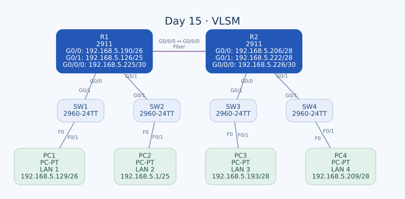

# Day 15 — VLSM ile Adres Planlama ve Statik Yönlendirme

Bu labda `192.168.5.0/24` bloğunu farklı büyüklükteki dört LAN ve iki router arasındaki bağlantı için böldüm. En büyük adres ihtiyacından başlayarak subnet'leri yerleştirdim; PC'lere ilk, LAN gateway'lerine son kullanılabilir adresleri verdim. Son olarak iki router arasında statik rotalar tanımladım.

| Alan | Açıklama |
| --- | --- |
| Lab dosyası | [Day 15 Lab - VLSM.pkt](../../labs/Day%2015%20Lab%20-%20VLSM.pkt) |
| Konu | VLSM, subnet sınırları, adres kapasitesi ve statik yönlendirme |
| Ortam | Cisco Packet Tracer 9.0.1 |
| Ana adres bloğu | `192.168.5.0/24` |
| Cihazlar | İki Cisco 2911, dört Cisco 2960-24TT ve dört PC |

## Amaç ve adres ihtiyacı

Görevde LAN1 için 45, LAN2 için 64, LAN3 için 14, LAN4 için 9 host adresi isteniyor. Ayrıca R1–R2 bağlantısının iki ucu için adres gerekiyor. Bütün bu ağları aynı maskeyle bölmek yerine ihtiyaçlarına göre farklı prefix uzunlukları kullandım.

| Bölüm | Etiketteki ihtiyaç | Seçtiğim prefix | Kullanılabilir adres | Seçimin nedeni |
| --- | --- | --- | --- | --- |
| LAN2 | 64 host | `/25` | 126 | `/26` yalnızca 62 adres sağlar. |
| LAN1 | 45 host | `/26` | 62 | 45 adres için yeterli en küçük normal subnet. |
| LAN3 | 14 host | `/28` | 14 | Kullanılabilir kapasite tam 14. |
| LAN4 | 9 host | `/28` | 14 | `/29` yalnızca 6 adres sağlar. |
| R1–R2 | 2 arayüz | `/30` | 2 | İki uç için birer kullanılabilir adres. |

Buradaki kapasite, subnet'teki **toplam kullanılabilir IP sayısı**. Router'ın LAN arayüzü de bu sayıya dahil. Örneğin LAN3'ün `/28` bloğu gateway dahil 14 adres sağlar; 14 ayrı uç cihaz ve ayrıca bir gateway istenseydi `/28` yeterli olmazdı.

## Topoloji



| Birinci uç | İkinci uç | Bağlantı |
| --- | --- | --- |
| R1 — GigabitEthernet0/0/0 | R2 — GigabitEthernet0/0/0 | Single-mode fiber |
| R1 — GigabitEthernet0/0 | SW1 — GigabitEthernet0/1 | Copper straight-through |
| R1 — GigabitEthernet0/1 | SW2 — GigabitEthernet0/1 | Copper straight-through |
| R2 — GigabitEthernet0/0 | SW3 — GigabitEthernet0/1 | Copper straight-through |
| R2 — GigabitEthernet0/1 | SW4 — GigabitEthernet0/1 | Copper straight-through |
| PC1 — FastEthernet0 | SW1 — FastEthernet0/1 | Copper straight-through |
| PC2 — FastEthernet0 | SW2 — FastEthernet0/1 | Copper straight-through |
| PC3 — FastEthernet0 | SW3 — FastEthernet0/1 | Copper straight-through |
| PC4 — FastEthernet0 | SW4 — FastEthernet0/1 | Copper straight-through |

LAN1 ve LAN2 R1'in, LAN3 ve LAN4 R2'nin arkasında. Router'lar arasındaki fiber portun adı G0/0/0; bunu LAN tarafındaki G0/0 portuyla karıştırmamak gerekiyor.

## VLSM hesabı

Önce 64 adres gerektiren LAN2'yi, sonra LAN1'i, ardından iki küçük LAN'ı ve transit ağı yerleştirdim. Böylece blok başlangıçlarını kendi subnet sınırlarında tuttum ve ağları üst üste bindirmedim.

| Bölüm | Ağ / prefix | Maske | İlk kullanılabilir | Son kullanılabilir | Broadcast |
| --- | --- | --- | --- | --- | --- |
| LAN2 | `192.168.5.0/25` | `255.255.255.128` | `.1` | `.126` | `.127` |
| LAN1 | `192.168.5.128/26` | `255.255.255.192` | `.129` | `.190` | `.191` |
| LAN3 | `192.168.5.192/28` | `255.255.255.240` | `.193` | `.206` | `.207` |
| LAN4 | `192.168.5.208/28` | `255.255.255.240` | `.209` | `.222` | `.223` |
| R1–R2 | `192.168.5.224/30` | `255.255.255.252` | `.225` | `.226` | `.227` |

Kısaltılmış adreslerin ilk üç okteti `192.168.5`. Blok boyları sırasıyla 128, 64, 16, 16 ve 4 adres; toplam 228 adreslik alan ayrılmış oluyor. Ana `/24` içinde `.228`–`.255` aralığındaki 28 adres bu planda kullanılmıyor. Bu aralık tek bir subnet değil; gerekirse uygun CIDR bloklarına ayrıca bölünmeli.

VLSM'nin faydası burada somut: Her bölüme en büyük ihtiyaç için gereken `/25` büyüklüğünü ayırsaydım beş blok `/24` içine sığmazdı. Farklı maskelerle mevcut adres alanını ihtiyaca göre dağıtabildim.

## PC ve gateway atamaları

| LAN | PC / IPv4 | Gateway | Router arayüzü |
| --- | --- | --- | --- |
| LAN1 | PC1 — `192.168.5.129/26` | `192.168.5.190` | R1 G0/0 |
| LAN2 | PC2 — `192.168.5.1/25` | `192.168.5.126` | R1 G0/1 |
| LAN3 | PC3 — `192.168.5.193/28` | `192.168.5.206` | R2 G0/0 |
| LAN4 | PC4 — `192.168.5.209/28` | `192.168.5.222` | R2 G0/1 |

PC ve gateway aynı subnet maskesini kullanıyor. Aynı `192.168.5` başlangıcını görmek, bütün PC'lerin aynı subnet'te olduğu anlamına gelmiyor; hangi adresin yerel olduğu prefix'e göre belirleniyor.

## Router konfigürasyonları

### R1

```text
interface GigabitEthernet0/0
 ip address 192.168.5.190 255.255.255.192
 no shutdown
!
interface GigabitEthernet0/1
 ip address 192.168.5.126 255.255.255.128
 no shutdown
!
interface GigabitEthernet0/0/0
 ip address 192.168.5.225 255.255.255.252
 no shutdown
!
ip route 192.168.5.192 255.255.255.240 192.168.5.226
ip route 192.168.5.208 255.255.255.240 192.168.5.226
```

### R2

```text
interface GigabitEthernet0/0
 ip address 192.168.5.206 255.255.255.240
 no shutdown
!
interface GigabitEthernet0/1
 ip address 192.168.5.222 255.255.255.240
 no shutdown
!
interface GigabitEthernet0/0/0
 ip address 192.168.5.226 255.255.255.252
 no shutdown
!
ip route 192.168.5.128 255.255.255.192 192.168.5.225
ip route 192.168.5.0 255.255.255.128 192.168.5.225
```

Statik rotalarda yalnızca hedef ağı değil, o hedefin doğru maskesini de yazdım. R1'in iki uzak LAN'ı `/28`; R2'nin uzak LAN'ları ise `/26` ve `/25`. Her satıra alışkanlıkla `/24` yazmak bu adres planını doğru tanımlamazdı.

## Düzelttiğim adresleme denemeleri

| Deneme | Neden değiştirdim? | Son değer |
| --- | --- | --- |
| R1 G0/1'e `.127/25` | LAN2'nin broadcast adresi. | `.126/25` |
| R1 G0/0'a `.129/26` | Görevde ilk kullanılabilir PC'ye, son kullanılabilir router'a ayrılıyor. | `.190/26` |
| R2 LAN portlarında `/27` | `.206` ve `.222`, aynı `.192/27` bloğuna düşüyor. Ayrı LAN sınırlarını karşılamıyor. | İki portta da `/28` |

Bu denemeler, kullanılabilir bir IP seçmenin tek başına yeterli olmadığını gösterdi. Adres hem cihazın rolüne hem de karşı uçtaki subnet planına uymalı. Özellikle maske değişikliği, bir adresin hangi ağa ait olduğunu tamamen değiştirebiliyor.

## İletim ve kontrol

Örneğin PC1, PC4'e ulaşmak istediğinde `.209` adresini kendi `.128/26` ağı dışında görür ve gateway'i `.190` üzerinden R1'e gönderir. R1, `.208/28` rotasıyla R2'nin `.226` adresine gider. R2 hedef LAN'a doğrudan bağlıdır. Yanıt için R2'nin LAN1'e `.225` üzerinden dönüş rotası bulunur.

| Kontrol | İncelediğim bilgi |
| --- | --- |
| `show ip interface brief` | Doğru port, IP ve canlı durum |
| `show ip interface ...` | Özellikle subnet maskesinin doğruluğu |
| `show ip route` | Farklı prefix'lerin ve next hop'ların görünmesi |
| PC IP Configuration | İlk adres, doğru maske ve son adres olan gateway |
| Farklı LAN'lar arasında ping | Statik rota ve dönüş yolu |

PC1'den örnek hedefler `.1`, `.193` ve `.209`; bunlar sırasıyla diğer üç LAN'daki PC'ler. Tam ping yanıtları saklanmadığından sayısal başarı oranı belirtmedim.

## Açık kalan kalıcılık adımı

Son çalışma konfigürasyonlarında IP'ler ve statik rotalar mevcut. R1 ve R2'nin startup-config kayıtlarında ise ilgili arayüzler hâlâ IP'siz ve shutdown, statik rotalar da yok. Yani bu labdaki adres planını ve rotaları başlangıç ayarlarına aktarma adımı açık kalmış.

Kontrollerden sonra iki router'da tamamlanması gereken işlem:

```text
end
copy running-config startup-config
show startup-config
```

## Öğrendiklerim

- En büyük ihtiyaçtan başlayarak hizalı ve çakışmayan VLSM blokları ayırdım.
- 64 host ihtiyacının `/26` ile karşılanmadığını hesapladım.
- Ağ, broadcast, ilk ve son kullanılabilir adresleri maske üzerinden belirledim.
- Gateway adresinin de subnet'in kullanılabilir kapasitesini tükettiğini fark ettim.
- Yanlış bir `/27` maskenin iki ayrı LAN'ı aynı blokta gösterebildiğini gördüm.
- Statik rotalarda hedef prefix'in adres planıyla aynı olması gerektiğini uyguladım.

## Sonuç

Dört LAN ve transit bağlantıyı tek `/24` içinde farklı büyüklükte subnet'lerle yerleştirdim. PC'lerin ilk, router LAN arayüzlerinin son kullanılabilir adresleri kullanmasını sağladım ve uzak ağlar için dört statik rota ekledim. Başlangıç konfigürasyonlarına kayıt ve iki yönlü erişim sonuçlarının saklanması, çalışmanın tamamlama adımları olarak duruyor.

[Önceki lab](day-12-life-of-a-packet.md) · [Lab kataloğu](../../README.md) · [Sonraki lab: VLANs — Part 1](day-16-vlans-part-1.md)
