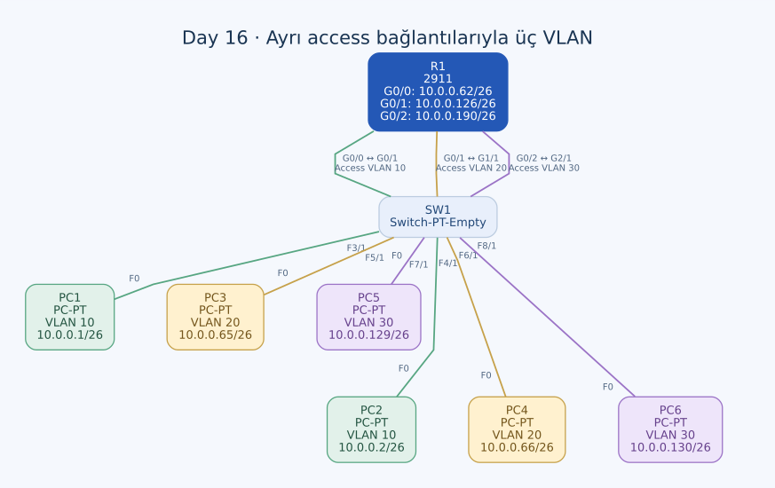

# Day 16 — VLAN'lar ve Ayrı Router Arayüzleriyle Inter-VLAN Routing

Bu labda tek switch üzerindeki altı PC'yi üç VLAN'a ayırdım. Her VLAN için ayrı bir `/26` subnet kullandım ve R1'i switch'e üç ayrı fiziksel bağlantıyla bağladım. Böylece aynı VLAN içindeki Ethernet iletimiyle VLAN'lar arası yönlendirmeyi karşılaştırdım.

| Alan | Açıklama |
| --- | --- |
| Lab dosyası | [Day 16 Lab - VLANs (Part 1).pkt](../../labs/Day%2016%20Lab%20-%20VLANs%20%28Part%201%29.pkt) |
| Konu | Access VLAN, broadcast domain ve fiziksel arayüzlerle inter-VLAN routing |
| Ortam | Cisco Packet Tracer 9.0.1 |
| Cihazlar | Cisco 2911 R1, modüler Switch-PT-Empty SW1 ve altı PC |

## Amaç

PC'leri Engineering, HR ve Sales gruplarına yerleştirdim. Her grubun broadcast alanını ayrı tuttum; farklı VLAN'lardaki PC'ler arasında erişim için R1'in ilgili LAN arayüzlerini gateway olarak kullandım.

Bu tasarımda trunk veya router subinterface yok. Her VLAN, switch'ten router'a **ayrı bir access bağlantısı** üzerinden gidiyor. Bir sonraki labda aynı işi tek fiziksel router hattında 802.1Q ile yapıyorum.

## Topoloji



| Switch portu | Bağlı cihaz / port | VLAN | Rol |
| --- | --- | --- | --- |
| SW1 G0/1 | R1 G0/0 | 10 | Engineering gateway bağlantısı |
| SW1 G1/1 | R1 G0/1 | 20 | HR gateway bağlantısı |
| SW1 G2/1 | R1 G0/2 | 30 | Sales gateway bağlantısı |
| SW1 F3/1 | PC1 F0 | 10 | İstemci |
| SW1 F4/1 | PC2 F0 | 10 | İstemci |
| SW1 F5/1 | PC3 F0 | 20 | İstemci |
| SW1 F6/1 | PC4 F0 | 20 | İstemci |
| SW1 F7/1 | PC5 F0 | 30 | İstemci |
| SW1 F8/1 | PC6 F0 | 30 | İstemci |

Dokuz bağlantının tamamı copper straight-through. Modüler switch'in port adları F3/1, F4/1 gibi ilerliyor; bunları 2960'lardaki F0/1 düzeniyle karıştırmadan kullandım.

## VLAN ve IP planı

| VLAN | Ad | Subnet | Kullanılabilir aralık | Gateway | Broadcast |
| --- | --- | --- | --- | --- | --- |
| 10 | `ENGINEERING` | `10.0.0.0/26` | `.1`–`.62` | `10.0.0.62` | `10.0.0.63` |
| 20 | `HR` | `10.0.0.64/26` | `.65`–`.126` | `10.0.0.126` | `10.0.0.127` |
| 30 | `SALES` | `10.0.0.128/26` | `.129`–`.190` | `10.0.0.190` | `10.0.0.191` |

Tüm maskeler `255.255.255.192`. Gateway olarak her subnet'in son kullanılabilir adresini seçtim.

| PC | IPv4 / prefix | VLAN | Gateway |
| --- | --- | --- | --- |
| PC1 | `10.0.0.1/26` | 10 | `10.0.0.62` |
| PC2 | `10.0.0.2/26` | 10 | `10.0.0.62` |
| PC3 | `10.0.0.65/26` | 20 | `10.0.0.126` |
| PC4 | `10.0.0.66/26` | 20 | `10.0.0.126` |
| PC5 | `10.0.0.129/26` | 30 | `10.0.0.190` |
| PC6 | `10.0.0.130/26` | 30 | `10.0.0.190` |

VLAN numarası ile IP subnet'i farklı bilgiler. PC'ye `.1/26` vermek switch portunu kendiliğinden VLAN 10'a taşımaz. Hem uç adresini hem port üyeliğini yapılandırmam gerekti.

## SW1 üzerinde VLAN oluşturma

```text
vlan 10
 name ENGINEERING
vlan 20
 name HR
vlan 30
 name SALES
```

VLAN isimleri, `show vlan brief` çıktısının okunmasını kolaylaştırıyor. Trafiğin hangi VLAN'a ait olduğu ise VLAN ID ve port üyeliğiyle belirleniyor; farklı bir isim yazmak kendi başına farklı bir iletim alanı oluşturmaz.

### Access portları atama

```text
interface range GigabitEthernet0/1, FastEthernet3/1, FastEthernet4/1
 switchport mode access
 switchport access vlan 10
!
interface range GigabitEthernet1/1, FastEthernet5/1, FastEthernet6/1
 switchport mode access
 switchport access vlan 20
!
interface range GigabitEthernet2/1, FastEthernet7/1, FastEthernet8/1
 switchport mode access
 switchport access vlan 30
```

Her gruba yalnızca PC portlarını değil router'a giden portu da dahil ettim. Örneğin PC1 ve PC2 VLAN 10'da olup R1'e giden G0/1 VLAN 1'de kalsaydı, bu iki PC kendi aralarında haberleşse bile doğru gateway'e aynı broadcast alanından ulaşamazdı.

Bu portlar access modunda. Ethernet çerçevesi PC veya R1 tarafına gönderilirken VLAN ayrımı bir trunk etiketiyle değil, bağlı olduğu fiziksel access portuyla sağlanıyor.

## R1 arayüzleri

```text
interface GigabitEthernet0/0
 ip address 10.0.0.62 255.255.255.192
 no shutdown
!
interface GigabitEthernet0/1
 ip address 10.0.0.126 255.255.255.192
 no shutdown
!
interface GigabitEthernet0/2
 ip address 10.0.0.190 255.255.255.192
 no shutdown
```

Üç VLAN subnet'i de R1'e doğrudan bağlı olduğundan aralarında iletim yapmak için ayrıca statik rota tanımlamadım. Arayüzler çalıştığında R1 bu ağları doğrudan bağlı rotalarla kullanabilir.

## Aynı VLAN ve farklı VLAN iletişimi

**PC1 → PC2:** İkisi aynı `/26` subnet ve VLAN 10 içinde. PC1 hedef PC2'nin MAC adresini ARP ile öğrenir; bilinen unicast çerçeveyi SW1 ilgili PC portuna iletir. R1 üzerinden yönlendirme gerekmez.

**PC1 → PC3:** PC1, `.65` adresini kendi `.0/26` subnet'i dışında görür ve çerçeveyi gateway `.62` için oluşturur. R1 paketi G0/0'dan alıp hedef `.64/26` ağı için G0/1'e yönlendirir. Böylece trafik VLAN 10'dan VLAN 20'ye bir Layer 3 kararıyla geçer.

VLAN'ların ayrı broadcast alanları olması, aralarında hiç IP erişimi olmayacağı anlamına gelmiyor. Bu labda router üzerinden erişim özellikle sağlanıyor; ayrıca bir ACL veya erişim politikası yapılandırılmamış.

## Broadcast ping ile VLAN sınırı

Görevde, bir PC'den kendi subnet'inin broadcast adresine ping gönderip hangi cihazların çerçeveyi aldığını incelemek de var.

| Kaynak örneği | Broadcast hedefi | Aynı VLAN'da ulaşacağı diğer uçlar |
| --- | --- | --- |
| PC1 — VLAN 10 | `10.0.0.63` | PC2 ve R1 G0/0 bağlantısı |
| PC3 — VLAN 20 | `10.0.0.127` | PC4 ve R1 G0/1 bağlantısı |
| PC5 — VLAN 30 | `10.0.0.191` | PC6 ve R1 G0/2 bağlantısı |

Switch, bu Ethernet broadcast çerçevesini kaynak port dışında aynı VLAN'a ait uygun portlara yayar. Diğer VLAN'lardaki PC portlarına kopyalamaz. Router da sıradan Layer 2 broadcast'i diğer arayüzlerine switch gibi taşımaz.

Çerçevenin bir porta ulaşmasıyla cihazın broadcast ICMP isteğine yanıt vermesi farklı konular. Bu nedenle yalnızca ping yanıt sayısından broadcast alanını çıkarmak yerine Simulation Mode'da çerçevenin hangi portlara gittiğini kontrol etmek gerekiyor.

## Kontroller ve kalıcılık

| Komut / kontrol | Amacı |
| --- | --- |
| `show vlan brief` | VLAN adları ve access port üyelikleri |
| `show interfaces ... switchport` | İlgili portun access modu ve VLAN'ı |
| `show ip interface brief` | R1 adresleri ve arayüz durumları |
| Aynı VLAN içi ping | Layer 2 alanı ve uç adresleme |
| VLAN'lar arası ping | Gateway ve R1 yönlendirmesi |
| Broadcast çerçeve incelemesi | VLAN sınırını görmek |

Son dosyada üç VLAN ve isimleri mevcut; kullanılan dokuz switch portu doğru VLAN'larda access modunda. R1'in üç gateway adresi de PC ayarlarıyla eşleşiyor. Tam ping ve PDU çıktıları saklanmış değil.

R1'in startup-config kaydında gateway IP'leri henüz yok ve arayüzler shutdown. SW1'in startup-config kaydında da son access VLAN/port modu ayarları yok. Router ve switch'te konfigürasyon kaydı tamamlanmalı:

```text
end
copy running-config startup-config
```

VLAN veritabanını ve port konfigürasyonunu ayrıca kontrol ediyorum. VLAN'ların `show vlan brief` ile görünmesi, son port üyeliklerinin de startup-config'e aktarılmış olduğunu tek başına göstermez.

## Öğrendiklerim

- Aynı fiziksel switch üzerinde ayrı broadcast alanları oluşturdum.
- PC'nin IP ayarıyla switch portunun VLAN üyeliğinin ayrı işlemler olduğunu öğrendim.
- Router'a giden access portlarının da ilgili VLAN'a atanması gerektiğini gördüm.
- Aynı VLAN içindeki trafiğin router'a gitmeden, farklı VLAN trafiğinin ise gateway üzerinden ilerlediğini açıkladım.
- Broadcast çerçevesinin alınmasıyla ICMP yanıtı verilmesini birbirinden ayırdım.
- Bu tasarımın her VLAN için bir router arayüzü ve kablo gerektirdiğini gördüm.

## Sonuç

Altı PC'yi üç VLAN'a ayırdım ve her VLAN'ı ayrı fiziksel router arayüzüyle sonlandırdım. Böylece VLAN sınırı ile IP yönlendirmesinin birlikte nasıl çalıştığını kurdum. Son port ve gateway ayarlarının başlangıç konfigürasyonlarına kaydedilmesi açık kalan adım.

## Kaynaklar

- [Cisco — VLAN'lar ve access port üyeliği](https://www.cisco.com/c/en/us/td/docs/switches/lan/catalyst2960/software/release/12-2_53_se/configuration/guide/2960scg/swvlan.html)
- [RFC 2644 — Router'larda directed broadcast varsayılanları](https://www.rfc-editor.org/rfc/rfc2644.html)

[Önceki lab](day-15-vlsm.md) · [Lab kataloğu](../../README.md) · [Sonraki lab: VLANs — Part 2](day-17-vlans-part-2.md)
