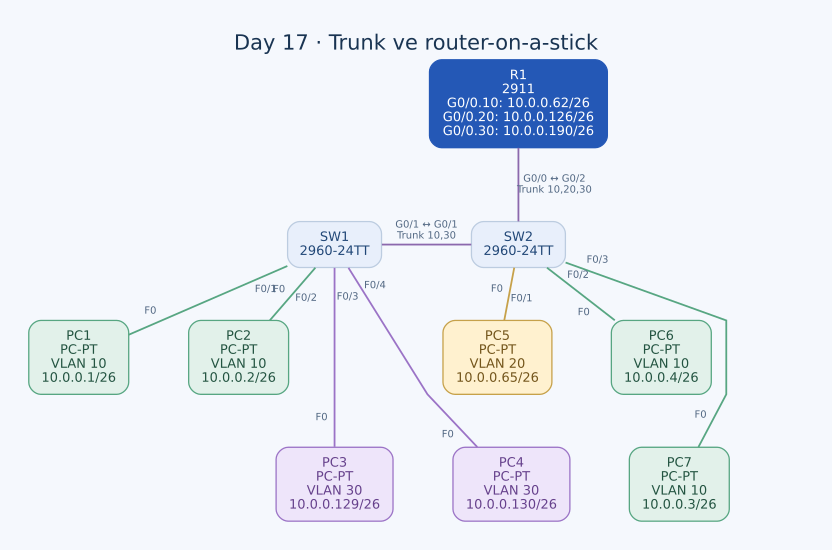

# Day 17 — 802.1Q Trunk ve Router-on-a-Stick

Bu labda VLAN'ları iki switch'e yaydım ve üç VLAN'ın gateway'ini R1'in tek fiziksel arayüzündeki subinterface'lerde topladım. Önceki labdaki üç ayrı router kablosunun yerini, VLAN etiketlerini taşıyan tek bir router-on-a-stick bağlantısı aldı.

| Alan | Açıklama |
| --- | --- |
| Lab dosyası | [Day 17 Lab - VLANs (Part 2).pkt](../../labs/Day%2017%20Lab%20-%20VLANs%20%28Part%202%29.pkt) |
| Konu | Access/trunk ayrımı, allowed VLAN, native VLAN ve ROAS |
| Ortam | Cisco Packet Tracer 9.0.1 |
| Cihazlar | Cisco 2911 R1, iki Cisco 2960-24TT ve yedi PC |

## Amaç

İstemci portlarını doğru VLAN'lara atadım. SW1–SW2 hattında yalnızca iki switch arasında gerekli VLAN'ları taşıyacak trunk ayarlarını, SW2–R1 hattında da üç VLAN için ROAS ayarlarını yaptım. R1'in subinterface IP'lerini her subnet'in son kullanılabilir adresi olarak seçtim.

Bu çalışma, VLAN'ın bir switch'e bağlı bir kavramla sınırlı olmadığını gösteriyor. Aynı VLAN, trunk üzerinden birden fazla switch'te devam edebiliyor; farklı VLAN'lar arasında geçiş ise hâlâ Layer 3 yönlendirme gerektiriyor.

## Topoloji ve port planı



| Bağlantı | Tür | Taşınması gereken VLAN'lar |
| --- | --- | --- |
| SW1 G0/1 ↔ SW2 G0/1 | Copper crossover, 802.1Q trunk | 10 ve 30 |
| SW2 G0/2 ↔ R1 G0/0 | Copper straight-through, ROAS hattı | 10, 20 ve 30 |

| PC | Switch / port | VLAN | IPv4 / prefix | Gateway |
| --- | --- | --- | --- | --- |
| PC1 | SW1 F0/1 | 10 | `10.0.0.1/26` | `10.0.0.62` |
| PC2 | SW1 F0/2 | 10 | `10.0.0.2/26` | `10.0.0.62` |
| PC3 | SW1 F0/3 | 30 | `10.0.0.129/26` | `10.0.0.190` |
| PC4 | SW1 F0/4 | 30 | `10.0.0.130/26` | `10.0.0.190` |
| PC5 | SW2 F0/1 | 20 | `10.0.0.65/26` | `10.0.0.126` |
| PC6 | SW2 F0/2 | 10 | `10.0.0.4/26` | `10.0.0.62` |
| PC7 | SW2 F0/3 | 10 | `10.0.0.3/26` | `10.0.0.62` |

PC bağlantılarının tamamı straight-through. PC6 ile PC7'nin adres sırası isim sırasından farklı: PC6 `.4`, PC7 `.3` kullanıyor.

## VLAN'ların switch'lerde bulunması

| Switch | Kullanılan veri VLAN'ları | Gerekçesi |
| --- | --- | --- |
| SW1 | 10, 30 | Bu switch'teki PC'ler bu iki VLAN'da. |
| SW2 | 10, 20, 30 | Yerel PC'ler ve R1'e iletim için üç VLAN gerekiyor. |

VLAN 20'nin SW1'de bulunmaması bu tasarımda tek başına eksiklik değil. VLAN 20 istemcisi SW2'de ve gateway bağlantısı da SW2 üzerinden. SW1–SW2 trunk'ının VLAN 20'yi taşımasına ihtiyaç yok.

Bu dosyada veri VLAN'larının isimleri `VLAN0010`, `VLAN0020`, `VLAN0030` olarak kalmış. Önceki labdaki departman isimlerini bu konfigürasyonda varmış gibi kullanmadım.

## Access portları

SW1 üzerinde:

```text
interface range FastEthernet0/1 - 2
 switchport mode access
 switchport access vlan 10
!
interface range FastEthernet0/3 - 4
 switchport mode access
 switchport access vlan 30
```

SW2 üzerinde:

```text
interface FastEthernet0/1
 switchport mode access
 switchport access vlan 20
!
interface range FastEthernet0/2 - 3
 switchport mode access
 switchport access vlan 10
```

PC tarafındaki bağlantılar access olduğu için PC'nin VLAN etiketi oluşturması gerekmiyor. Switch, etiketsiz gelen çerçeveyi portun access VLAN'ıyla ilişkilendiriyor.

## Trunk konfigürasyonu

SW1 G0/1'in son ayarları:

```text
interface GigabitEthernet0/1
 switchport trunk native vlan 1001
 switchport trunk allowed vlan 10,30
 switchport mode trunk
```

SW2 G0/1'de bulunan ayarlar:

```text
interface GigabitEthernet0/1
 switchport trunk native vlan 1001
 switchport trunk allowed vlan 10,30
```

SW2'nin router'a bakan G0/2 portu:

```text
interface GigabitEthernet0/2
 switchport trunk native vlan 1001
 switchport trunk allowed vlan 10,20,30
 switchport mode trunk
```

### Allowed VLAN listeleri neden farklı?

SW1'in veri trafiği VLAN 10 ve 30'dan oluşuyor. Bu nedenle switch'ler arası hattın listesi `10,30`. R1 ise üç VLAN'ın da gateway'i; SW2–R1 hattında liste `10,20,30` olmalı.

VLAN'ın veritabanında bulunması, trunk üzerinde taşındığı anlamına gelmiyor. Benzer şekilde allowed listesine bir VLAN yazmak da onun switch'te oluşturulmuş ve aktif olduğunu tek başına göstermiyor. İki koşulu ayrı kontrol ediyorum.

### Açık kalan trunk modu

SW2 G0/1'de native ve allowed VLAN satırları var, ancak açık bir `switchport mode trunk` satırı yok. Bu satırların varlığı portun operasyonel olarak trunk olduğunu tek başına kanıtlamaz.

SW1 tarafı trunk olduğundan SW2 tarafı dinamik görüşmeyle trunk olmuş olabilir. Bunu kesinleştirmek için `show interfaces trunk` ve `show interfaces GigabitEthernet0/1 switchport` çıktıları gerekir. Yönergedeki açık trunk tasarımını tamamlamak için SW2'de şu ayar ayrıca yapılmalı:

```text
interface GigabitEthernet0/1
 switchport mode trunk
```

Bu komutu son dosyada zaten uygulanmış gibi göstermiyorum.

## Native VLAN seçimi

İki trunk üzerinde veri VLAN'larından farklı olarak 1001 native VLAN seçilmiş. Normal 802.1Q kullanımında native VLAN, etiketsiz trafikle ilişkilendirilen VLAN'dır; veri VLAN'larının etiketli taşınmasıyla aynı şey değil.

Port ayarlarında 1001 yazsa da iki switch'in VLAN veritabanında **VLAN 1001 bulunmuyor**. Bu nedenle native VLAN seçimiyle VLAN'ın oluşturulmasını ayrı adımlar olarak not ettim. Tamamlama seçeneği, iki switch'te de:

```text
vlan 1001
 name NATIVE_UNUSED
```

Bu düzenleme kayıtlı son durumda yok. Native VLAN 1001, veri trafiği listelerine eklenmiş de değil; amaç kullanıcı trafiğini 10, 20 ve 30'da etiketli taşımak. Kullanılmayan native VLAN için R1'de IP'li bir `.1001` subinterface oluşturmadım.

## R1 — Router-on-a-stick

R1'in fiziksel G0/0 arayüzünde IP adresi yok; üç VLAN ayrı subinterface'lerde sonlandırılıyor:

```text
interface GigabitEthernet0/0
 no ip address
 no shutdown
!
interface GigabitEthernet0/0.10
 encapsulation dot1Q 10
 ip address 10.0.0.62 255.255.255.192
!
interface GigabitEthernet0/0.20
 encapsulation dot1Q 20
 ip address 10.0.0.126 255.255.255.192
!
interface GigabitEthernet0/0.30
 encapsulation dot1Q 30
 ip address 10.0.0.190 255.255.255.192
```

Subinterface adındaki `.10`, tek başına VLAN eşleştirmesi yapmıyor. Eşleştirmeyi `encapsulation dot1Q 10` satırı kuruyor. İsimlendirmeyi VLAN ID ile aynı tutmak konfigürasyonu okunur hâle getiriyor.

### VLAN 30 adresini düzeltme

G0/0.30 üzerinde önce `.126`, ardından `.125` adreslerini denedim. İkisi de VLAN 20'nin `10.0.0.64/26` subnet'inde. VLAN 30'un ağı `.128/26` olduğu için doğru son kullanılabilir gateway `.190`.

Son konfigürasyonda subinterface'lerin IP'leri `.62`, `.126` ve `.190` olarak ayrılıyor. Üç ağ da R1'e doğrudan bağlı olduğundan bu VLAN'lar arasında ayrıca statik rota kullanmadım.

## Paket yolunu karşılaştırma

**PC1 → PC6:** İki uç VLAN 10'da, farklı switch'lerde. Çerçeve SW1–SW2 trunk'ında VLAN 10 etiketiyle taşınır; R1 üzerinden routing gerekmez.

**PC3 → PC5:** Kaynak VLAN 30'da, hedef VLAN 20'de. Kaynak çerçeve gateway için oluşturulur; SW1–SW2 hattından VLAN 30 olarak, sonra SW2–R1 hattından yine VLAN 30 olarak gider. R1 paketi `.20` subinterface'i üzerinden geri gönderir. SW2, VLAN 20'deki PC5'e access portundan etiketsiz teslim eder.

Bu tasarım fiziksel router portu sayısını azaltıyor; ancak VLAN'lar arası trafik aynı router bağlantısından geçiyor. Bu, multilayer switch ile yerel yönlendirmeye geçişin neden anlamlı olabileceğini gösteriyor.

## Kontroller ve kaydetme durumu

| Kontrol | İncelediğim bilgi |
| --- | --- |
| `show vlan brief` | Yerel VLAN'lar ve access port üyelikleri |
| `show interfaces trunk` | Operasyonel trunk'lar, native ve allowed VLAN'lar |
| `show interfaces ... switchport` | Administrative/operational mode farkı |
| `show ip interface brief` | Fiziksel arayüz ve subinterface durumları |
| Aynı VLAN'da farklı switch'ler arasında ping | Trunk üzerinden VLAN devamlılığı |
| Farklı VLAN'lar arasında ping | ROAS ve gateway doğruluğu |

Tam ping ve `show` çıktıları saklanmış değil. Çalışma konfigürasyonlarında access üyelikleri ve ROAS adresleri mevcut; SW2 G0/1 modu ile native VLAN 1001'in oluşturulması yukarıdaki tamamlama notları arasında.

R1'in startup-config kaydında subinterface'ler yok ve fiziksel G0/0 eski shutdown durumunda. İki switch'in startup-config kayıtlarında da son access/trunk değişiklikleri bulunmuyor. Tamamlama ve kontrollerden sonra üç cihazda konfigürasyonların kaydedilmesi gerekiyor.

## Öğrendiklerim

- Access portlarının etiketsiz uç trafiğini, trunk'ın ise birden fazla VLAN'ı taşımasını ayırdım.
- Allowed VLAN listesini her bağlantının gerçekten ihtiyaç duyduğu VLAN'lara göre seçtim.
- Native VLAN ayarıyla VLAN veritabanındaki kaydın ayrı koşullar olduğunu gördüm.
- Trunk parametrelerinin yazılmasının portu tek başına statik trunk yapmadığını fark ettim.
- Subinterface adı ile `encapsulation dot1Q` eşleştirmesini ayırdım.
- Aynı VLAN'ın switch'ler arasında devam etmesiyle VLAN'lar arası routing'in farklı işler olduğunu öğrendim.

## Sonuç

Üç VLAN'ın gateway'ini R1'in tek fiziksel hattında topladım ve PC portlarını doğru VLAN'lara atadım. VLAN 30 gateway adresini düzelttim. SW2 G0/1'in açık trunk modu, native VLAN'ın oluşturulması ve son konfigürasyonların kaydedilmesi bu çalışmanın açık kalan adımları.

## Kaynak

- [Cisco — VLAN, trunk, allowed ve native VLAN yapılandırması](https://www.cisco.com/c/en/us/td/docs/switches/lan/catalyst2960/software/release/12-2_53_se/configuration/guide/2960scg/swvlan.html)

[Önceki lab](day-16-vlans-part-1.md) · [Lab kataloğu](../../README.md) · [Sonraki lab: Multilayer Switching](day-18-multilayer-switching.md)
