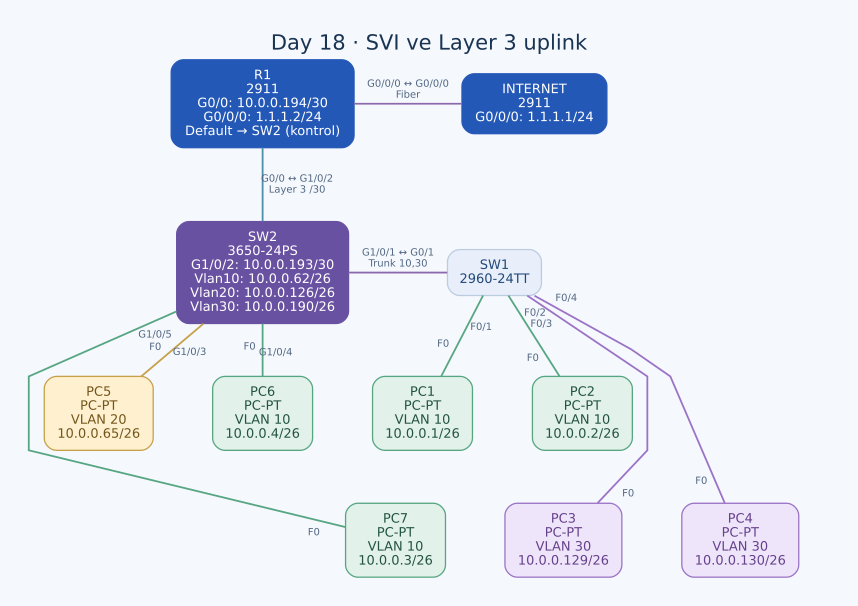

# Day 18 — Multilayer Switch, SVI ve Layer 3 Uplink

Bu labda VLAN'lar arası yönlendirmeyi R1'deki router-on-a-stick yapısından SW2 üzerindeki SVI'lara taşıdım. SW2'yi Layer 3 yönlendirme yapacak şekilde etkinleştirdim ve R1'e giden portunu trunk yerine IP adresli routed port olarak kullandım. PC'lerin gateway IP'leri aynı kaldı; bu adreslerin bulunduğu cihaz değişti.

| Alan | Açıklama |
| --- | --- |
| Lab dosyası | [Day 18 Lab - Multilayer Switching.pkt](../../Day%2018%20Lab%20-%20Multilayer%20Switching.pkt) |
| Konu | SVI, `ip routing`, `no switchport`, default route ve dönüş rotası |
| Ortam | Cisco Packet Tracer 9.0.1 |
| Cihazlar | Cisco 3650-24PS SW2, Cisco 2960-24TT SW1, iki Cisco 2911 ve yedi PC |
| Dış ağ testi | Labdaki INTERNET router'ının `1.1.1.1` adresi |

## Mimari değişiklik

| Başlık | ROAS yaklaşımı | Bu labdaki çalışma ayarı |
| --- | --- | --- |
| VLAN gateway'leri | R1 subinterface'leri | SW2 SVI'ları |
| R1–SW2 hattı | 802.1Q trunk | `/30` Layer 3 bağlantı |
| Inter-VLAN routing | R1 üzerinde | SW2 üzerinde |
| SW1–SW2 hattı | Layer 2 trunk | VLAN 10 ve 30'u taşıyan trunk olarak devam ediyor |

Sadece router'ın subinterface'lerini silmek yeterli değildi. Yeni gateway arayüzlerini SW2'de oluşturmak, IP routing'i açmak ve iki cihaz arasındaki dönüş rotalarını da kontrol etmek gerekti.

## Topoloji ve port planı



| Birinci uç | İkinci uç | İşlev |
| --- | --- | --- |
| SW1 G0/1 | SW2 G1/0/1 | VLAN 10,30 trunk; crossover |
| SW2 G1/0/2 | R1 G0/0 | Layer 3 uplink; straight-through |
| R1 G0/0/0 | INTERNET G0/0/0 | Single-mode fiber |
| SW1 F0/1 | PC1 F0 | VLAN 10 access |
| SW1 F0/2 | PC2 F0 | VLAN 10 access |
| SW1 F0/3 | PC3 F0 | VLAN 30 access |
| SW1 F0/4 | PC4 F0 | VLAN 30 access |
| SW2 G1/0/3 | PC5 F0 | VLAN 20 access |
| SW2 G1/0/4 | PC6 F0 | VLAN 10 access |
| SW2 G1/0/5 | PC7 F0 | VLAN 10 access |

PC bağlantıları straight-through. 3650'nin portları G1/0/1 biçiminde adlandırılıyor; önceki 2960 SW2'nin G0/1 düzeninden farklı.

## IP adresleri ve gateway'ler

### SVI ve transit adresleri

| Arayüz | IPv4 / prefix | Rol |
| --- | --- | --- |
| SW2 Vlan10 | `10.0.0.62/26` | VLAN 10 gateway'i |
| SW2 Vlan20 | `10.0.0.126/26` | VLAN 20 gateway'i |
| SW2 Vlan30 | `10.0.0.190/26` | VLAN 30 gateway'i |
| SW2 G1/0/2 | `10.0.0.193/30` | R1'e Layer 3 uplink |
| R1 G0/0 | `10.0.0.194/30` | SW2'ye bağlantı |
| R1 G0/0/0 | `1.1.1.2/24` | Dış ağ tarafı |
| INTERNET G0/0/0 | `1.1.1.1/24` | Test hedefi |

Transit ağ `10.0.0.192/30`; `.193` ve `.194` kullanılabilir, `.195` broadcast. Diyagramdaki VLAN 20 subnet etiketinde bulunan yazım hatasını adres planına taşımadım; PC ve SVI ayarları bu ağın `10.0.0.64/26` olduğunu gösteriyor.

### PC adresleri

| PC | VLAN | IPv4 / prefix | Gateway |
| --- | --- | --- | --- |
| PC1 | 10 | `10.0.0.1/26` | `10.0.0.62` |
| PC2 | 10 | `10.0.0.2/26` | `10.0.0.62` |
| PC3 | 30 | `10.0.0.129/26` | `10.0.0.190` |
| PC4 | 30 | `10.0.0.130/26` | `10.0.0.190` |
| PC5 | 20 | `10.0.0.65/26` | `10.0.0.126` |
| PC6 | 10 | `10.0.0.4/26` | `10.0.0.62` |
| PC7 | 10 | `10.0.0.3/26` | `10.0.0.62` |

## R1'de ROAS'ı kaldırma

Eski subinterface'leri kaldırıp fiziksel arayüze transit IP verdim:

```text
no interface GigabitEthernet0/0.10
no interface GigabitEthernet0/0.20
no interface GigabitEthernet0/0.30
interface GigabitEthernet0/0
 ip address 10.0.0.194 255.255.255.252
 no shutdown
```

R1'in G0/0 arayüzü artık VLAN etiketlerine göre üç gateway sunmuyor. SW2 ile tek bir Layer 3 subnet'i paylaşıyor. Eski VLAN gateway adreslerinin fiziksel arayüze topluca verilmesi gibi bir tasarım kullanmadım.

## SW2'de routed port ve IP routing

```text
default interface GigabitEthernet1/0/2
interface GigabitEthernet1/0/2
 no switchport
 ip address 10.0.0.193 255.255.255.252
!
ip routing
ip route 0.0.0.0 0.0.0.0 10.0.0.194
```

`no switchport`, bu fiziksel portu VLAN üyeliği olan Layer 2 switchport'tan IP adresli Layer 3 arayüze dönüştürüyor. `ip routing`, SW2'nin IP paketlerini ağlar arasında yönlendirmesini sağlıyor. SVI'lara IP vermekle yönlendirmeyi etkinleştirmeyi ayrı adımlar olarak ele aldım.

SW2'nin default route'u R1'in `.194` adresine gidiyor. Doğrudan bağlı VLAN ağlarına iletimde default route değil, daha özel bağlı rotalar kullanılacak.

## VLAN gateway'lerini SVI'lara taşıma

```text
interface Vlan10
 ip address 10.0.0.62 255.255.255.192
!
interface Vlan20
 ip address 10.0.0.126 255.255.255.192
!
interface Vlan30
 ip address 10.0.0.190 255.255.255.192
```

VLAN 10, 20 ve 30 SW2'nin veritabanında mevcut. SVI'larda `shutdown` satırı yok. Ancak SVI'ın canlı olarak up olması yalnızca IP tanımına bağlı değil; ilgili VLAN'ın aktif olması ve VLAN'ı taşıyan uygun bir fiziksel portun da çalışması gerekiyor.

VLAN 30'un SW2'de yerel PC portu yok. Bu VLAN'a ait aktif Layer 2 bağlantı, SW1'e giden trunk üzerinden sağlanabilir. Bu nedenle SVI kontrolünde trunk'ın allowed ve aktif VLAN listelerine de bakıyorum.

## Korunan Layer 2 ayarlar

SW1 G0/1 ve SW2 G1/0/1, VLAN 10 ve 30'u taşıyan trunk portları. İki tarafta da native VLAN'a özel bir satır yok; bu dosyada varsayılan native VLAN kullanılıyor. Önceki labdaki native 1001 seçimini bu dosyada da varmış gibi değerlendirmedim.

SW2'nin PC portlarında access üyelikleri ve `switchport nonegotiate` bulunuyor:

```text
interface GigabitEthernet1/0/3
 switchport mode access
 switchport access vlan 20
 switchport nonegotiate
!
interface range GigabitEthernet1/0/4 - 5
 switchport mode access
 switchport access vlan 10
 switchport nonegotiate
```

VLAN 20 istemcisi SW2'de olduğundan SW1 trunk'ına VLAN 20 eklemem gerekmiyor.

## Inter-VLAN paket yolu

PC1, VLAN 20'deki PC5'e giderken çerçeveyi `.62` gateway'inin MAC'ine oluşturur. Trafik SW1 trunk'ından VLAN 10 olarak SW2'ye gelir. SW2, IP routing ile hedef ağı seçip VLAN 20'deki PC5'e yeni Ethernet çerçevesi gönderir. R1 bu yerel inter-VLAN yolunda yer almıyor.

PC1 ve PC3 aynı fiziksel SW1'e bağlı olsalar da farklı VLAN'larda. Bu ikisi arasındaki trafik önce trunk üzerinden SW2'ye gidip yönlendirilir, sonra VLAN 30 olarak aynı trunk'tan SW1'e dönebilir. Aynı switch'e takılı olmak, farklı subnet'ler arasında Layer 3 kararına ihtiyaç olmadığı anlamına gelmiyor.

## R1'deki rota sorunu

Son dosyada R1'in tek statik rotası şu:

```text
ip route 0.0.0.0 0.0.0.0 GigabitEthernet0/0
```

G0/0, dış ağ yerine SW2'ye bakıyor. R1'de VLAN subnet'lerine açık next-hop rotası yok; bilinmeyen hedefler bu default ile iç bağlantıya yönlendiriliyor. Ayrıca Ethernet üzerinde yalnızca arayüz belirtilmesi, uzak PC adreslerini o linkte ARP ile çözmeye çalışmasına neden olabilir.

Bu ayarın `1.1.1.1` testine etkisini dikkatli ayırıyorum:

- **Gidiş:** R1'in `1.1.1.0/24` ağı doğrudan fiber arayüzüne bağlı. Bu hedefe giderken daha özel bağlı rota default'tan önce seçilebilir.
- **PC'ye dönüş:** R1'in `10.0.0.x` VLAN hedefine açık bir rotası bulunmuyor; mevcut arayüz tabanlı default, SW2'nin Proxy ARP davranışına bağımlılık oluşturabilir.
- **Diğer hedefler:** İçeriye bakan default, SW2'nin R1'e bakan default'u ile yanlış yönlendirme veya döngü koşulları oluşturabilir; bunu canlı testle gerçekleşmiş bir sonuç olarak kaydetmedim.

Dolayısıyla yalnızca SW2'nin transit adresinden yapılan bir dış ağ testi, PC1 kaynaklı testin dönüş yolunu da kanıtlamaz.

### Önerilen tamamlama

Bu labın VLAN ağlarını açıkça SW2'ye yönlendirmek için R1'de uygulanabilecek düzenleme:

```text
! Öneri; dosyadaki mevcut rota bu şekilde değiştirilmiş değil.
no ip route 0.0.0.0 0.0.0.0 GigabitEthernet0/0
ip route 10.0.0.0 255.255.255.0 10.0.0.193
```

Bu `/24` özet, üç VLAN subnet'ini kapsıyor. Transit `/30` daha özel ve doğrudan bağlı olarak kalır. Test hedefi `1.1.1.1` zaten R1'e doğrudan bağlı olduğundan, sırf bu hedef için R1'e yeni bir dış default eklemek gerekmiyor.

INTERNET router'ında default next hop `1.1.1.2`; bu, labın iç ağlarına R1 üzerinden dönüş yönünü sağlıyor. Buradaki INTERNET cihazı simülasyonun bir parçası; `1.1.1.1` ping'i gerçek internet bağlantısı testi değil.

## Kontroller ve kalıcılık

| Kontrol | Beklediğim bilgi |
| --- | --- |
| SW2 `show ip interface brief` | Routed port ve üç SVI'ın doğru IP/durumları |
| SW2 `show interfaces trunk` | SW1 hattında VLAN 10 ve 30 |
| SW2 `show ip route` | VLAN bağlı rotaları ve `.194` default next hop'u |
| R1 `show ip route` | İç VLAN'lara dönüş yolu ve doğrudan bağlı dış ağ |
| VLAN'lar arası ping | SW2 üzerinde Layer 3 iletim |
| PC'den `ping 1.1.1.1` | Uç kaynaklı dış ağ gidiş/dönüş yolu |

Tam ping çıktıları saklanmadığından dış ağ erişimini başarılı kabul eden bir sonuç eklemedim. R1'in rota düzenlemesi de ayrıca tamamlanmalı.

R1'in startup-config kaydında eski ROAS subinterface'leri duruyor. SW2'nin startup-config kaydında ise `ip routing`, yeni routed port, üç SVI ve default route henüz yok. Son tasarım doğrulandıktan sonra R1 ve SW2'de `copy running-config startup-config` ile kayıt yapılmalı.

## Öğrendiklerim

- VLAN gateway IP'sini değiştirmeden gateway işlevini başka cihaza taşıdım.
- SVI ile fiziksel routed port arasındaki farkı uyguladım.
- IP adresi tanımlamanın yanında `ip routing` etkinleştirmesinin gerektiğini öğrendim.
- Inter-VLAN trafiğin artık R1'e gitmeden SW2'de yönlendirilebildiğini açıkladım.
- Default route'un yanında dönüş prefix'lerini de kontrol etmem gerektiğini gördüm.
- Doğrudan bağlı bir test hedefinin çalışmasının, bütün iç ağ dönüş yollarının doğru olduğunu kanıtlamadığını anladım.

## Sonuç

ROAS yerine SW2 üzerinde üç SVI ve R1'e Layer 3 uplink oluşturdum. Inter-VLAN mimarisi çalışma ayarlarında kurulmuş durumda. R1'in iç ağ dönüş rotası, uç kaynaklı dış ağ testi ve son ayarların kaydedilmesi çalışmanın açık kalan bölümleri.

## Kaynaklar

- [Cisco — Multilayer switch, routed port ve IP routing](https://www.cisco.com/c/en/us/td/docs/switches/lan/catalyst3850/software/release/16-3/configuration_guide/b_163_consolidated_3850_cg/b_163_consolidated_3850_cg_chapter_01011100.html)
- [Cisco — Ethernet statik rotalarında next-hop seçimi](https://www.cisco.com/c/en/us/support/docs/dial-access/floating-static-route/118263-technote-nexthop-00.html)

[Önceki lab](day-17-vlans-part-2.md) · [Lab kataloğu](../../README.md) · [Sonraki lab: DTP & VTP](day-19-dtp-vtp.md)
