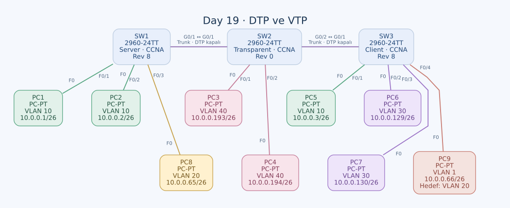

# Day 19 — DTP, VTP ve VLAN Veritabanı Dağıtımı

Bu labda üç switch arasında trunk'ları elle yapılandırıp DTP görüşmesini kapattım. Ardından VTP server, transparent ve client modlarını aynı topolojide karşılaştırdım. VLAN'ın switch'lerde tanımlı olmasıyla bir PC portunun o VLAN'a atanmasının farklı işlemler olduğunu özellikle takip ettim.

| Alan | Açıklama |
| --- | --- |
| Lab dosyası | [Day 19 Lab - DTP & VTP.pkt](../../labs/Day%2019%20Lab%20-%20DTP%20%26%20VTP.pkt) |
| Konu | Statik trunk, DTP, VTP domain/revision ve access VLAN üyeliği |
| Ortam | Cisco Packet Tracer 9.0.1 |
| Cihazlar | Üç Cisco 2960-24TT ve dokuz PC |
| VTP domain / version | `CCNA` / version 1 |

## Amaç

Önce switch'ler arası portları statik trunk yaptım ve DTP paketlerinin gönderilmesini durdurdum. Sonra SW1'de oluşturulan VLAN'ların diğer switch'lerdeki durumunu, SW2'de yerel olarak oluşturduğum VLAN 40'ı ve SW3 client modundayken VLAN 50 oluşturma denemesini karşılaştırdım.

Bu labda router veya VLAN gateway'i yok. Hedef, aynı VLAN'ın switch'ler arasında devam etmesi ve VTP davranışını anlamak; farklı VLAN'lar arasında routing yapmak değil.

## Topoloji



| Bağlantı | Son port ayarı |
| --- | --- |
| SW1 G0/1 ↔ SW2 G0/1 | İki uçta trunk + nonegotiate |
| SW2 G0/2 ↔ SW3 G0/1 | İki uçta trunk + nonegotiate |

Bu iki hat ve dokuz PC bağlantısı copper straight-through olarak kaydedilmiş. Trunk'larda özel allowed VLAN listesi veya native VLAN satırı yok; veri VLAN'ları için özel bir daraltma yapılmamış ve native VLAN varsayılanda kalmış.

## VLAN ve IP planı

| VLAN | Subnet | Kullanım |
| --- | --- | --- |
| 10 | `10.0.0.0/26` | SW1 ve SW3'teki istemciler |
| 20 | `10.0.0.64/26` | PC8 ve hedef tasarıma göre PC9 |
| 30 | `10.0.0.128/26` | SW3'teki istemciler |
| 40 | `10.0.0.192/26` | SW2'de yerel VLAN |

Bu dosyada PC gateway alanları boş. Aynı subnet ve VLAN içindeki iletişim için gateway gerekmiyor. Farklı VLAN'lar arasındaki erişimi sağlayacak bir Layer 3 cihaz yapılandırılmamış.

| PC | Switch / port | IPv4 / prefix | Kayıtlı port VLAN'ı |
| --- | --- | --- | --- |
| PC1 | SW1 F0/1 | `10.0.0.1/26` | 10 |
| PC2 | SW1 F0/2 | `10.0.0.2/26` | 10 |
| PC8 | SW1 F0/3 | `10.0.0.65/26` | 20 |
| PC3 | SW2 F0/1 | `10.0.0.193/26` | 40 |
| PC4 | SW2 F0/2 | `10.0.0.194/26` | 40 |
| PC5 | SW3 F0/1 | `10.0.0.3/26` | 10 |
| PC6 | SW3 F0/2 | `10.0.0.129/26` | 30 |
| PC7 | SW3 F0/3 | `10.0.0.130/26` | 30 |
| PC9 | SW3 F0/4 | `10.0.0.66/26` | Varsayılan 1; hedef üyelik 20 |

`.193` ve `.194` adresleri önceki labda `/30` transit ağında kullanılıyordu. Burada `/26` VLAN 40 içindeler. Aynı son oktetleri görmek, farklı dosyalardaki ağların aynı subnet olduğunu göstermiyor.

## DTP ile VTP'nin farkı

| Protokol | Sorduğu temel soru | Bu labdaki kullanım |
| --- | --- | --- |
| DTP | Bu bağlantı trunk olacak mı? | Statik trunk seçip görüşmeyi kapattım. |
| VTP | Hangi VLAN tanımları paylaşılacak? | Domain içindeki VLAN veritabanlarını karşılaştırdım. |

DTP, PC'nin IP adresini veya VLAN veritabanını dağıtmıyor. VTP de bir access portunu kendiliğinden doğru departman VLAN'ına atamıyor ve VLAN'lar arasında IP yönlendirmesi yapmıyor.

## Statik trunk ve DTP'yi kapatma

SW1 üzerinde:

```text
interface GigabitEthernet0/1
 switchport mode trunk
 switchport nonegotiate
```

SW2 üzerinde:

```text
interface range GigabitEthernet0/1 - 2
 switchport mode trunk
 switchport nonegotiate
```

SW3 üzerinde:

```text
interface GigabitEthernet0/1
 switchport mode trunk
 switchport nonegotiate
```

`switchport mode trunk`, yönetimsel modu statik trunk yapıyor. Trunk modunda DTP gönderimi ayrıca devam edebileceği için `switchport nonegotiate` ile görüşmeyi kapattım. `nonegotiate`, tek başına dinamik bir portu trunk'a dönüştüren bir komut değil; portun access/trunk modu ayrı belirleniyor.

### Administrative ve operational mode

Yazılan konfigürasyon ile portun o andaki çalışma durumunu ayrı okuyorum:

```text
show interfaces GigabitEthernet0/1 switchport
show interfaces trunk
```

Bu kontrollerde administrative mode, operational mode ve `Negotiation of Trunking` alanları önemli. Statik trunk + nonegotiate konfigürasyonunda trunk'ın çalışması beklenirken DTP görüşmesinin kapalı olması isteniyor. Tam canlı çıktılar bu çalışmada saklanmış değil.

## VTP rolleri ve son veritabanları

| Switch | Domain | Mod | Version | Revision | Veri VLAN'ları |
| --- | --- | --- | --- | --- | --- |
| SW1 | CCNA | Server | 1 | 8 | 10, 20, 30 |
| SW2 | CCNA | Transparent | 1 | 0 | 10, 20, 30, 40 |
| SW3 | CCNA | Client | 1 | 8 | 10, 20, 30 |

VLAN 1 ve varsayılan eski tip VLAN'ları bu tabloda tekrar listelemedim. Veri VLAN isimleri `VLAN0010` gibi varsayılan adlarda.

### SW1 — Server ve domain

```text
vtp domain CCNA
vtp mode server
vlan 10
vlan 20
vlan 30
```

SW1'de VLAN oluşturma, silme ve yeniden oluşturma denemeleri yaptım. Son durumda 10, 20 ve 30 üç switch'in veritabanında da var. SW1 ile SW3'ün revision değerleri de 8 olarak eşleşiyor.

Revision, VLAN sayısı değil; veritabanı değişiklikleriyle ilişkili sürüm bilgisidir. Üç veri VLAN'ı bulunurken revision'ın 8 olması bu nedenle çelişki değil. Domain, mod ve version ile birlikte kontrol edilmesi gerekiyor.

### SW2 — Transparent ve yerel VLAN 40

```text
vtp mode transparent
vlan 40
```

SW2'yi transparent moda aldıktan sonra VLAN 40 oluşturdum. Son durumda VLAN 40 yalnızca SW2'de var; SW1 ve SW3'e eklenmemiş. Transparent switch kendi VLAN değişikliklerini VTP ile diğerlerine dağıtmıyor ve gelen güncellemelere göre kendi veritabanını senkronize etmiyor.

Bu mod, switch'in VLAN etiketli veri trafiğini iletmeyi bıraktığı anlamına gelmiyor. SW2, yerel veritabanında bulunan VLAN 10'u iki trunk arasında taşıyabilir; böylece SW1'deki PC1 ile SW3'teki PC5 aynı VLAN'da haberleşebilir.

VTP ilanlarının aktarılması ise sürüme bağlı ayrı bir konu. Version 1'de transparent cihaz domain ve version koşullarını kontrol edebilir; version 2 davranışını bütün sürümlere genellemiyorum. Bu topolojide üç cihaz da version 1 ve CCNA domain'inde.

### SW3 — Client ve VLAN 50 denemesi

```text
vtp mode client
vlan 50
```

Client moda geçtikten sonra VLAN 50 oluşturmayı denedim. Son VLAN veritabanında **VLAN 50 yok**. VTP v1 client, VLAN veritabanını server'dan öğrenir; yerel VLAN oluşturma/değiştirme işlemi için server gibi kullanılmaz.

Buradaki `vlan 50` satırı son konfigürasyona eklenmiş bir VLAN değil, yaptığım deneme. Tam hata mesajı kaydı bulunmadığından bir hata çıktısı alıntılamadım.

## Access portlarını atama

SW1 üzerinde:

```text
interface range FastEthernet0/1 - 2
 switchport mode access
 switchport access vlan 10
!
interface FastEthernet0/3
 switchport mode access
 switchport access vlan 20
```

SW2 üzerinde:

```text
interface range FastEthernet0/1 - 2
 switchport mode access
 switchport access vlan 40
```

SW3 üzerinde:

```text
interface FastEthernet0/1
 switchport mode access
 switchport access vlan 10
!
interface range FastEthernet0/2 - 3
 switchport mode access
 switchport access vlan 30
```

### Access portlarında DTP

Bu platformdaki statik access portları trunk görüşmesine katılmayacak şekilde değerlendirilir; canlı kontrolde `Negotiation of Trunking: Off` beklenir. Konfigürasyonda ayrıca `switchport nonegotiate` bulunmaması, statik access portunda DTP'nin mutlaka açık olduğu sonucunu vermiyor.

Statik trunk portu için kullandığım iki komutu, access portu için aynı amaçla zorunlu bir çift gibi düşünmüyorum. Kontrolü `show interfaces ... switchport` üzerinden yapıyorum.

## Açık kalan port — PC9

PC9, SW3 F0/4'e bağlı ve IP'si `10.0.0.66/26`. Bu adres, PC8'in `.65/26` adresiyle aynı subnet'te; görevde ikisinin de VLAN 20'de olması bekleniyor. Ancak SW3 F0/4 konfigürasyonunda access modu ve VLAN 20 ataması yok. Port varsayılan VLAN 1'de kalmış.

Bu durumda VTP'nin VLAN 20'yi SW3 veritabanına getirmiş olması PC9'un üyeliğini düzeltmiyor. PC8'in yerel ARP yayını VLAN 20 içinde ilerler; PC9'un VLAN 1 portuna normal VLAN 20 trafiği olarak teslim edilmez.

Tamamlama için SW3'te uygulanması gereken ayar:

```text
! Tamamlama adımı; son dosyada henüz uygulanmış değil.
interface FastEthernet0/4
 switchport mode access
 switchport access vlan 20
```

VTP client modu, mevcut VLAN'a port atamayı engellemiyor. SW3'te VLAN 20 zaten öğrenilmiş olduğundan bu düzenleme, client üzerinde yeni bir VLAN oluşturma işlemi değil.

## Bağlantı testlerini nasıl ayırıyorum?

| Test | Değerlendirme |
| --- | --- |
| PC1 ↔ PC2 | Aynı switch ve VLAN 10 içindeki iletim |
| PC1 ↔ PC5 | İki trunk ve SW2 üzerinden VLAN 10 devamlılığı |
| PC6 ↔ PC7 | SW3 üzerinde VLAN 30 içi iletim |
| PC3 ↔ PC4 | SW2 üzerinde yerel VLAN 40 içi iletim |
| PC8 ↔ PC9 | PC9'un VLAN 20 üyeliği tamamlanmadan hedef tasarımla uyumlu değil |
| VLAN 10 ↔ VLAN 30 | Layer 3 gateway olmadığı için bu labda inter-VLAN erişim beklemiyorum |

Bu tablo test amaçlarını ve mevcut kısıtları gösteriyor; kaydedilmiş ping başarı oranları bulunmuyor.

## Kontroller ve kalıcılık

Başlıca komutlar:

```text
show vtp status
show vlan brief
show interfaces trunk
show interfaces GigabitEthernet0/1 switchport
show interfaces FastEthernet0/4 switchport
```

Port atamaları ve trunk/nonegotiate değişiklikleri startup-config kayıtlarına aktarılmamış. SW2'nin transparent mode/domain ayarları da son running-config'te bulunurken eski startup-config'te yok. Kontrollerden sonra port konfigürasyonlarını kaydetmek gerekiyor.

Normal aralıktaki VLAN veritabanı, VTP modu ve port konfigürasyonunun saklanması aynı mekanizma değil. Bu IOS ailesinde `vlan.dat` da önem taşıyor. Yalnızca startup-config içinde `vlan 10` satırını arayıp “VLAN kaydedilmemiş” sonucuna varmıyorum; `show vlan brief` ve `show vtp status` ile birlikte değerlendiriyorum.

## Öğrendiklerim

- Statik trunk ile DTP paketlerini kapatmanın ayrı ayarlar olduğunu öğrendim.
- Administrative ve operational port modlarını ayrı kontrol etmeyi çalıştım.
- VTP server, transparent ve client rollerini aynı domain içinde karşılaştırdım.
- Transparent switch'te oluşturulan VLAN'ın diğer switch'lere dağıtılmadığını gördüm.
- Client üzerinde VLAN oluşturma ile mevcut VLAN'a port atamanın farklı işlemler olduğunu anladım.
- VLAN veritabanı dağıtımının eksik access port konfigürasyonunu tamamlamadığını PC9 üzerinden fark ettim.

## Sonuç

Switch'ler arasındaki trunk'ları DTP görüşmesi olmadan yapılandırdım; CCNA domain'inde server, transparent ve client rollerini uyguladım. VLAN 40 yalnızca SW2'de kaldı, client üzerindeki VLAN 50 denemesi veritabanına eklenmedi. PC9'un VLAN 20 port ataması ve son port ayarlarının kaydedilmesi açık kalan adımlar.

## Kaynaklar

- [Cisco — Trunk modları ve DTP](https://www.cisco.com/c/en/us/td/docs/switches/lan/c9000/lyr2-fwd/vlan/vlan-configuration-guide/configure-vlan-trunks.html)
- [Cisco — VTP modları ve VLAN veritabanı](https://www.cisco.com/c/en/us/td/docs/switches/lan/catalyst3750/software/release/12-2_55_se/configuration/guide/scg3750/swvtp.html)
- [Cisco — VTP sürümüne bağlı transparent davranışı](https://www.cisco.com/c/en/us/td/docs/switches/lan/catalyst4500/12-2/31sg/configuration/guide/vtp.pdf)

[Önceki lab](day-18-multilayer-switching.md) · [Lab kataloğu](../../README.md) · [Sonraki lab: STP analizi](day-20-analyzing-stp.md)
