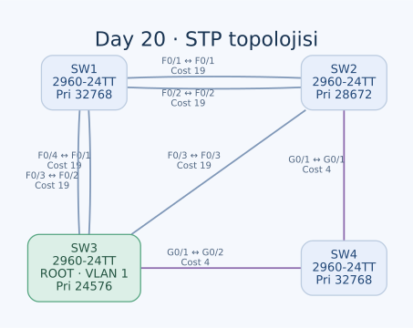

# Day 20 — STP Topolojisini ve Port Rollerini Analiz Etme

Bu labda dört switch arasındaki yedekli bağlantılarda hangi portların trafiği ileteceğini hesapladım. Önce root bridge'i Bridge ID üzerinden seçtim; sonra root path cost ve eşitlik bozma kurallarıyla her bağlantının iki ucunu değerlendirdim. Özellikle en az switch üzerinden geçen yolun her zaman en düşük maliyetli yol olmadığını gördüm.

| Alan | Açıklama |
| --- | --- |
| Lab dosyası | [Day 20 Lab - Analyzing STP.pkt](../../labs/Day%2020%20Lab%20-%20Analyzing%20STP.pkt) |
| Konu | Root bridge, root port, designated port ve yedek yollar |
| Ortam | Cisco Packet Tracer 9.0.1 |
| Cihazlar | Dört Cisco 2960-24TT |
| STP modu / VLAN | PVST+ / VLAN 1 |

## Amaç

Topolojideki link ışıklarını kapatıp önce hesap yapmam, ardından CLI ile karşılaştırmam isteniyor. Bu yüzden bir kablonun görünümünden karar vermek yerine switch önceliklerini, MAC adreslerini, port maliyetlerini ve BPDU seçim sırasını kullandım.

Bu çalışma bir IP adresleme veya ping labı değil. PC, router ve yönlendirme konfigürasyonu yok; incelenen konu Layer 2 döngülerinin önlenmesi.

## Fiziksel topoloji



| Birinci uç | İkinci uç | Bağlantı |
| --- | --- | --- |
| SW1 F0/1 | SW2 F0/1 | FastEthernet |
| SW1 F0/2 | SW2 F0/2 | FastEthernet |
| SW1 F0/3 | SW3 F0/2 | FastEthernet |
| SW1 F0/4 | SW3 F0/1 | FastEthernet |
| SW2 F0/3 | SW3 F0/3 | FastEthernet |
| SW2 G0/1 | SW4 G0/1 | GigabitEthernet |
| SW3 G0/1 | SW4 G0/2 | GigabitEthernet |

Yedi kablonun tamamı copper crossover. SW1–SW2 ve SW1–SW3 arasında ikişer fiziksel yol var. Bunlar EtherChannel olarak birleştirilmemiş; STP her portu ayrı değerlendiriyor.

## Root bridge seçimi

Bridge ID karşılaştırmasında önce priority ve extended system ID, eşitlikte MAC adresi değerlendirilir. Daha küçük değer kazanır. VLAN 1 için görülen priority değeri, yapılandırılan taban priority'ye VLAN ID'nin eklenmiş hâlidir.

| Switch | Taban priority | VLAN 1 ile değer | Bridge MAC |
| --- | --- | --- | --- |
| SW1 | 32768 | 32769 | `0001.4338.79D8` |
| SW2 | 28672 | 28673 | `0002.16D6.D0B8` |
| SW3 | 24576 | 24577 | `00E0.F9E6.44A5` |
| SW4 | 32768 | 32769 | `0090.0C01.9587` |

**VLAN 1'in root bridge'i SW3 olmalı.** SW1'in MAC adresi daha küçük olsa da SW3'ün priority'si daha düşük. MAC karşılaştırması, priority farkını geçersiz kılmaz.

İlgili mevcut ayarlar:

```text
! SW2
spanning-tree mode pvst
spanning-tree extend system-id
spanning-tree vlan 1 priority 28672
!
! SW3
spanning-tree mode pvst
spanning-tree extend system-id
spanning-tree vlan 1 priority 24576
```

SW1 ve SW4'te VLAN 1 priority'si varsayılan. Bu labda root'u değiştiren yeni bir konfigürasyon yapmadım; verilmiş değerleri yorumladım.

## Maliyet hesabı

Hesapta standart kısa STP maliyetlerini kullandım: FastEthernet için **19**, GigabitEthernet için **4**. Bunlar bant genişliği temelli STP maliyetleri; kablo adedini veya gecikmeyi doğrudan saymıyor. Canlı karşılaştırmada `show spanning-tree vlan 1` içindeki gerçek Cost değerleri esas alınmalı.

| Switch | En iyi root yolu | Toplam maliyet | Root port |
| --- | --- | --- | --- |
| SW3 | Root'un kendisi | 0 | Yok |
| SW4 | Doğrudan SW3 | 4 | G0/2 |
| SW2 | SW4 üzerinden SW3 | 4 + 4 = 8 | G0/1 |
| SW1 | Doğrudan SW3 | 19 | F0/4 |

SW2'nin SW3'e doğrudan FastEthernet bağlantısı 19 maliyetli. SW4 üzerinden iki GigabitEthernet bağlantısı ise toplam 8. Bu nedenle SW2 root port olarak doğrudan SW3'e bakan F0/3'ü seçmez.

SW1'in SW2 üzerinden ulaşması 19 + 8 = 27 maliyetli. SW3'e giden iki doğrudan FastEthernet yolunun maliyeti ise 19. SW1 için seçim bu iki doğrudan port arasında kalıyor.

### SW1 neden F0/4'ü seçiyor?

SW1 F0/3, SW3 F0/2'ye; SW1 F0/4 ise SW3 F0/1'e bağlı. İki adayın root bilgisi, toplam maliyeti ve gönderen bridge'i aynı. Varsayılan port priority'leri de eşit olduğundan **gönderen SW3'ün daha küçük port ID'si** belirleyici olur.

SW3 F0/1, F0/2'den önce gelir. Dolayısıyla SW1'in yerel numarası daha büyük olan F0/4'ü root port seçmesi beklenir. Sadece alıcı switch'in port numarasına bakmak burada yanlış sonuç verir.

## Portların tamamı

Aşağıdaki tablo standart maliyetlerle hesapladığım, topoloji yakınsadığında beklenen VLAN 1 sonucudur. R: root, D: designated, N: non-designated. CLI, yedek portu `Altn` olarak da gösterebilir.

| Switch | Port | Karşı uç | Rol | Kararlı durum |
| --- | --- | --- | --- | --- |
| SW1 | F0/1 | SW2 F0/1 | N | Blocking |
| SW1 | F0/2 | SW2 F0/2 | N | Blocking |
| SW1 | F0/3 | SW3 F0/2 | N | Blocking |
| SW1 | F0/4 | SW3 F0/1 | R | Forwarding |
| SW2 | F0/1 | SW1 F0/1 | D | Forwarding |
| SW2 | F0/2 | SW1 F0/2 | D | Forwarding |
| SW2 | F0/3 | SW3 F0/3 | N | Blocking |
| SW2 | G0/1 | SW4 G0/1 | R | Forwarding |
| SW3 | F0/1 | SW1 F0/4 | D | Forwarding |
| SW3 | F0/2 | SW1 F0/3 | D | Forwarding |
| SW3 | F0/3 | SW2 F0/3 | D | Forwarding |
| SW3 | G0/1 | SW4 G0/2 | D | Forwarding |
| SW4 | G0/1 | SW2 G0/1 | D | Forwarding |
| SW4 | G0/2 | SW3 G0/1 | R | Forwarding |

SW1–SW2 segmentlerinde SW2'nin root maliyeti 8, SW1'inki 19 olduğu için designated taraf SW2. İki segmentin de SW1 ucu bloklanabilir; her yedek kablonun mutlaka farklı switch tarafında bloklanması gibi bir kural yok.

Root bridge üzerinde root port bulunmaz. Bu topolojide SW3'ün kullanılan portları designated olur. Sonraki Rapid STP labındaki aynı shared segmente iki portla bağlanma durumu, bu basit genellemenin sınırını ayrıca gösteriyor.

## Mantıksal iletim ağacı

İki ucu da forwarding olan bağlantılar SW1 F0/4–SW3 F0/1, SW3 G0/1–SW4 G0/2 ve SW4 G0/1–SW2 G0/1. Dört switch'i döngüsüz bağlayan üç aktif yol kalıyor.

Blocking, kablonun kopuk veya portun shutdown olduğu anlamına gelmiyor. Yedek port, STP bilgilerini işlemeye devam eder; topoloji değişirse yeniden seçime katılabilir. Bir ucun designated/forwarding olması da kablonun karşı ucunun kullanıcı trafiğini geçirdiğini tek başına göstermez.

## Kontroller

```text
show spanning-tree
show spanning-tree vlan 1
show spanning-tree detail
show spanning-tree interface FastEthernet0/4 detail
```

| Alan | Kontrol ettiğim nokta |
| --- | --- |
| Root ID | Bütün switch'lerin SW3'ü aynı root olarak tanıması |
| Bridge ID | Yerel switch'in priority ve MAC bilgisi |
| Root Cost / Port | SW2 için 8 ve G0/1; SW1 için 19 ve F0/4 hesabı |
| Role / Sts | Designated ile root rollerinin, forwarding ile blocking durumlarının ayrılması |
| Cost / Prio.Nbr | Maliyet ve eşitlik bozma sırasının doğru yorumlanması |

CLI'de `show spanning-tree` ve ayrıntı komutlarını kullandım. Tam komut çıktıları saklanmadığından tabloyu ölçülmüş bir çıktı alıntısı olarak sunmadım; hesaplanan sonuç olarak tuttum. Cihazların running-config ve startup-config kayıtları aynı; bu labda açık kalan yeni bir konfigürasyon kaydı yok.

## Öğrendiklerim

- Root seçimini port hızından veya MAC adresinden önce priority üzerinden yaptım.
- Daha çok bağlantıdan geçen bir yolun daha düşük STP maliyetine sahip olabileceğini hesapladım.
- Paralel bağlantılarda gönderen port ID'sinin alıcı port numarasından önce değerlendirildiğini gördüm.
- Port rolü ile port durumunun farklı bilgiler olduğunu ayırdım.
- Fiziksel yedekliliğin STP ile döngüsüz bir iletim ağacına dönüştüğünü açıkladım.

## Sonuç

VLAN 1 için SW3'ü root olarak belirledim. Gigabit yolların SW2'deki root port seçimini, SW3'ün port ID'sinin de SW1'deki eşitliği nasıl etkilediğini hesapladım. Yedi fiziksel bağlantının hangi uçlarda bloklanması gerektiğini port bazında çıkardım.

## Kaynak

- [Cisco — Catalyst 2960 üzerinde STP](https://www.cisco.com/c/en/us/td/docs/switches/lan/catalyst2960/software/release/12-2_55_se/configuration/guide/scg_2960/swstp.html)

[Önceki lab](day-19-dtp-vtp.md) · [Lab kataloğu](../../README.md) · [Sonraki lab: STP yapılandırması](day-21-configuring-spanning-tree.md)
