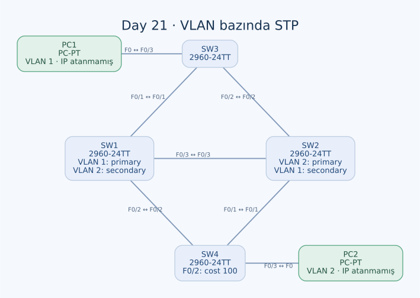

# Day 21 — VLAN Bazında STP Root, Cost ve Uç Port Koruması

Bu labda STP topolojisini yalnızca okumak yerine root bridge seçimini ve yol maliyetlerini değiştirdim. VLAN 1 ve VLAN 2 için farklı primary root'lar seçtim; bir portun maliyetini ve başka bir portun priority'sini artırarak seçim sırasını karşılaştırdım. PC portlarında PortFast ve BPDU Guard kullandım.

| Alan | Açıklama |
| --- | --- |
| Lab dosyası | [Day 21 Lab - Configuring Spanning Tree.pkt](../../Day%2021%20Lab%20-%20Configuring%20Spanning%20Tree.pkt) |
| Konu | PVST+, root primary/secondary, path cost, port priority, PortFast ve BPDU Guard |
| Ortam | Cisco Packet Tracer 9.0.1 |
| Cihazlar | Dört Cisco 2960-24TT ve iki PC |
| VLAN'lar | VLAN 1 ve VLAN 2 |

## Amaç

SW1'i VLAN 1 için primary, VLAN 2 için secondary; SW2'yi ise bunun tersi şekilde yapılandırdım. Böylece her VLAN'ın ayrı STP ağacı olabileceğini uyguladım. Sonraki adımlarda SW4 F0/2 maliyetini 100'e, SW1 F0/1'in VLAN 1 port priority'sini 240'a çıkardım.

## Topoloji ve uçlar



| Birinci uç | İkinci uç | İşlev |
| --- | --- | --- |
| SW1 F0/1 | SW3 F0/1 | Trunk |
| SW1 F0/2 | SW4 F0/2 | Trunk |
| SW1 F0/3 | SW2 F0/3 | Trunk |
| SW2 F0/1 | SW4 F0/1 | Trunk |
| SW2 F0/2 | SW3 F0/2 | Trunk |
| SW3 F0/3 | PC1 F0 | Access VLAN 1 |
| SW4 F0/3 | PC2 F0 | Access VLAN 2 |

Switch'ler arasındaki beş bağlantı crossover, iki PC bağlantısı straight-through. Trunk'larda allowed VLAN daraltması yok; VLAN 1 ve 2 dört switch'in veritabanında da bulunuyor.

Topoloji etiketlerinde VLAN 1 için `172.16.0.0/25`, VLAN 2 için `172.16.0.128/25` planı var. Ancak PC1 ve PC2'ye IP/gateway atanmamış. Bu subnet etiketlerini uygulanmış uç adresleri gibi değerlendirmedim. Labın doğrulaması STP üzerinden; iki VLAN arasında routing sağlayan cihaz da yok.

## Başlangıç seçimi

Başlangıç ayarlarında dört switch'in taban priority'si 32768. Bu eşitlikte Bridge MAC belirleyici:

| Switch | Bridge MAC |
| --- | --- |
| SW1 | `0060.2F90.D14A` |
| SW2 | `0001.4301.4B81` |
| SW3 | `0040.0B50.AA56` |
| SW4 | `0090.0C03.2D70` |

Bu değerlerle başlangıç root'u iki VLAN için de SW2 olmalı. Bu, başlangıç konfigürasyonlarından yaptığım hesap; eski CLI çıktısının birebir kaydı değil. VLAN 1'de görülen priority 32769, VLAN 2'de 32770 olur.

## Primary ve secondary root seçimi

SW1:

```text
spanning-tree vlan 1 root primary
spanning-tree vlan 2 root secondary
```

SW2:

```text
spanning-tree vlan 2 root primary
spanning-tree vlan 1 root secondary
```

Bu komutlardan sonra kalan priority değerleri:

| Switch | VLAN 1 taban priority | VLAN 2 taban priority | Seçtiğim rol |
| --- | --- | --- | --- |
| SW1 | 24576 | 28672 | VLAN 1 primary, VLAN 2 secondary |
| SW2 | 28672 | 24576 | VLAN 1 secondary, VLAN 2 primary |
| SW3 | 32768 | 32768 | Varsayılan |
| SW4 | 32768 | 32768 | Varsayılan |

`root primary` ve `root secondary`, kalıcı bir cihaz rol etiketi yerine priority ayarlayan komutlar. Primary her koşulda sabit 24576 anlamına gelmez; mevcut root değerine göre daha düşük bir değer seçilebilir. Bu labda sonuç 24576 ve 28672 olmuş. Secondary root da ağda aynı anda ikinci bir aktif root oluşturmaz.

## SW4'ün root portunu cost ile değiştirme

Root seçiminden hemen sonra VLAN 1 için SW4'ün SW1'e doğrudan F0/2 yolu 19 maliyetli; SW2 üzerinden F0/1 yolu 19 + 19 = 38 maliyetli olmalı. Önce doğrudan F0/2 tercih edilir.

Uyguladığım komut:

```text
interface FastEthernet0/2
 spanning-tree cost 100
```

Bu ayarla VLAN 1'de doğrudan yol 100, SW2 üzerinden yol 38 olur. **SW4'ün VLAN 1 root portunun F0/1'e geçmesi beklenir.** SW1'e bakan F0/2 ise yedek durumda kalır.

### Görev ile komutun kapsamı arasındaki fark

Görev yalnızca VLAN 1 maliyetini değiştirmeyi istiyor. Benim yazdığım `spanning-tree cost 100` ise VLAN ID içermeyen arayüz ayarı. VLAN 2 için de bu portun maliyetini etkiliyor.

VLAN 2'nin root'u SW2 olduğundan SW4'ün doğrudan F0/1 yolu zaten 19 maliyetli. SW1 üzerinden F0/2 yolu maliyet artışından önce 38, sonra 119 olur; root port yine F0/1 kalır. Yani VLAN 2'de root portun değişmemesi, komutun VLAN 2'ye hiç etkisi olmadığı anlamına gelmiyor.

Görevin kapsamını yalnızca VLAN 1 ile sınırlamak için uygulanabilecek düzeltme:

```text
! Tamamlama önerisi; kayıtlı ayar hâlâ genel cost 100.
interface FastEthernet0/2
 no spanning-tree cost
 spanning-tree vlan 1 cost 100
```

## Port priority denemesi neden root portu değiştirmiyor?

SW1'de:

```text
interface FastEthernet0/1
 spanning-tree vlan 1 port-priority 240
```

Bu port SW3 F0/1'e gidiyor. Priority'nin varsayılan 128'den 240'a yükselmesi port ID'sini daha az tercih edilir yapıyor. Fakat SW3 açısından SW1'e doğrudan yol hâlâ 19; SW2 üzerinden yol 38 maliyetli.

Maliyet karşılaştırması port ID eşitliğinden önce yapılır. Bu yüzden SW3'ün VLAN 1 root portunun F0/1 olarak kalması beklenir. Port priority'yi artırmak, daha düşük maliyetli bir yolu otomatik olarak daha pahalı yapmaz. Önceki labdaki aynı bridge'den gelen eşit maliyetli paralel yollarla bu deneme aynı koşullara sahip değil.

## Son ayarlarla beklenen port rolleri

Tablo, standart FastEthernet maliyeti 19 ve kayıtlı genel cost 100 ayarıyla yapılan hesap. R/F: root-forwarding, D/F: designated-forwarding, A/B: alternate-blocking. Uç portu o VLAN'a üye değilse çizgi kullandım.

| Switch | Port / karşı uç | VLAN 1 | VLAN 2 |
| --- | --- | --- | --- |
| SW1 | F0/1 → SW3 | D/F | D/F |
| SW1 | F0/2 → SW4 | D/F | D/F |
| SW1 | F0/3 → SW2 | D/F | R/F |
| SW2 | F0/1 → SW4 | D/F | D/F |
| SW2 | F0/2 → SW3 | D/F | D/F |
| SW2 | F0/3 → SW1 | R/F | D/F |
| SW3 | F0/1 → SW1 | R/F | A/B |
| SW3 | F0/2 → SW2 | A/B | R/F |
| SW3 | F0/3 → PC1 | D/F | — |
| SW4 | F0/1 → SW2 | R/F | R/F |
| SW4 | F0/2 → SW1 | A/B | A/B |
| SW4 | F0/3 → PC2 | — | D/F |

VLAN 1'de SW2 ve SW3'ün root maliyetleri 19 ile eşit. SW2'nin daha düşük Bridge ID'si, aralarındaki segmentte SW2 F0/2'nin designated olmasını sağlar. VLAN 2'de benzer eşitlik SW1 ile SW3 arasında oluşur; bu kez SW1'in daha düşük priority'si belirleyici olur.

## PC portlarında PortFast ve BPDU Guard

SW3 ve SW4'ün F0/3 arayüzlerine:

```text
interface FastEthernet0/3
 spanning-tree portfast
 spanning-tree bpduguard enable
```

Access üyelikleri önceden SW3'te VLAN 1, SW4'te VLAN 2 olarak ayarlanmış. Bu iki özellik VLAN atamasını değiştirmez.

PortFast, uç cihaz portunun geleneksel bekleme aşamalarını atlayıp hızlı iletime geçmesini sağlar; STP'yi kapatmaz. BPDU Guard ise bu uç portuna BPDU gelirse portu err-disabled durumuna alır. Switch bağlantılarına gelişigüzel PortFast vermek yerine uç ve ağ portlarını ayırmam gerekiyor.

SW3 F0/3'te `shutdown` ve `no shutdown` denemesi de yaptım. Bunun öncesinde gerçekten BPDU Guard tetiklendiğini gösteren bir olay çıktısı yok; bu iki komutu gerçekleşmiş bir err-disable olayının kanıtı olarak yorumlamadım.

## Kontroller ve kaydetme

```text
show spanning-tree vlan 1
show spanning-tree vlan 2
show spanning-tree interface FastEthernet0/2 detail
show spanning-tree interface FastEthernet0/3 detail
show interfaces status
```

İki VLAN için Root ID, root port, cost ve port priority alanlarını ayrı karşılaştırmak gerekiyor. BPDU Guard kontrolünde de yalnızca konfigürasyon satırına değil portun gerçek durumuna bakılmalı. Tam CLI durum çıktıları saklanmadığı için hesaplanan port tablosunu canlı ölçüm olarak göstermedim.

Dört switch'in startup-config kayıtlarında son priority, cost, port priority ve uç port koruma değişiklikleri henüz yok. Kapsam düzeltmesi ve kontrollerden sonra dört cihazda:

```text
end
copy running-config startup-config
```

## Öğrendiklerim

- Aynı fiziksel ağda iki VLAN için farklı root seçtim.
- Root primary/secondary komutlarının priority üzerinden çalıştığını gördüm.
- Path cost ile port priority'nin seçim sırasındaki yerlerini ayırdım.
- VLAN belirtilmeyen maliyet komutunun görevden daha geniş kapsam oluşturduğunu fark ettim.
- PortFast ve BPDU Guard'ın farklı amaçlara hizmet ettiğini uyguladım.

## Sonuç

VLAN 1'in root'unu SW1, VLAN 2'nin root'unu SW2 olacak şekilde ayarladım. SW4'ün VLAN 1 yolunu cost ile değiştirdim; SW1 port priority değişikliğinin neden SW3'ün daha iyi maliyetli yolunu değiştirmediğini hesapladım. Maliyet ayarını VLAN 1'e daraltma ve son konfigürasyonları kaydetme adımları açık kaldı.

## Kaynaklar

- [Cisco — Catalyst 2960 STP yapılandırması](https://www.cisco.com/c/en/us/td/docs/switches/lan/catalyst2960/software/release/12-2_55_se/configuration/guide/scg_2960/swstp.html)
- [Cisco — STP cost komutunun VLAN ve arayüz kapsamı](https://www.cisco.com/c/en/us/td/docs/switches/lan/catalyst2960/software/release/15-0_2_se/command/reference/cr2960/cli3.html)
- [Cisco — PortFast ve BPDU Guard](https://www.cisco.com/c/en/us/support/docs/lan-switching/spanning-tree-protocol/10586-65.html)

[Önceki lab](day-20-analyzing-stp.md) · [Lab kataloğu](../../README.md) · [Sonraki lab: Rapid STP](day-22-rapid-stp.md)
