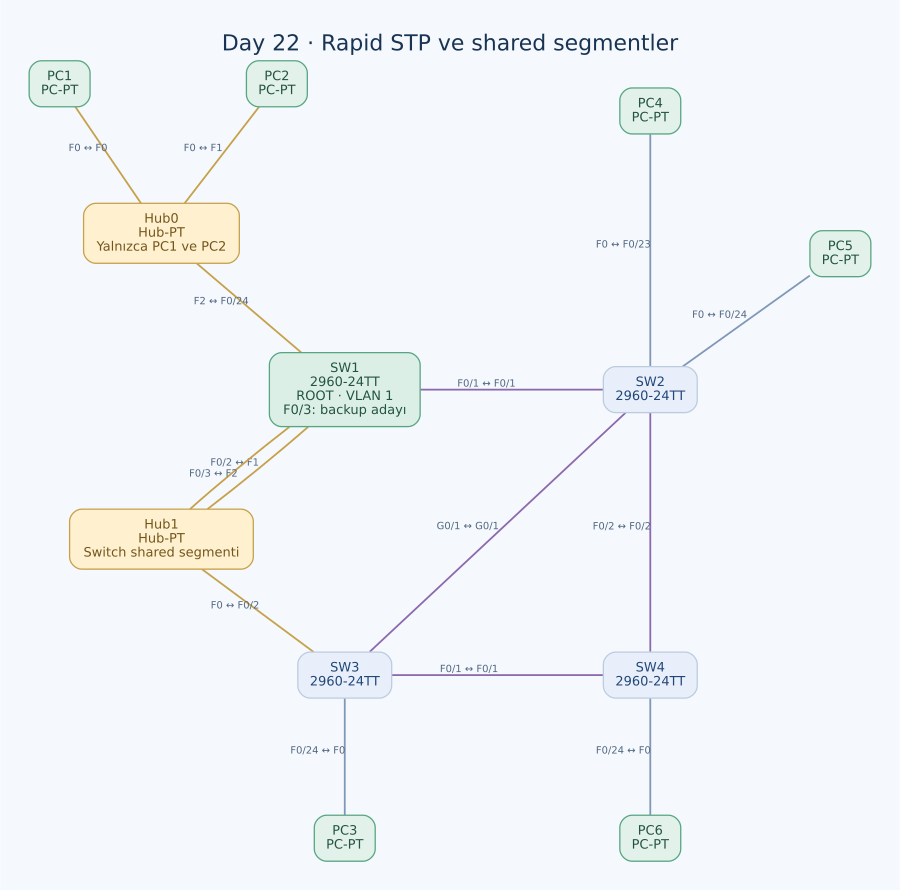

# Day 22 — Rapid STP, Shared Segmentler ve Backup Port

Bu labda Rapid PVST+ çalışan dört switch'i, iki hub'ı ve altı PC'yi inceledim. Root bridge üzerinde bile discarding durumunda bir port bulunabileceğini, aynı shared segmente iki bağlantı üzerinden gördüm. Ardından point-to-point, shared ve edge ayrımını portların gerçekten neye bağlı olduğuna göre değerlendirdim.

| Alan | Açıklama |
| --- | --- |
| Lab dosyası | [Day 22 Lab - Rapid STP.pkt](../../Day%2022%20Lab%20-%20Rapid%20STP.pkt) |
| Konu | RSTP rolleri, alternate/backup, link type ve PortFast |
| Ortam | Cisco Packet Tracer 9.0.1 |
| Cihazlar | Dört Cisco 2960-24TT, iki Hub-PT ve altı PC |
| STP modu / VLAN | Rapid PVST+ / VLAN 1 |

## Amaç

Önce root bridge'i ve bütün bağlı switch portlarının rollerini belirledim. Sonra arayüzlerin link type ayarlarını inceledim. Bu çalışma IP erişiminden çok STP davranışına odaklanıyor; PC'lerde atanmış IPv4/gateway bilgisi yok.

## Topoloji



| Birinci uç | İkinci uç | Kablo / işlev |
| --- | --- | --- |
| SW1 F0/1 | SW2 F0/1 | Crossover, doğrudan switch bağlantısı |
| SW3 F0/1 | SW4 F0/1 | Crossover, doğrudan switch bağlantısı |
| SW4 F0/2 | SW2 F0/2 | Crossover, doğrudan switch bağlantısı |
| SW3 G0/1 | SW2 G0/1 | Crossover, GigabitEthernet bağlantısı |
| SW3 F0/2 | Hub1 F0 | Crossover, shared segment |
| SW1 F0/2 | Hub1 F1 | Crossover, aynı shared segment |
| SW1 F0/3 | Hub1 F2 | Crossover, aynı shared segmente ikinci bağlantı |
| SW1 F0/24 | Hub0 F2 | Crossover, PC'lere giden hub |
| PC1 F0 | Hub0 F0 | Straight-through |
| PC2 F0 | Hub0 F1 | Straight-through |
| SW3 F0/24 | PC3 F0 | Straight-through |
| SW2 F0/23 | PC4 F0 | Straight-through |
| SW2 F0/24 | PC5 F0 | Straight-through |
| SW4 F0/24 | PC6 F0 | Straight-through |

Hub1, üç switch portunu **tek bir Ethernet segmentine** bağlıyor. Hub, çerçeveleri MAC adresine göre seçmez ve STP'ye bridge olarak katılmaz. Hub0 ise yalnızca PC1 ve PC2'nin SW1'e erişmesini sağlıyor. İki hub'ın port sayısına bakarak aynı edge kararını vermek doğru değil; arkalarında başka bir bridge bulunup bulunmadığı önemli.

## Root bridge seçimi

Dört switch'in taban priority'si 32768, VLAN 1 ile görülen değeri 32769. Seçim MAC adresiyle çözülüyor:

| Switch | Bridge MAC | Sonuç |
| --- | --- | --- |
| SW1 | `0005.5E4E.714B` | En küçük Bridge ID; root |
| SW3 | `000C.8519.6EBA` | Non-root |
| SW2 | `00D0.5882.4834` | Non-root |
| SW4 | `00E0.A381.AD46` | Non-root |

Bütün switch'lerde aşağıdaki mod mevcut:

```text
spanning-tree mode rapid-pvst
spanning-tree extend system-id
```

Rapid PVST+, her VLAN için RSTP davranışı sunuyor. Bu dosyada incelenen kullanıcı VLAN'ı 1; önceki labın VLAN 2 root ayarları burada yok.

## Root üzerindeki backup port

SW1 F0/2 ve F0/3, Hub1 üzerinden aynı segmente bağlı. İki port da aynı root bridge'e ait olduğundan root ID, path cost ve gönderen bridge ID eşit. Varsayılan port priority ile F0/2'nin port ID'si daha küçük.

Bu segmentte SW1 F0/2'nin designated/forwarding, F0/3'ün **backup/discarding** olması beklenir. F0/3, kendi bridge'inden daha iyi bir BPDU duyduğu için yedek kalır. Root bridge'in root portu yoktur; fakat bu, aynı shared segmente bağlı her portunun designated olmak zorunda olduğu anlamına gelmez.

| Rol | Yedeklediği ilişki |
| --- | --- |
| Alternate | Başka bir bridge üzerinden root'a alternatif yol |
| Backup | Aynı bridge'in aynı segmente olan diğer bağlantısı |

Bu nedenle SW1 F0/3'ü alternate diye adlandırmak, aynı segmentteki yerel bağlantı tekrarını gözden kaçırır.

## Yol maliyetleri ve beklenen roller

Hesapta standart kısa maliyetleri kullandım: FastEthernet 19, GigabitEthernet 4. Hub1 kendi başına bir bridge maliyeti eklemiyor; SW3'ün shared segmente bağlı F0/2 arayüzünün maliyeti hesaba giriyor.

| Switch | Root'a en iyi yol | Maliyet | Root port |
| --- | --- | --- | --- |
| SW1 | Root | 0 | Yok |
| SW2 | SW1'e doğrudan | 19 | F0/1 |
| SW3 | Hub1 üzerinden SW1 | 19 | F0/2 |
| SW4 | SW3 üzerinden SW1 | 38 | F0/1 |

SW3'ün SW2 üzerinden Gigabit yolunun toplamı 4 + 19 = 23; Hub1 tarafındaki 19'dan daha büyük. Hızlı bir yerel portun bulunması tek başına en iyi toplam yolu garanti etmiyor.

SW4'ün SW2 ve SW3 üzerinden aday yolları 38 ile eşit. Gönderen bridge ID karşılaştırmasında SW3'ün MAC adresi SW2'ninkinden küçük olduğu için SW3'e bakan F0/1 tercih edilir. SW2–SW3 Gigabit segmentinde de root maliyetleri 19 ile eşit; designated taraf yine SW3 olur.

| Switch | Port / karşı uç | Beklenen rol | Kararlı durum |
| --- | --- | --- | --- |
| SW1 | F0/1 → SW2 | Designated | Forwarding |
| SW1 | F0/2 → Hub1 | Designated | Forwarding |
| SW1 | F0/3 → Hub1 | Backup | Discarding |
| SW1 | F0/24 → Hub0 | Designated, uç segment | Forwarding |
| SW2 | F0/1 → SW1 | Root | Forwarding |
| SW2 | F0/2 → SW4 | Designated | Forwarding |
| SW2 | G0/1 → SW3 | Alternate | Discarding |
| SW2 | F0/23 → PC4 | Designated, edge | Forwarding |
| SW2 | F0/24 → PC5 | Designated, edge | Forwarding |
| SW3 | F0/1 → SW4 | Designated | Forwarding |
| SW3 | F0/2 → Hub1 | Root | Forwarding |
| SW3 | G0/1 → SW2 | Designated | Forwarding |
| SW3 | F0/24 → PC3 | Designated, edge | Forwarding |
| SW4 | F0/1 → SW3 | Root | Forwarding |
| SW4 | F0/2 → SW2 | Alternate | Discarding |
| SW4 | F0/24 → PC6 | Designated, edge | Forwarding |

Bu tablo maliyet ve Bridge ID hesabıyla beklenen kararlı sonucu gösteriyor. Tam canlı `show spanning-tree` çıktısı saklanmış değil. CLI'de görülebilecek `BLK` kısaltması, RSTP'nin discarding durumuyla birlikte yorumlanmalı.

## Link type ile edge birbirinden farklı

| Özellik | Belirlediği konu | Bu labdaki örnek |
| --- | --- | --- |
| Point-to-point | İki bridge arasındaki doğrudan, full-duplex ilişki | SW1–SW2 |
| Shared | Birden çok katılımcının paylaştığı ortam | Hub1 bağlantıları |
| Edge / PortFast | Portun arkasında STP'ye katılan bridge beklenmemesi | PC portları |

RSTP, link type'ı normalde duplex bilgisinden çıkarır: full-duplex için point-to-point, half-duplex için shared. Elle yazılmış bir link-type satırının olmaması, link type'ın belirlenemediği anlamına gelmez.

**SW1 F0/24 için shared ortam ve edge kullanımını ayrı değerlendiriyorum.** Hub0 tarafında yalnızca iki PC bulunduğu sürece burası başka bridge'e giden bir ağ bağlantısı değil. PortFast uç segment mantığıyla kullanılabilir; hub ortamını point-to-point olarak tanımlamak ise doğru olmaz. Hub0'a başka bir switch bağlanırsa bu kabul yeniden gözden geçirilmeli.

## Uyguladığım ayarlar ve kalan düzeltme

SW1'in son port ayarları:

```text
interface FastEthernet0/1
 spanning-tree portfast
 spanning-tree link-type point-to-point
!
interface range FastEthernet0/2 - 3
 spanning-tree portfast
 spanning-tree link-type shared
!
interface FastEthernet0/24
 spanning-tree portfast
```

SW3'te F0/1 ve G0/1 point-to-point, F0/2 shared olarak yazılmış; PC3'e giden F0/24 PortFast. SW2 F0/23–24 ve SW4 F0/24 de PortFast. SW4 F0/23'te `spanning-tree portfast disable` var; ancak bu portta kablo yok. PC6'nın portu F0/24.

### SW1 F0/1–3'te PortFast fazla geniş uygulanmış

Bu üç port PC'lere gitmiyor: F0/1 doğrudan SW2'ye, F0/2–3 ise SW3'ün de bulunduğu Hub1 segmentine bağlı. Son konfigürasyonda PortFast satırları kalmış olsa da bu bağlantıları uç port kabul etmek doğru değil.

RSTP, BPDU alınca operational edge niteliğini kaybedebilir; bu davranış, yanlış yönetimsel PortFast ayarını uygun bir tasarım hâline getirmiyor. Düzeltilmesi gereken kapsam:

```text
! Önerilen düzeltme; son dosyada uygulanmış değil.
interface range FastEthernet0/1 - 3
 no spanning-tree portfast
!
interface FastEthernet0/24
 spanning-tree link-type shared
```

SW1 F0/24'teki shared satırı, mevcut hub ortamını açıkça belgelemek için. Son dosyada bu satır yok; link type varsayılan duplex çıkarımına bırakılmış.

### Diğer switch'lerde açık link type

SW2 ve SW4'ün doğrudan switch bağlantılarında elle yazılmış point-to-point satırları yok. Full-duplex varsayılan çıkarımı bu bağlantılar için uygun olabilir; görevdeki elle yapılandırma adımını görünür biçimde tamamlamak için:

```text
! SW2 — tamamlama önerisi
interface range FastEthernet0/1 - 2, GigabitEthernet0/1
 spanning-tree link-type point-to-point
!
! SW4 — tamamlama önerisi
interface range FastEthernet0/1 - 2
 spanning-tree link-type point-to-point
```

Link type'ı değiştirmek, gerçek shared bir ortama full-duplex veya iki uçlu fiziksel özellik kazandırmaz. Komutun ortamla uyumlu olması gerekir.

## RSTP'nin hızlanma mantığı

RSTP'de discarding, learning ve forwarding durumlarını; root, designated, alternate ve backup rollerinden ayrı okuyorum. Point-to-point bridge bağlantılarında proposal/agreement mekanizması güvenli geçişi hızlandırabilir. Shared segmentte aynı iki taraflı anlaşma varsayımı kullanılamaz; sırf `rapid-pvst` seçmek bütün portları aynı biçimde hızlandırmaz.

Bu çalışmada yakınsama süresi ölçülmedi. Dolayısıyla belirli bir saniye veya milisaniye sonucu çıkarmadım.

## Kontroller ve kalıcılık

```text
show spanning-tree vlan 1
show spanning-tree interface FastEthernet0/3 detail
show spanning-tree interface FastEthernet0/24 detail
show interfaces FastEthernet0/24
show spanning-tree summary
```

Özellikle root üzerindeki backup portu, shared/point-to-point bilgisini, administrative ve operational edge farkını kontrol etmek gerekiyor. PortFast'ı kapatmak için yazdığım komutun doğru arayüze uygulandığını da port numarasıyla karşılaştırıyorum.

Rapid PVST+ modu başlangıç konfigürasyonlarında mevcut. Son link-type ve PortFast değişiklikleri ise dört switch'in startup-config kayıtlarına aktarılmamış. Hatalı PortFast kapsamı düzeltildikten ve roller doğrulandıktan sonra son ayarlar kaydedilmeli.

## Öğrendiklerim

- Root bridge'de root port bulunmamasıyla bütün portların designated olması iddiasını ayırdım.
- Aynı bridge'in aynı shared segmente ikinci bağlantısının backup olabileceğini gördüm.
- Alternate ve backup rollerinin farklı yedeklilik türleri olduğunu öğrendim.
- Link type ile edge bilgisini birbirinin yerine kullanmamayı çalıştım.
- PortFast arayüz aralığını seçerken bağlantıların arkasındaki cihazları kontrol etmem gerektiğini fark ettim.

## Sonuç

SW1'i root olarak belirledim ve Hub1'e bağlı ikinci SW1 portunun neden backup kalacağını hesapladım. RSTP'nin shared segmentteki davranışını doğrudan switch ve PC bağlantılarıyla karşılaştırdım. SW1'in ağ portlarındaki PortFast satırlarının kaldırılması, elle link-type adımının tamamlanması ve konfigürasyonların kaydedilmesi açık kalan bölümler.

## Kaynak

- [Cisco — Rapid Spanning Tree Protocol: roller, edge ve link type](https://www.cisco.com/c/en/us/support/docs/lan-switching/spanning-tree-protocol/24062-146.html)

[Önceki lab](day-21-configuring-spanning-tree.md) · [Lab kataloğu](../../README.md) · [Sonraki lab: EtherChannel](day-23-etherchannel.md)
