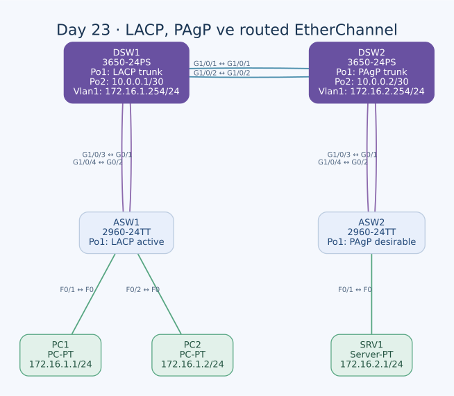

# Day 23 — LACP, PAgP ve Layer 3 EtherChannel

Bu labda iki fiziksel bağlantıyı tek mantıksal arayüz altında topladım. ASW1–DSW1 arasında LACP, ASW2–DSW2 arasında PAgP kullandım; DSW1–DSW2 arasında ise protokol görüşmesi olmadan statik Layer 3 EtherChannel oluşturdum. Son olarak iki LAN arasına statik rotalar ekledim ve yük dağıtımı ayarlarını karşılaştırdım.

| Alan | Açıklama |
| --- | --- |
| Lab dosyası | [Day 23 Lab - EtherChannel.pkt](../../Day%2023%20Lab%20-%20EtherChannel.pkt) |
| Konu | LACP, PAgP, statik EtherChannel, routed Port-channel ve hashing |
| Ortam | Cisco Packet Tracer 9.0.1 |
| Cihazlar | İki 2960-24TT, iki 3650-24PS, iki PC ve bir sunucu |
| Mantıksal bağlantılar | İki Layer 2 trunk Port-channel1, bir Layer 3 Port-channel2 |

## Amaç

Birbirinden bağımsız iki kabloyu STP'ye ayrı yollar olarak bırakmak yerine EtherChannel altında topladım. LACP ve PAgP'nin görüşmeli modlarıyla statik `on` modunu ayırdım. Layer 2 kanallarda VLAN çerçevelerini taşırken, dağıtım switch'leri arasındaki kanalı IP adresli bir yönlendirme bağlantısı olarak kullandım.

## Fiziksel ve mantıksal topoloji



| Fiziksel uçlar | Kanal | Tür / mod |
| --- | --- | --- |
| ASW1 G0/1 ↔ DSW1 G1/0/3 | Her iki uçta Po1 | L2 trunk, LACP active/active |
| ASW1 G0/2 ↔ DSW1 G1/0/4 | Aynı Po1'in ikinci üyesi | L2 trunk, LACP |
| ASW2 G0/1 ↔ DSW2 G1/0/3 | Her iki uçta Po1 | L2 trunk, PAgP desirable/desirable |
| ASW2 G0/2 ↔ DSW2 G1/0/4 | Aynı Po1'in ikinci üyesi | L2 trunk, PAgP |
| DSW1 G1/0/1 ↔ DSW2 G1/0/1 | Her iki uçta Po2 | L3, statik on/on |
| DSW1 G1/0/2 ↔ DSW2 G1/0/2 | Aynı Po2'nin ikinci üyesi | L3, statik |
| PC1 F0 ↔ ASW1 F0/1 | — | Access VLAN 1 |
| PC2 F0 ↔ ASW1 F0/2 | — | Access VLAN 1 |
| SRV1 F0 ↔ ASW2 F0/1 | — | Access VLAN 1 |

Altı switch bağlantısı crossover, üç uç cihaz bağlantısı straight-through. Port-channel numarası cihaz içinde anlamlıdır; bütün ağ için tek bir global kanal numarası değildir. Burada iki ayrı erişim bağlantısında Po1 adını kullanmam çakışma oluşturmuyor.

## Adres planı

| Cihaz / arayüz | IPv4 / prefix | Gateway veya rol |
| --- | --- | --- |
| PC1 | `172.16.1.1/24` | `172.16.1.254` |
| PC2 | `172.16.1.2/24` | `172.16.1.254` |
| DSW1 Vlan1 | `172.16.1.254/24` | Birinci LAN gateway'i |
| DSW1 Port-channel2 | `10.0.0.1/30` | DSW2'ye transit |
| DSW2 Port-channel2 | `10.0.0.2/30` | DSW1'e transit |
| DSW2 Vlan1 | `172.16.2.254/24` | İkinci LAN gateway'i |
| SRV1 | `172.16.2.1/24` | `172.16.2.254` |

Uç ve SVI adresleri labın başlangıcında hazır. Transit ağ `10.0.0.0/30`; `.1` ve `.2` kullanılabilir, `.3` broadcast.

İki tarafta da VLAN 1 kullanılıyor ama bu iki LAN birbirine Layer 2 trunk ile bağlanmıyor. Aradaki Po2 routed port. Dolayısıyla aynı VLAN numarasına rağmen iki ayrı broadcast alanı ve iki ayrı `/24` bulunuyor.

## LACP — ASW1 ve DSW1

ASW1:

```text
interface range GigabitEthernet0/1 - 2
 switchport mode trunk
 channel-group 1 mode active
!
interface Port-channel1
 switchport mode trunk
```

DSW1:

```text
interface range GigabitEthernet1/0/3 - 4
 switchport mode trunk
 channel-group 1 mode active
!
interface Port-channel1
 switchport mode trunk
```

`active`, LACP görüşmesini başlatır; iki ucun da active olması geçerli. LACP'de passive taraf yanıt verebilir, ancak passive/passive eşleşmesinde başlatan taraf bulunmaz.

Po1, Layer 2 trunk olarak yapılandırılmış. Kullanılan VLAN üyeliği, trunk modu, hız/duplex ve diğer kanal uyumluluk koşullarının fiziksel üyelerde tutarlı olması gerekir. Bir portu aynı gruba yazmak, her koşulda başarıyla bundle'a katıldığını tek başına kanıtlamaz.

## PAgP — ASW2 ve DSW2

ASW2:

```text
interface range GigabitEthernet0/1 - 2
 switchport mode trunk
 channel-group 1 mode desirable
!
interface Port-channel1
 switchport mode trunk
```

DSW2:

```text
interface range GigabitEthernet1/0/3 - 4
 switchport mode trunk
 channel-group 1 mode desirable
!
interface Port-channel1
 switchport mode trunk
```

`desirable`, PAgP görüşmesini başlatır. Desirable/desirable geçerli; PAgP'nin pasif tarafı `auto`. Bu isimleri LACP'nin active/passive modlarıyla karıştırmamak gerekiyor.

| Mekanizma | Başlatan mod | Yanıtlayan mod | İki taraf pasifse |
| --- | --- | --- | --- |
| LACP | active | passive | Kanal görüşmesi başlamaz |
| PAgP | desirable | auto | Kanal görüşmesi başlamaz |
| Statik | on | on | Görüşme protokolü kullanılmaz |

LACP active ile PAgP desirable birbirinin karşılığı olarak aynı linkte eşleştirilemez; bunlar farklı protokoller.

## Layer 3 statik EtherChannel

DSW1'in son ilgili ayarları:

```text
interface range GigabitEthernet1/0/1 - 2
 no switchport
 no ip address
 channel-group 2 mode on
!
interface Port-channel2
 no switchport
 ip address 10.0.0.1 255.255.255.252
!
ip routing
```

DSW2:

```text
interface range GigabitEthernet1/0/1 - 2
 no switchport
 no ip address
 channel-group 2 mode on
!
interface Port-channel2
 no switchport
 ip address 10.0.0.2 255.255.255.252
!
ip routing
```

IP adresini fiziksel üyelere ayrı ayrı değil **mantıksal Po2 arayüzüne** verdim. `no switchport` kanalın ve üyelerin Layer 3 olmasını sağlıyor. `ip routing`, dağıtım switch'lerinin bağlı ağlar arasında IP iletmesini etkinleştiriyor.

Statik `on` modunda LACP/PAgP komşuluk kontrolü yok. Bu yüzden doğru kablolama ve karşı uç uyumu özellikle önemli; yalnızca yerel `channel-group` satırına bakarak karşı tarafın doğru bağlandığını varsaymıyorum.

### DSW1'de kanalı yeniden oluşturma

İlk denemede G1/0/1–2'yi kanal grubuna ekledikten sonra Layer 3 dönüşümünü düzenlemeye çalıştım. Ardından üyelikleri kaldırıp Po2'yi sildim; fiziksel portları önce routed moda getirerek kanalı yeniden oluşturdum:

```text
interface range GigabitEthernet1/0/1 - 2
 no channel-group 2
exit
no interface Port-channel2
interface range GigabitEthernet1/0/1 - 2
 no switchport
 no shutdown
 channel-group 2 mode on
```

Bu sıra son ayarın nasıl oluştuğunu açıklıyor. Yeniden oluşturma komutlarını normal kurulum için her seferinde gerekli bir işlem gibi düşünmüyorum; burada önceki denemeyi temizlemek için kullandım.

## SVI ve yönlendirme

DSW1:

```text
interface Vlan1
 ip address 172.16.1.254 255.255.255.0
!
ip route 172.16.2.0 255.255.255.0 10.0.0.2
```

DSW2:

```text
interface Vlan1
 ip address 172.16.2.254 255.255.255.0
!
ip route 172.16.1.0 255.255.255.0 10.0.0.1
```

PC1, SRV1'e giderken hedefi kendi `/24` ağı dışında görür ve DSW1'in `.254` gateway'ini kullanır. DSW1, statik rota üzerinden Po2 ile DSW2'ye yönlendirir. DSW2, sunucunun yerel LAN'ına iletir. Yanıtın dönmesi için DSW2'deki `172.16.1.0/24` rotası da gerekir.

DSW2'de ilk rota denemesinde ağ adresini `172.16.1` olarak eksik yazdım; son satır `172.16.1.0 255.255.255.0 10.0.0.1` şeklinde düzeltilmiş.

## EtherChannel ve STP sınırı

Layer 2 EtherChannel'da STP, başarılı şekilde birleşmiş üyeleri ayrı yedek yollar yerine tek mantıksal Port-channel olarak değerlendirir. Ancak Po2 Layer 3 olduğundan iki LAN'ın STP ağaçlarını birleştirmez.

DSW1'de VLAN 1 priority 24576, DSW2'de 20480. DSW2'nin sayısal olarak daha düşük priority'si olması, routed bağlantının diğer tarafındaki DSW1 LAN'ının da root'u olacağı anlamına gelmiyor. BPDU'lar burada IP yönlendirmesiyle taşınmıyor.

## Yük dağıtımı

Görev, varsayılan yöntemi inceleyip source ve destination IP'ye göre dağıtıma geçmeyi istiyor. Bu Catalyst ailelerinin dokümante edilen varsayılanı `src-mac`; gerçek cihaz durumu için `show etherchannel load-balance` kullanılmalı.

Denediğim global komut:

```text
port-channel load-balance src-dst-ip
```

| Cihaz | Son konfigürasyonda durum |
| --- | --- |
| DSW1 | `port-channel load-balance src-dst-ip` mevcut |
| DSW2 | `port-channel load-balance src-dst-ip` mevcut |
| ASW1 | Komut denemesi var; son running-config'te bu satır yok |
| ASW2 | Komut denemesi var; son running-config'te bu satır yok |

Bu nedenle dört switch'in tamamında IP tabanlı dağıtımın doğrulandığını söylemiyorum. ASW1 ve ASW2'nin gerçek seçimi ayrıca `show etherchannel load-balance` ile kontrol edilmeli; gerekiyorsa desteklenen seçenek uygulanıp yeniden doğrulanmalı. Tam hata veya doğrulama çıktısı saklanmış değil.

Dağıtım paketleri sırayla iki porta bölmek anlamına gelmiyor. Aynı kaynak/hedef IP çiftinin hash sonucu aynı üyeyi seçebilir; farklı çiftler başka üyelere dağılabilir. Bu yüzden iki kablo, tek bir PC–sunucu aktarımının otomatik olarak iki kat hızlanacağı anlamına gelmez. Bu labda throughput veya dağılım oranı ölçmedim.

## Kontroller

| Komut | İncelediğim bilgi |
| --- | --- |
| `show etherchannel summary` | Po1/Po2, L2/L3 niteliği, kullanılan ve bundle'a katılan üyeler |
| `show lacp neighbor` | ASW1–DSW1 LACP komşuları |
| `show pagp neighbor` | ASW2–DSW2 PAgP komşuları |
| `show interfaces trunk` | Po1'in operasyonel trunk olması |
| `show ip interface brief` | SVI ve Po2 adres/durumları |
| `show ip route` | İki LAN arasındaki bağlı ve statik rotalar |
| `show etherchannel load-balance` | Cihazın gerçekten kullandığı hash yöntemi |

`show etherchannel summary` içindeki `S` Layer 2'yi, `R` Layer 3'ü, `U` kullanımda olmayı ve fiziksel üyedeki `P` bundle'a katılımı ifade edebilir. Bunları burada alınmış bir çıktı satırı olarak üretmedim.

DSW2'den `do ping 10.0.0.1` denemesi var. Bu denemenin tam yanıtları ve PC–SRV1 erişim sonuçları saklanmadığı için başarı yüzdesi vermedim. Bir fiziksel üyeyi kapatarak kalan üyenin çalışmasını kontrol etmek de yedeklilik için yararlı bir ek doğrulama; yapılmış ölçüm olarak kaydetmedim.

## Kalıcılık

Dört switch'te son kanal üyelikleri ve Port-channel arayüzleri startup-config'e aktarılmamış. DSW1/DSW2'de IP routing, transit adresleri, statik rotalar ve son yük dağıtım ayarı da yeni çalışma konfigürasyonunda. Başlangıçtaki SVI adreslerinin kayıtlı olması, son EtherChannel tasarımının kaydedildiğini göstermiyor.

Kanal üyeleri, uç erişimi ve ASW yük dağıtımı doğrulandıktan sonra dört cihazda `copy running-config startup-config` ile kayıt tamamlanmalı.

## Öğrendiklerim

- LACP active/passive ile PAgP desirable/auto modlarını ayırdım.
- Layer 2 trunk kanal ile IP adresli Layer 3 kanalı aynı topolojide uyguladım.
- Routed kanalın IP'sini üyeler yerine Port-channel üzerine verdim.
- Statik `on` modunda protokol görüşmesi bulunmadığını gördüm.
- İki LAN arasında gidiş ve dönüş rotalarının birlikte gerektiğini uyguladım.
- Hash tabanlı dağıtımın tek akış için iki kat bant genişliği garantisi olmadığını öğrendim.

## Sonuç

İki erişim hattını LACP/PAgP trunk kanalları, dağıtım switch'leri arasını statik Layer 3 kanal olarak yapılandırdım. LAN'lar arasına karşılıklı statik rotalar ekledim. ASW1/ASW2 yük dağıtımının doğrulanması, uçtan uca erişim ve üye kaybı testlerinin sonuçlandırılması, ardından son ayarların kaydedilmesi açık kalan adımlar.

## Kaynaklar

- [Cisco — Catalyst 2960 EtherChannel, LACP, PAgP ve yük dağıtımı](https://www.cisco.com/c/en/us/td/docs/switches/lan/catalyst2960/software/release/12-2_58_se/configuration/guide/2960scg/swethchl.html)
- [Cisco — Catalyst 3650 Layer 2 ve Layer 3 EtherChannel](https://www.cisco.com/c/en/us/td/docs/switches/lan/catalyst3650/software/release/3e/consolidated_guide/configuration_guide/b_consolidated_3650_3e_cg/b_consolidated_3650_3e_cg_chapter_0111101.html)

[Önceki lab](day-22-rapid-stp.md) · [Lab kataloğu](../../README.md) · [Sonraki lab: Floating Static Routes](day-24-floating-static-routes.md)
