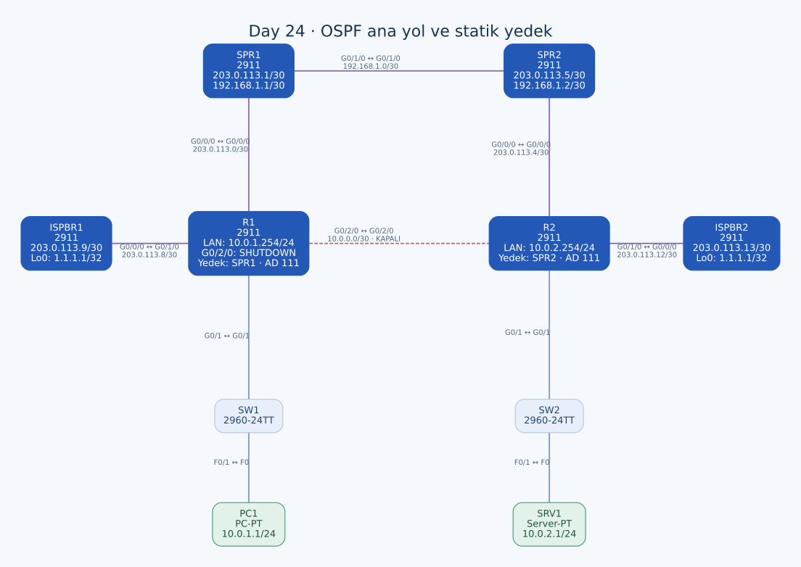

# Day 24 — OSPF için Floating Static Route ile Yedek Yol

Bu labda iki kurumsal LAN arasındaki doğrudan OSPF yoluna sağlayıcı üzerinden statik bir yedek ekledim. OSPF rotası varken yedeğin neden tercih edilmediğini administrative distance üzerinden değerlendirdim; ardından R1'in doğrudan bağlantısını shutdown yaparak arıza senaryosuna geçtim. Bir rotanın konfigürasyonda yazılı olmasıyla routing table'a gerçekten alınmasının farklı şeyler olduğunu özellikle takip ettim.

| Alan | Açıklama |
| --- | --- |
| Lab dosyası | [Day 24 Lab - Floating Static Routes.pkt](../../Day%2024%20Lab%20-%20Floating%20Static%20Routes.pkt) |
| Konu | OSPF, administrative distance, longest prefix match ve statik yedek yol |
| Ortam | Cisco Packet Tracer 9.0.1 |
| Cihazlar | Altı Cisco 2911, iki 2960-24TT, bir PC ve bir sunucu |
| Birincil / yedek yol | R1–R2 doğrudan bağlantısı / SPR1–SPR2 üzerinden sağlayıcı yolu |
| Son test durumu | R1 G0/2/0 shutdown |

## Amaç

PC1'in SRV1'e normalde doğrudan R1–R2 bağlantısından ulaşması, bu yol kesildiğinde ise SPR1 ve SPR2 üzerinden devam etmesi isteniyor. Ayrıca `1.1.1.1` hedefiyle default route kullanımını karşılaştırıyorum.

Bu topolojide SPR1/SPR2 kurumsal ağlar için yedek taşıma yolunu, ISPBR1/ISPBR2 ise ayrı dış ağ hedeflerini temsil ediyor. Bunlar aynı bağlantı zinciri değil.

## Topoloji



| Birinci uç | İkinci uç | Ağ / kablo |
| --- | --- | --- |
| R1 G0/2/0 | R2 G0/2/0 | `10.0.0.0/30`, single-mode fiber |
| R1 G0/0/0 | SPR1 G0/0/0 | `203.0.113.0/30`, single-mode fiber |
| SPR1 G0/1/0 | SPR2 G0/1/0 | `192.168.1.0/30`, single-mode fiber |
| SPR2 G0/0/0 | R2 G0/0/0 | `203.0.113.4/30`, single-mode fiber |
| R1 G0/1/0 | ISPBR1 G0/0/0 | `203.0.113.8/30`, single-mode fiber |
| R2 G0/1/0 | ISPBR2 G0/0/0 | `203.0.113.12/30`, single-mode fiber |
| R1 G0/1 | SW1 G0/1 | LAN1, straight-through |
| SW1 F0/1 | PC1 F0 | LAN1, straight-through |
| R2 G0/1 | SW2 G0/1 | LAN2, straight-through |
| SW2 F0/1 | SRV1 F0 | LAN2, straight-through |

Altı fiber ve dört bakır bağlantı bulunuyor. R1 G0/2/0 son konfigürasyonda shutdown olsa da kablo fiziksel topolojide duruyor. Kablonun mevcut olması arayüzün idari olarak açık olduğu anlamına gelmiyor.

## Adres planı

| Cihaz / arayüz | IPv4 / prefix | Karşı uç veya işlev |
| --- | --- | --- |
| PC1 | `10.0.1.1/24` | Gateway `10.0.1.254` |
| R1 G0/1 | `10.0.1.254/24` | PC LAN'ı |
| R1 G0/2/0 | `10.0.0.1/30` | R2 `.2`; son durumda shutdown |
| R2 G0/2/0 | `10.0.0.2/30` | R1 `.1` |
| R1 G0/0/0 | `203.0.113.2/30` | SPR1 `.1` |
| SPR1 G0/0/0 | `203.0.113.1/30` | R1 `.2` |
| SPR1 G0/1/0 | `192.168.1.1/30` | SPR2 `.2` |
| SPR2 G0/1/0 | `192.168.1.2/30` | SPR1 `.1` |
| SPR2 G0/0/0 | `203.0.113.5/30` | R2 `.6` |
| R2 G0/0/0 | `203.0.113.6/30` | SPR2 `.5` |
| R2 G0/1 | `10.0.2.254/24` | Sunucu LAN'ı |
| SRV1 | `10.0.2.1/24` | Gateway `10.0.2.254` |
| R1 G0/1/0 | `203.0.113.10/30` | ISPBR1 `.9` |
| ISPBR1 G0/0/0 | `203.0.113.9/30` | R1 `.10` |
| R2 G0/1/0 | `203.0.113.14/30` | ISPBR2 `.13` |
| ISPBR2 G0/0/0 | `203.0.113.13/30` | R2 `.14` |

ISPBR1 ve ISPBR2'nin her birinde Loopback0 `1.1.1.1/32`, Loopback1 `2.2.2.2/32`. Bu iki router birbirine bağlı değil; aynı hedef adresleri iki ayrı simüle dış ağda kullanılıyor. Bu nedenle `1.1.1.1` denemesini gerçek internet erişimi gibi yorumlamıyorum.

## Mevcut dinamik yönlendirme

R1 ve R2'de OSPF process 1 var:

```text
router ospf 1
 log-adjacency-changes
 network 10.0.0.0 0.255.255.255 area 0
```

Wildcard `0.255.255.255`, ilk okteti 10 olan arayüz adreslerini kapsıyor. Böylece doğrudan `10.0.0.0/30` bağlantısı ve iki router'ın yerel `10.0.x.0/24` LAN'ları OSPF kapsamına giriyor. Sağlayıcı tarafındaki 203.0.113 adresleri bu satırla OSPF'ye dahil edilmiyor.

Normal bağlantı ve OSPF komşuluğu çalıştığında R1'in uzak `10.0.2.0/24` ağını R2 üzerinden, R2'nin `10.0.1.0/24` ağını R1 üzerinden öğrenmesi beklenir. Routing table'da OSPF rotasının kodu `O`, varsayılan administrative distance değeri 110'dur.

## SRV1 ve dış ağ hedefi neden farklı yollar kullanıyor?

R1'in mevcut default route'u:

```text
ip route 0.0.0.0 0.0.0.0 203.0.113.9
```

R2'nin default route'u:

```text
ip route 0.0.0.0 0.0.0.0 203.0.113.13
```

| PC1'in hedefi | Normal durumda beklenen karar |
| --- | --- |
| SRV1 `10.0.2.1` | R1'de daha özel `10.0.2.0/24` OSPF rotası, doğrudan R2 yönü |
| `1.1.1.1` | Daha özel bir rota yoksa R1 default'u, ISPBR1 yönü |

Default statik rotanın AD'sinin 1 olması, onu her hedef için OSPF'den üstün yapmıyor. AD, **aynı prefix için** aday rota kaynaklarını karşılaştırıyor. Kurulmuş routing table üzerinden paket iletirken hedefle eşleşen en uzun prefix seçiliyor; `/24`, `/0` default'tan daha özel.

Bu ayrım, yedek `/24` için de geçerli. Floating static rota devreye girerse AD'si 111 olsa bile eşleşen `/24`, dış ağa giden default'tan daha özel kalır.

## Floating static route ayarları

OSPF'nin 110 değerinden daha büyük olacak şekilde 111 kullandım. Normal statik rotanın varsayılan 1 değeriyle bırakılması, aynı prefix'te OSPF'nin önüne geçmesine neden olurdu.

R1'de istenen sağlayıcı yedeği:

```text
ip route 10.0.2.0 255.255.255.0 203.0.113.1 111
```

R2'de dönüş yedeği:

```text
ip route 10.0.1.0 255.255.255.0 203.0.113.5 111
```

Her iki next hop da ilgili router'ın sağlayıcıya doğrudan bağlı komşusu. R2'de önce AD belirtmeden bir statik rota denedim; son konfigürasyonda bu prefix için 111 değerli satır kalmış.

Floating route'un kullanılabilmesi için yalnızca AD'nin büyük olması yeterli değil. Next hop'un çözümlenebilmesi, bağlantıların çalışması ve dönüş yolunun bulunması da gerekiyor. OSPF rotası varken statik satırın running-config'te bulunup aktif routing table'da görünmemesi normal olabilir.

## R1'de kalan yanlış next-hop denemesi

R1'in son konfigürasyonunda doğru `.1` satırının yanında şu satır da var:

```text
ip route 10.0.2.0 255.255.255.0 203.0.113.5 111
```

`.5`, SPR2'nin **R2 tarafındaki** adresi. R1'in doğrudan sağlayıcı komşusu `.1`; `.5` değil. R1'in `.5` adresini içeren `203.0.113.4/30` ağına doğrudan bağlı bir arayüzü yok.

Doğru satırı eklemek eski satırı otomatik silmemiş. Bu iki satırı bilinçli tasarlanmış iki eşdeğer yedek yol gibi kabul etmiyorum. Uzak next hop kullanılan statik rotanın geçerliliği ayrıca recursive çözümlemeye bağlı; son canlı routing table olmadan eski satırın gerçekten kurulup kurulmadığını iddia etmiyorum.

Konfigürasyonda tamamlanması gereken temizlik:

```text
! Önerilen düzeltme; eski .5 satırı son dosyada hâlâ var.
no ip route 10.0.2.0 255.255.255.0 203.0.113.5 111
```

R2'deki `.5` next hop'u ise doğru: R2 gerçekten SPR2'nin `.5` adresine bağlı. Aynı IP değerinin bir router'da uygun, diğerinde hatalı aday olmasının nedeni topolojideki konumu.

## Sağlayıcı tarafındaki dönüş yolu

SPR1:

```text
ip route 10.0.1.0 255.255.255.0 203.0.113.2
ip route 0.0.0.0 0.0.0.0 192.168.1.2
```

SPR2:

```text
ip route 10.0.2.0 255.255.255.0 203.0.113.6
ip route 0.0.0.0 0.0.0.0 192.168.1.1
```

Doğrudan R1–R2 hattı kesildiğinde beklenen gidiş:

1. PC1, kendi gateway'i R1'e gönderir.
2. R1, uzak LAN için floating route ile SPR1 `.1` adresine iletir.
3. SPR1, bu hedef için default üzerinden SPR2'ye gider.
4. SPR2, `10.0.2.0/24` statik rotasıyla R2 `.6` adresine gönderir.
5. R2, doğrudan bağlı sunucu LAN'ına teslim eder.

Yanıtta R2'nin floating route'u SPR2'ye gider; SPR2 default ile SPR1'e, SPR1 de `10.0.1.0/24` rotasıyla R1'e iletir. Yalnızca R1'e yedek eklemek çift yönlü erişimi tamamlamaz.

## Arıza denemesi ve son durum

R1'de uyguladığım son değişiklik:

```text
interface GigabitEthernet0/2/0
 shutdown
```

Bu port R2'ye giden `10.0.0.0/30` hattı. Son dosya arıza denemesi durumunda bırakılmış: R1 tarafı idari olarak kapalı, R2 tarafında ise shutdown satırı yok.

Normalde doğrudan OSPF komşuluğu kaybolduğunda bu komşu üzerinden öğrenilen uzak LAN rotasının çekilmesi, çözümlenebilir 111 AD'li statik rotanın da aday hâle gelmesi beklenir. Arayüz shutdown olayıyla aktif routing table sonucunu aynı bilgi gibi değerlendirmiyorum; her ikisi ayrı kontrol edilmeli.

## Doğrulama komutları

```text
show ip interface brief
show ip protocols
show ip ospf neighbor
show ip route
show ip route 10.0.2.0
show ip route static
show running-config
```

| Aşama | Kontrol |
| --- | --- |
| Doğrudan hat açıkken | OSPF komşuluğu ve uzak `/24` için 110 AD'li rota |
| Yedekler eklendikten sonra | Statik satırların mevcut olması; aktif `/24` için OSPF'nin tercih edilmesi |
| R1 G0/2/0 kapalıyken | OSPF kaybı sonrası doğru next hop'lu 111 AD'li `/24` rotaları |
| PC1 → SRV1 | Her iki yönde LAN erişimi ve yedek yol |
| PC1 → `1.1.1.1` | R1 default'u ve ayrı ISPBR1 hedefi |

PC üzerinde `ping 10.0.2.1` ve `tracert 10.0.2.1`, yalnızca erişimi değil yol değişimini de karşılaştırmak için kullanılabilir. CLI'de arıza öncesi ve sonrası routing table komutları var; tam çıktılar ve PC ping sonuçları saklanmamış. Bu nedenle yedek yolun başarı oranı veya geçiş süresi hakkında ölçülmüş bir sonuç eklemedim.

## Normal duruma dönüş ve kalıcılık

Arıza denemesi bitince doğrudan hattı yeniden açmak için:

```text
! Normal duruma dönüş adımı; son dosya hâlâ shutdown durumunda.
interface GigabitEthernet0/2/0
 no shutdown
```

OSPF komşuluğu ve uzak `/24` rotası geri geldiğinde AD 110 yolunun yeniden tercih edilmesi beklenir. Yedek rota satırları konfigürasyonda durabilir; tekrar arıza olana kadar aktif seçilmeyebilir.

R1 ve R2'nin startup-config kayıtlarında yeni floating rotalar yok. R1'in startup-config'inde doğrudan bağlantı açık; shutdown yalnızca son çalışma konfigürasyonunda. Dolayısıyla yeniden başlatma aynı arıza durumunu ve yeni yedek rotaları korumaz. Eski next-hop satırı temizlendikten, normal ve arıza durumları doğrulandıktan sonra korunacak ayarlar `copy running-config startup-config` ile kaydedilmeli.

## Öğrendiklerim

- Floating static route'un OSPF'den daha büyük AD ile yedekte tutulduğunu uyguladım.
- Longest prefix match ile administrative distance karşılaştırmasını ayırdım.
- Next hop'un her router'ın kendi bağlantılarına göre değerlendirilmesi gerektiğini gördüm.
- Doğru bir statik rota eklemenin eski yanlış satırı silmediğini fark ettim.
- Sağlayıcı yolunda gidiş kadar dönüş rotalarını da kontrol ettim.
- Konfigürasyon satırı, routing table sonucu ve ping doğrulamasını ayrı kanıtlar olarak değerlendirdim.

## Sonuç

OSPF ana yolunu 111 AD'li karşılıklı statik rotalarla yedekledim ve R1 G0/2/0'ı kapatarak doğrudan bağlantı arızasını oluşturdum. R1'de kalan eski `.5` next-hop satırının temizlenmesi, yedek erişimin sonuçlarıyla doğrulanması, normal yolun geri açılması ve son ayarların kaydedilmesi açık kalan adımlar.

## Kaynaklar

- [Cisco — Administrative distance ve floating static route](https://www.cisco.com/c/en/us/support/docs/ip/border-gateway-protocol-bgp/15986-admin-distance.html)
- [Cisco — Statik rotalarda next-hop ve recursive çözümleme](https://www.cisco.com/c/en/us/support/docs/dial-access/floating-static-route/118263-technote-nexthop-00.html)

[Önceki lab](day-23-etherchannel.md) · [Lab kataloğu](../../README.md) · [Sonraki lab: EIGRP](day-25-eigrp-configuration.md)
