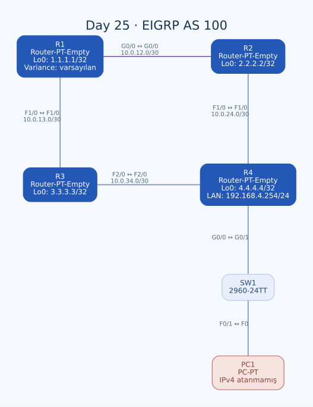

# Day 25 — EIGRP AS 100 ve Unequal-Cost Yol Seçimi

Bu labda dört router üzerinde EIGRP AS 100 kurdum. Transit bağlantılara ve loopback arayüzlerine adres verdim; router bağlantılarında komşuluk kurulmasını, loopback ve uç LAN tarafında ise gereksiz komşuluk aranmamasını hedefledim. R1'den R4'ün LAN'ına giden iki yolun farklı arayüz hızlarını kullanmasını, unequal-cost load balancing açısından değerlendirdim.

| Alan | Açıklama |
| --- | --- |
| Lab dosyası | [Day 25 Lab - EIGRP Configuration.pkt](../../labs/Day%2025%20Lab%20-%20EIGRP%20Configuration.pkt) |
| Konu | EIGRP, AS numarası, wildcard, passive interface ve variance |
| Ortam | Cisco Packet Tracer 9.0.1 |
| Cihazlar | Dört modüler Router-PT-Empty, bir 2960-24TT ve bir PC |
| Yönlendirme alanı | EIGRP AS 100 |
| Hedef LAN | `192.168.4.0/24` |

## Amaç ve topoloji

R1–R2–R4 ve R1–R3–R4 yollarıyla R4'ün arkasındaki LAN'a iki farklı yönden ulaşılabiliyor. R1–R2 bağlantısı GigabitEthernet; diğer router bağlantıları FastEthernet. Fiziksel yedekliliğin yanında metrik farkını da incelemek istedim.



| Birinci uç | İkinci uç | Tür |
| --- | --- | --- |
| R1 G0/0 | R2 G0/0 | GigabitEthernet, crossover |
| R1 F1/0 | R3 F1/0 | FastEthernet, crossover |
| R2 F1/0 | R4 F1/0 | FastEthernet, crossover |
| R3 F2/0 | R4 F2/0 | FastEthernet, crossover |
| R4 G0/0 | SW1 G0/1 | Straight-through |
| SW1 F0/1 | PC1 F0 | Straight-through |

Modüler router port adları G0/0, F1/0 ve F2/0 şeklinde. F1/0 ile başka lablardaki F0/1 aynı adlandırma değil; komutları bu dosyanın portlarına göre kullandım.

## Adres planı

| Ağ | Birinci uç | İkinci uç |
| --- | --- | --- |
| `10.0.12.0/30` | R1 G0/0 — `10.0.12.1` | R2 G0/0 — `10.0.12.2` |
| `10.0.13.0/30` | R1 F1/0 — `10.0.13.1` | R3 F1/0 — `10.0.13.2` |
| `10.0.24.0/30` | R2 F1/0 — `10.0.24.1` | R4 F1/0 — `10.0.24.2` |
| `10.0.34.0/30` | R3 F2/0 — `10.0.34.1` | R4 F2/0 — `10.0.34.2` |
| `192.168.4.0/24` | R4 G0/0 — `192.168.4.254` | PC1 için ayrılan uç LAN |

Transit maskeler `255.255.255.252`, LAN maskesi `255.255.255.0`. Her `/30` içinde `.1` ve `.2` uç adresleri; `.0` ağ, `.3` broadcast adresi.

| Router | Loopback0 |
| --- | --- |
| R1 | `1.1.1.1/32` |
| R2 | `2.2.2.2/32` |
| R3 | `3.3.3.3/32` |
| R4 | `4.4.4.4/32` |

Loopback'leri fiziksel kablodan bağımsız, adreslenebilir mantıksal arayüzler olarak oluşturdum. Örneğin R1'de ilgili kurulum:

```text
hostname R1
interface GigabitEthernet0/0
 ip address 10.0.12.1 255.255.255.252
 no shutdown
!
interface FastEthernet1/0
 ip address 10.0.13.1 255.255.255.252
 no shutdown
!
interface Loopback0
 ip address 1.1.1.1 255.255.255.255
```

R1 G0/0 için ilk denememde `10.0.12.0/30` yazmıştım; bu subnet'in ağ adresi. Son değeri kullanılabilir `10.0.12.1/30` olarak düzelttim. R2'de de yanlışlıkla açtığım Loopback10'u kaldırıp Loopback0 ile devam ettim.

## EIGRP konfigürasyonları

### R1

```text
router eigrp 100
 passive-interface Loopback0
 network 10.0.12.0 0.0.0.3
 network 10.0.13.0 0.0.0.3
 network 1.1.1.1 0.0.0.0
 no auto-summary
```

### R2

```text
router eigrp 100
 passive-interface Loopback0
 network 10.0.12.0 0.0.0.3
 network 10.0.24.0 0.0.0.3
 network 2.2.2.2 0.0.0.0
 no auto-summary
```

### R3

```text
router eigrp 100
 passive-interface Loopback0
 network 10.0.13.0 0.0.0.3
 network 10.0.34.0 0.0.0.3
 network 3.3.3.3 0.0.0.0
 no auto-summary
```

### R4

```text
router eigrp 100
 passive-interface GigabitEthernet0/0
 passive-interface Loopback0
 network 0.0.0.0
 no auto-summary
```

R4'te bütün IPv4 arayüzlerini eşleştiren `network 0.0.0.0 255.255.255.255` komutunu kullandım; son konfigürasyon bunu `network 0.0.0.0` olarak gösteriyor. Diğer router'larda daha dar wildcard eşleşmeleri yazdım. Geniş R4 eşleşmesinin sonradan eklenen arayüzleri de kapsayabileceğini hesaba katmak gerekiyor.

EIGRP'de komşuların AS numarası uyumlu olmalı; burada dört cihazda da 100 kullandım. `network` satırlarını uzak hedefe elle statik rota eklemek için değil, yerel arayüzlerin EIGRP kapsamını seçmek için yazdım.

## Wildcard ve passive interface

`0.0.0.3`, `/30` maskenin tersidir; son iki bit değişebilir. `0.0.0.0` ise tek IP'yi tam eşleştirir. Bu nedenle loopback için tam adres eşleşmesi, transit bağlantı için subnet eşleşmesi kullandım.

Loopback'lerde EIGRP komşusu aranmasına ihtiyaç yok. R4 G0/0 da yalnızca switch ve PC tarafına gidiyor. Bu arayüzleri passive yapmam, ağlarının ilanını kaldırmak anlamına gelmiyor; komşuluk mesajlarını bu yönlerde durduruyorum.

Beklenen router komşuları:

| Router | Komşu bağlantıları |
| --- | --- |
| R1 | R2 — G0/0, R3 — F1/0 |
| R2 | R1 — G0/0, R4 — F1/0 |
| R3 | R1 — F1/0, R4 — F2/0 |
| R4 | R2 — F1/0, R3 — F2/0 |

`no auto-summary` ile classful sınırlar üzerinden otomatik özetlemeyi kapattım. Böylece kullanılan daha özel subnet'leri bilinçli olarak taşıyan bir yapı kurdum.

## Eşit olmayan maliyetli yollar

R1'den LAN'a giden yollar R2 ve R3 üzerinden. EIGRP'nin varsayılan klasik metriğinde bant genişliği ve toplam delay önemli; yalnızca hop sayısını saymıyor. R1–R2'nin Gigabit, R1–R3'ün FastEthernet olması iki adayın aynı metrikte olacağını garanti etmiyor.

| Kavram | Bu labda anlamı |
| --- | --- |
| Successor | Aktif en iyi yol için seçilen komşu |
| Feasible distance | DUAL'ın döngüsüzlük değerlendirmesinde kullandığı yerel referans mesafe |
| Reported distance | Komşunun hedef için bildirdiği kendi mesafesi |
| Feasible successor | Reported distance koşuluyla güvenli alternatif olabilen yol |
| Variance | Farklı metrikli uygun yolların kurulmasına izin veren çarpan |

Bir alternatifin yalnızca variance eşiğine sığması yeterli değil; komşunun reported distance değeri, DUAL'ın kullandığı feasible distance değerinden küçük olmalı: `RD < FD`. Alternatifin toplam metriği de seçilen variance çarpanının açtığı aralıkta kalmalı. Bu yüzden doğru başlangıç komutu, önce hedefe ait topology bilgisini okumak:

```text
show ip eigrp topology 192.168.4.0 255.255.255.0
show ip route 192.168.4.0
```

### Açık kalan variance adımı

R1'in son EIGRP konfigürasyonunda **`variance` satırı yok**. Dolayısıyla görevde istenen unequal-cost load balancing adımını tamamlanmış saymadım. Varsayılan variance 1, eşit maliyetli yolları esas alır.

İki yolun metrik ve feasibility değerleri doğrulandıktan sonra uygulanabilecek bir başlangıç düzenlemesi:

```text
! Tamamlama önerisi; son dosyada uygulanmış değil.
router eigrp 100
 variance 2
```

Bu örneği iki yolun kesin kurulduğu veya trafiğin yarı yarıya dağıldığı anlamında kullanmıyorum. Gerçek FD/RD değerleri, kurulabilen yollar ve iletim davranışı ayrıca kontrol edilmeli. EIGRP topology çıktısındaki `Passive` durumunu da `passive-interface` ile karıştırmıyorum: ilki yol hesabının kararlı durumunu, ikincisi arayüzde komşuluk davranışını anlatır.

## PC1 adreslemesi ve erişim kontrolü

PC1'in son dosyada IPv4 ve default gateway alanları boş. R4 LAN adresi hazır olsa da PC'den erişim testinin bu hâliyle tamamlanmış olduğunu söyleyemem.

Uygulanabilecek uç ayarı:

| Alan | Önerilen değer |
| --- | --- |
| IPv4 | `192.168.4.1` |
| Maske | `255.255.255.0` |
| Gateway | `192.168.4.254` |

R1'den hedef LAN'a erişimde gidiş kadar dönüş de gerekli. R4'ün R1 bağlantıları ve loopback ağına EIGRP üzerinden dönüş bilgisi bulunmalı. Önce router adreslerine, sonra uç PC'ye erişimi kontrol etmek sorunu ayırmayı kolaylaştırır.

## Kontroller ve kalıcılık

```text
show ip interface brief
show ip protocols
show ip eigrp neighbors
show ip eigrp topology
show ip route eigrp
```

R1'de komşu, routing table ve topology inceleme komutlarını kullandım. Tam çıktılar ve ping sonuçları saklanmadığından komşuluk sayısını, metrik değerlerini veya başarı oranını ölçülmüş sonuç olarak vermedim.

Dört router'ın startup-config kayıtları boş. Son IP, loopback ve EIGRP ayarlarının kayıt adımı açık kalmış. PC adreslemesi ve variance doğrulaması tamamlandıktan sonra router'larda `copy running-config startup-config` uygulanmalı.

## Öğrendiklerim

- EIGRP arayüz seçimini wildcard eşleşmeleriyle yaptım.
- Komşuluk gereken transit portlarla passive olacak uçları ayırdım.
- Loopback ilanının passive yapılmasına rağmen sürdürülebileceğini öğrendim.
- Eşit olmayan metrikteki yolun kurulması için variance yanında feasibility gerektiğini gördüm.
- Router ayarları hazır olsa bile PC adreslemesinin ayrıca tamamlanması gerektiğini fark ettim.

## Sonuç

AS 100 içinde dört router'ın transit ve loopback ayarlarını, passive kapsamını ve otomatik özetleme seçimini yapılandırdım. PC1'in adreslenmesi, R1'de unequal-cost adımının uygun metriklerle tamamlanması ve konfigürasyonların kaydedilmesi açık kalan işler.

## Kaynaklar

- [Cisco — EIGRP çalışma mantığı ve metrikler](https://www.cisco.com/c/en/us/support/docs/ip/enhanced-interior-gateway-routing-protocol-eigrp/16406-eigrp-toc.html)
- [Cisco — Variance ve feasibility koşulları](https://www.cisco.com/c/en/us/td/docs/ios-xml/ios/iproute_eigrp/command/ire-cr-book/ire-s1.html)

[Önceki lab](day-24-floating-static-routes.md) · [Lab kataloğu](../../README.md) · [Sonraki lab: OSPF — Part 1](day-26-ospf-part-1.md)
