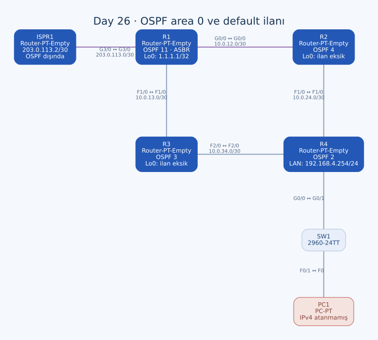

# Day 26 — Tek Area OSPF ve Default Route İlanı

Bu labda dört router'ı OSPF area 0 içinde birleştirdim ve R1 üzerinden dış ağa yönelen default route'u iç ağa ilan ettim. Farklı process ID'lerin komşuluğu engellemediğini, passive interface ayarının ise tek başına bir arayüzü OSPF'ye dahil etmediğini karşılaştırdım.

| Alan | Açıklama |
| --- | --- |
| Lab dosyası | [Day 26 Lab - OSPF (Part 1).pkt](../../Day%2026%20Lab%20-%20OSPF%20%28Part%201%29.pkt) |
| Konu | Area 0, network/wildcard, passive interface, ASBR ve OSPF default |
| Ortam | Cisco Packet Tracer 9.0.1 |
| Cihazlar | Beş modüler router, bir 2960-24TT ve bir PC |
| İç yönlendirme | R1, R2, R3 ve R4; OSPF area 0 |
| Dış bağlantı | R1–ISPR1, `203.0.113.0/30` |

## Topoloji ve adres planı



| Bağlantı | Adresler | Tür |
| --- | --- | --- |
| R1 G0/0 ↔ R2 G0/0 | `10.0.12.1/30` ↔ `10.0.12.2/30` | Crossover |
| R1 F1/0 ↔ R3 F1/0 | `10.0.13.1/30` ↔ `10.0.13.2/30` | Crossover |
| R2 F1/0 ↔ R4 F1/0 | `10.0.24.1/30` ↔ `10.0.24.2/30` | Crossover |
| R3 F2/0 ↔ R4 F2/0 | `10.0.34.1/30` ↔ `10.0.34.2/30` | Crossover |
| R4 G0/0 ↔ SW1 G0/1 | R4 `192.168.4.254/24` | Straight-through |
| SW1 F0/1 ↔ PC1 F0 | Uç adresi henüz atanmamış | Straight-through |
| R1 G3/0 ↔ ISPR1 G3/0 | `203.0.113.1/30` ↔ `203.0.113.2/30` | Single-mode fiber |

Router loopback'leri R1 `1.1.1.1/32`, R2 `2.2.2.2/32`, R3 `3.3.3.3/32`, R4 `4.4.4.4/32`. Bütün iç transit bağlantıların maskesi `255.255.255.252`; uç LAN `255.255.255.0` kullanıyor.

ISPR1 labda hazır geliyor. İç OSPF alanına dahil değil. R1'in G3/0 arayüzüne OSPF açmadım; dış erişim için ayrı statik default kullandım.

## Process ID ile area arasındaki fark

| Router | Yerel OSPF process ID | Area |
| --- | --- | --- |
| R1 | 11 | 0 |
| R2 | 4 | 0 |
| R3 | 3 | 0 |
| R4 | 2 | 0 |

Process ID cihaz içinde yerel bir tanımlayıcı. Komşuların bunu aynı sayı seçmesi gerekmiyor. Area bilgisi ve komşuluk parametreleri ise bağlantının iki ucunda uyumlu olmalı. Bu labı EIGRP'deki ortak AS numarası koşuluyla aynı şekilde değerlendirmiyorum.

## Son OSPF konfigürasyonları

### R1

```text
router ospf 11
 log-adjacency-changes
 passive-interface Loopback0
 network 10.0.13.0 0.0.0.3 area 0
 network 10.0.12.0 0.0.0.3 area 0
 network 1.1.1.1 0.0.0.0 area 0
 default-information originate
```

### R2

```text
router ospf 4
 log-adjacency-changes
 passive-interface Loopback0
 network 10.0.0.0 0.0.255.255 area 0
```

### R3

```text
router ospf 3
 log-adjacency-changes
 passive-interface Loopback0
 network 10.0.0.0 0.0.255.255 area 0
```

### R4

```text
router ospf 2
 log-adjacency-changes
 passive-interface GigabitEthernet0/0
 passive-interface Loopback0
 network 0.0.0.0 255.255.255.255 area 0
```

R1'de arayüz adreslerine dar eşleşmeler, R2/R3'te `10.0.0.0/16` içindeki adresleri seçen daha geniş eşleşme, R4'te bütün IPv4 arayüzlerini seçen wildcard kullandım. `network` satırı, yerel arayüzü OSPF'ye dahil eder; satırdaki metin tek başına uzak bir ağa rota oluşturmaz.

## Passive interface ve eksik loopback ilanları

R4'ün LAN portu PC tarafına gittiğinden passive. Loopback'lerde de komşuluk aranmıyor. Ancak bunun için önce ilgili arayüzün OSPF kapsamına girmiş olması gerekiyor.

**R2 ve R3'te bu iki adımın biri eksik.** Son `network 10.0.0.0 0.0.255.255` satırı, `2.2.2.2` ve `3.3.3.3` adreslerini eşleştirmiyor. `passive-interface Loopback0` yazılması da bu loopback'leri kendiliğinden ilana dahil etmiyor.

| Router | Loopback adresi | Son network eşleşmesi |
| --- | --- | --- |
| R1 | `1.1.1.1/32` | Var, tam adres eşleşmesi |
| R2 | `2.2.2.2/32` | Yok |
| R3 | `3.3.3.3/32` | Yok |
| R4 | `4.4.4.4/32` | Var, bütün adresleri eşleştiren wildcard |

Görevdeki loopback ilanlarını tamamlamak için:

```text
! R2 — tamamlama önerisi
router ospf 4
 network 2.2.2.2 0.0.0.0 area 0
!
! R3 — tamamlama önerisi
router ospf 3
 network 3.3.3.3 0.0.0.0 area 0
```

Bu satırlar son dosyada henüz yok. Bir loopback adresinin router ID seçiminde kullanılabilmesiyle o prefix'in OSPF üzerinden ilan edilmesi de farklı konular; router ID'ye bakarak loopback rotasının yayıldığını varsaymıyorum.

## R1'i ASBR yapma

R1'in doğru dış next hop'u ISPR1 `203.0.113.2`:

```text
ip route 0.0.0.0 0.0.0.0 203.0.113.2
router ospf 11
 default-information originate
```

Statik default, R1'in dış hedefleri nereye ileteceğini; `default-information originate` ise diğer OSPF router'larının bu çıkışı nasıl öğreneceğini belirliyor. Birinin varlığı diğerinin yerini tutmuyor.

`always` kullanmadım. Bu nedenle R1'in aktif routing table'ında uygun bir default bulunması, normal default ilanı için gerekli. Dış arayüzün çalışması ve next hop'un çözümlenmesi ayrıca doğrulanmalı.

### Kalan yazım hatası

İlk denemede `20.30.113.2` yazmışım. Ardından doğru default'u eklemişim; son konfigürasyonda iki satır da bulunuyor:

```text
ip route 0.0.0.0 0.0.0.0 20.30.113.2
ip route 0.0.0.0 0.0.0.0 203.0.113.2
```

`20.30.113.2`, bu bağlantının adres planına ait değil. Doğru satırı eklemek yanlışını kaldırmamış. Eski satırın canlı RIB'de kurulup kurulmadığını ayrıca görmek gerekir; bunu ikinci geçerli çıkış gibi kabul etmiyorum.

```text
! Temizleme önerisi; eski satır son dosyada hâlâ var.
no ip route 0.0.0.0 0.0.0.0 20.30.113.2
```

## Beklenen default rota türü ve yollar

Normal area 0 içinde bu ilan, Type 5 external LSA ile taşınır; varsayılan rota türü E2, external metric 1. İç router'larda `O*E2` kodlu default beklenir. `*`, default adayı bilgisidir; ayrı bir komşuluk durumu değil.

Referans bant genişliği bu dosyada değiştirilmemiş. Varsayılan 100 Mbps referansla hem FastEthernet hem GigabitEthernet maliyeti en az 1'e yuvarlanır. Bütün bağlantılar çalışıyorsa:

| Router | R1'e beklenen en iyi yön |
| --- | --- |
| R2 | Doğrudan G0/0, R1 `10.0.12.1` |
| R3 | Doğrudan F1/0, R1 `10.0.13.1` |
| R4 | R2 `10.0.24.1` ve R3 `10.0.34.1` üzerinden eşit iç maliyetli iki aday |

R4'te iki adayın R1'e iç maliyeti 2 olur. Aynı ASBR'nin E2 default'u için iç erişim maliyetleri eşit olduğunda çoklu next hop kurulması beklenebilir. Bu tablo canlı çıktı alıntısı değil; mevcut topolojinin ve varsayılan maliyetlerin hesabı.

E2'nin external metric'inin 1 görünmesi, R1'e erişimin iç maliyetinin yok sayıldığı anlamına gelmiyor. Bir sonraki labda referans bant genişliğini değiştirince bu iki iç yol birbirinden ayrılıyor.

## Uç adresleme ve dış erişimin sınırı

PC1'in IPv4 ve gateway alanları boş. Uç denemesi için örneğin `192.168.4.1/24`, gateway `192.168.4.254` kullanılabilir; bu, henüz uygulanmamış tamamlama ayarı.

ISPR1'in default'u R1 `203.0.113.1` yönünde. Bu, labdaki iç hedeflere dönüşü sağlayabilir; fakat dosyada ayrıca tanımlı bir uzak internet sunucusu yok. R1–ISPR1 bağlantısını gerçek internet erişimi olarak değerlendirmedim. Bilinmeyen hedefler için iki router'ın birbirine bakan default'ları, tek başına geçerli bir internet çıkışı kanıtı oluşturmaz.

## Kontroller ve kalıcılık

```text
show ip protocols
show ip ospf neighbor
show ip ospf interface brief
show ip route ospf
show ip route 0.0.0.0
show ip ospf database external
```

R2/R3'ün loopback ilanları, R1'in doğru default'u ve R4'ün next hop'ları ayrı kontrol edilmeli. Komşuluk kurulması, bütün istenen prefix'lerin ilan edildiğini tek başına göstermez. Tam `show` çıktıları ve ping yanıtları saklanmış değil.

R2, R3 ve R4'ün startup-config kayıtları boş; R1'in başlangıç kaydında da yeni IP, loopback, OSPF ve default değişiklikleri yok. ISPR1'in hazır konfigürasyonu kayıtlı. Eksikler giderilip erişim doğrulandıktan sonra dört iç router'da son ayarlar kaydedilmeli.

## Öğrendiklerim

- OSPF process ID ile area kimliğini ayırdım.
- Passive arayüzün önce OSPF kapsamına girmesi gerektiğini gördüm.
- Loopback'in adresli olması, router ID adayı olması ve ilan edilmesini ayrı kontrol ettim.
- Default route ile default ilanının iki ayrı işlem olduğunu uyguladım.
- Varsayılan maliyetin FastEthernet ve GigabitEthernet'i eşit gösterebildiğini hesapladım.

## Sonuç

İç bağlantıları area 0'a aldım ve R1'de statik default ile OSPF default ilanını kurdum. R2/R3 loopback eşleşmeleri, R1'deki yanlış default satırının temizlenmesi, PC1 adreslemesi ve son konfigürasyonların kaydı açık kalan adımlar.

## Kaynaklar

- [Cisco — OSPF default route oluşturma](https://www.cisco.com/c/en/us/support/docs/ip/open-shortest-path-first-ospf/13692-21.html)
- [Cisco — OSPF maliyeti ve referans bant genişliği](https://www.cisco.com/c/en/us/support/docs/ip/open-shortest-path-first-ospf/9237-9.html)

[Önceki lab](day-25-eigrp-configuration.md) · [Lab kataloğu](../../README.md) · [Sonraki lab: OSPF — Part 2](day-27-ospf-part-2.md)
