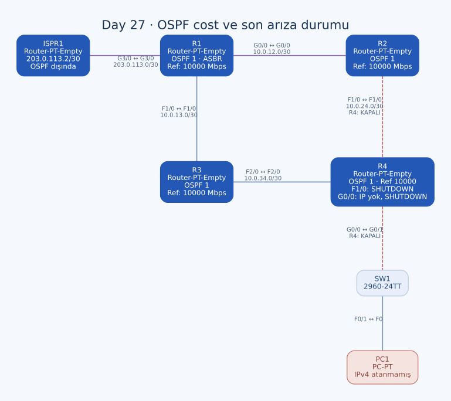

# Day 27 — Arayüz Üzerinden OSPF, Referans Bant Genişliği ve Hello

Bu labda OSPF'yi `network` satırları yerine doğrudan arayüzlerde etkinleştirdim. FastEthernet maliyetini 100 yapacak referans bant genişliğini seçtim; R4'ün default çıkış için farklı iç maliyetleri nasıl karşılaştıracağını hesapladım. Son olarak Hello paketindeki alanları komşuluk parametreleriyle ilişkilendirdim.

| Alan | Açıklama |
| --- | --- |
| Lab dosyası | [Day 27 Lab - OSPF (Part 2).pkt](../../Day%2027%20Lab%20-%20OSPF%20%28Part%202%29.pkt) |
| Konu | Interface OSPF, passive default, reference bandwidth, E2 yol seçimi ve Hello |
| Ortam | Cisco Packet Tracer 9.0.1 |
| Cihazlar | Beş modüler router, bir 2960-24TT ve bir PC |
| OSPF | İç router'larda process 1, area 0 |
| Referans bant genişliği | 10000 Mbps |

## Topoloji ve son arayüz durumu



| Bağlantı | Adresler / son durum | Tür |
| --- | --- | --- |
| R1 G0/0 ↔ R2 G0/0 | `10.0.12.1/30` ↔ `10.0.12.2/30` | Crossover |
| R1 F1/0 ↔ R3 F1/0 | `10.0.13.1/30` ↔ `10.0.13.2/30` | Crossover |
| R2 F1/0 ↔ R4 F1/0 | `10.0.24.1/30` ↔ `10.0.24.2/30`; R4 tarafı shutdown | Crossover |
| R3 F2/0 ↔ R4 F2/0 | `10.0.34.1/30` ↔ `10.0.34.2/30` | Crossover |
| R4 G0/0 ↔ SW1 G0/1 | R4'ün son config'inde IP yok, shutdown | Straight-through |
| SW1 F0/1 ↔ PC1 F0 | PC1'de IPv4/gateway atanmamış | Straight-through |
| R1 G3/0 ↔ ISPR1 G3/0 | `203.0.113.1/30` ↔ `203.0.113.2/30` | Single-mode fiber |

Loopback0 adresleri R1 `1.1.1.1/32`, R2 `2.2.2.2/32`, R3 `3.3.3.3/32`, R4 `4.4.4.4/32`. Bu kez dört loopback'te de arayüz üzerinden OSPF etkinleştirilmiş.

Topolojinin LAN etiketi hâlâ `192.168.4.0/24` planını gösteriyor. Ancak R4 G0/0'ın son running-config'i `no ip address` ve `shutdown` içeriyor. Bu nedenle önceki labdaki `.254` gateway'inin bu dosyada çalışır durumda kaldığını varsaymadım.

## Arayüzde OSPF'yi etkinleştirme

Kullandığım temel komut:

```text
ip ospf 1 area 0
```

Bu satır doğrudan ilgili arayüzün altında. Router altındaki wildcard eşleşmesiyle aynı kapsamı seçmenin başka bir yolu; arayüze IP adresi vermenin veya shutdown durumunu kaldırmanın yerine geçmiyor.

| Router | `ip ospf 1 area 0` bulunan arayüzler |
| --- | --- |
| R1 | Loopback0, G0/0, F1/0 |
| R2 | Loopback0, G0/0, F1/0 |
| R3 | Loopback0, F1/0, F2/0 |
| R4 | Loopback0, G0/0, F1/0, F2/0 |

R1 G3/0 dış sağlayıcıya gidiyor; üzerinde OSPF satırı yok. İç area ile ISP bağlantısını bu noktada ayırdım.

R1'den örnek:

```text
interface Loopback0
 ip address 1.1.1.1 255.255.255.255
 ip ospf 1 area 0
!
interface GigabitEthernet0/0
 ip address 10.0.12.1 255.255.255.252
 ip ospf 1 area 0
!
interface FastEthernet1/0
 ip address 10.0.13.1 255.255.255.252
 ip ospf 1 area 0
```

R2 ve R3'ün loopback'leri de doğrudan bu komutla seçildiği için önceki labdaki dar `network` eşleşmesi eksikliği burada yok.

## Passive interface kapsamı

R1, R2 ve R3'te Loopback0 passive. R4'te ise ters yaklaşımı kullandım:

```text
router ospf 1
 passive-interface default
 no passive-interface FastEthernet1/0
 no passive-interface FastEthernet2/0
 auto-cost reference-bandwidth 10000
```

Önce bütün arayüzleri passive kabul edip yalnızca iki router bağlantısını açtım. Loopback ve LAN tarafı bu yaklaşımda passive kalır. Bu, OSPF'nin o ağları ilan edebilmesiyle komşuluk araması yapmasını ayırıyor.

R4 F1/0 için `no passive-interface` bulunmasına rağmen son konfigürasyonda fiziksel arayüz shutdown. Komşuluk kurulması için passive kapsamının doğru olması tek başına yeterli değil.

## Referans bant genişliği hesabı

Görev, FastEthernet maliyetinin 100 olmasını istiyor. OSPF'nin otomatik maliyet hesabında referans bant genişliğini arayüz bant genişliğine böldüm:

```text
router ospf 1
 auto-cost reference-bandwidth 10000
```

Komutun birimi Mbps. 10000 Mbps referansla:

| Arayüz bant genişliği | Hesap | Beklenen otomatik cost |
| --- | --- | --- |
| FastEthernet — 100 Mbps | 10000 / 100 | 100 |
| GigabitEthernet — 1000 Mbps | 10000 / 1000 | 10 |

Dört iç router'da da aynı referansı ayarladım. Böylece önceki labda 1'e eşitlenen iki hız sınıfı bu hesapta ayrılıyor. `auto-cost` fiziksel port hızını artırmaz; yönlendirme maliyetini hesaplamak için kullanılan referansı değiştirir.

## Default route ve R4'ün tercih edeceği yol

R1'de:

```text
ip route 0.0.0.0 0.0.0.0 203.0.113.2
router ospf 1
 default-information originate
```

Bu dosyada önceki labdaki `20.30.113.2` yanlış default satırı yok. ISPR1'in dönüş default'u R1 `203.0.113.1` yönünde; ISP arayüzünde OSPF çalışmıyor.

R4'ün iki router bağlantısı da açık olsaydı R1'e iç maliyetleri:

| Aday | İç maliyet |
| --- | --- |
| R4 → R2 → R1 | 100 + 10 = 110 |
| R4 → R3 → R1 | 100 + 100 = 200 |

Varsayılan E2 external metric aynı olsa bile aynı ASBR'ye erişimdeki iç maliyet bu seçimi ayırır. Dolayısıyla önceki labdaki iki eşit adayın yerine R2 yönünün tercih edilmesi beklenir. Tablodaki 110 bir **iç path cost**; OSPF'nin administrative distance değeri 110 ile aynı kavram değil.

### Son dosyada F1/0 kapalı

Son adımda R4'te şu komutu uyguladım:

```text
interface FastEthernet1/0
 shutdown
```

Bu durumda R2 yönündeki daha düşük maliyetli yol kullanılamaz. R4'ün R3 üzerinden erişimi kaldığından, bağlantılar ve komşuluklar çalışıyorsa default'u `10.0.34.1` yönünde öğrenmesi beklenir. Tam routing table çıktısı saklanmadığı için bu sonucu canlı çıktı olarak vermedim.

Deneme sonrası iki adayın tekrar karşılaştırılması için F1/0'da `no shutdown` gerekir; bu normal duruma dönüş son dosyada yapılmış değil.

## LAN tarafında açık kalan adresleme

R4 G0/0'ın son ayarı:

```text
interface GigabitEthernet0/0
 no ip address
 ip ospf 1 area 0
 shutdown
```

Arayüzde OSPF komutunun durması, `192.168.4.0/24` LAN'ını kullanılabilir yapmıyor. Uç LAN'ını önceki plana göre tamamlamak için:

```text
! Tamamlama önerisi; son dosyada uygulanmış değil.
interface GigabitEthernet0/0
 ip address 192.168.4.254 255.255.255.0
 no shutdown
```

PC1'e de örneğin `192.168.4.1/24` ve gateway `192.168.4.254` atanmalı. Router'lar arasında default öğrenilmesiyle PC'nin dış hedefe erişmesi farklı doğrulamalar; PC adresi ve LAN gateway'i eksikken uç erişimini tamamlanmış saymadım.

## OSPF Hello paketindeki bilgiler

Simulation Mode'da incelenmesi istenen paket OSPFv2 Hello. Ethernet üzerinde normal Hello yayını AllSPFRouters `224.0.0.5` grubuna gider; OSPF, IP protocol 89 kullanır.

| Bölüm / alan | Anlamı |
| --- | --- |
| OSPF başlığında version/type | OSPFv2, paket type 1 yani Hello |
| Router ID / Area ID | Gönderen router ve area kimliği |
| Network Mask | İlgili arayüzün maske bilgisi |
| HelloInterval | Hello gönderim aralığı |
| Options | Desteklenen OSPF özellikleri |
| Router Priority | DR/BDR seçimine katılım önceliği |
| RouterDeadInterval | Komşunun kayıp sayılacağı süre |
| Designated Router / Backup DR | Segmentteki DR ve BDR bilgileri |
| Neighbor listesi | Gönderenin Hello duyduğu komşuların Router ID'leri |

Network mask ve zamanlayıcılar gibi parametrelerin uyumu komşuluk için önem taşıyor. Gelen Hello'nun neighbor listesinde kendi Router ID'mi görmek çift yönlü iletişim değerlendirmesinin parçası.

Referans bant genişliği veya hesaplanan interface cost, bu Hello alanlarının yerine geçmez. Ayrıca Hello **paket type 1** ile LSDB'deki **Type 1 Router-LSA** aynı sınıflandırma değil. Kaydedilmiş bir Hello paket dökümü olmadığı için tabloyu belirli bir yakalamanın ölçülmüş değerleri olarak sunmadım.

## Kontroller ve kalıcılık

```text
show ip ospf interface brief
show ip ospf interface FastEthernet1/0
show ip ospf neighbor
show ip protocols
show ip route 0.0.0.0
show ip interface brief
```

Önce IP ve idari durum, sonra OSPF üyeliği/passive kapsamı, ardından cost ve rota seçimi kontrol edilmeli. Tam ping veya Hello çıktıları saklanmış değil.

R2, R3 ve R4'ün startup-config kayıtları boş. R1'in başlangıç ayarları da son OSPF/IPv4 düzenini içermiyor. F1/0 arıza denemesi, LAN adreslemesi ve uç testleri tamamlandıktan sonra korunacak normal ayarlar kaydedilmeli.

## Öğrendiklerim

- Interface OSPF ile wildcard tabanlı arayüz seçimini karşılaştırdım.
- Passive default yaklaşımında yalnızca router bağlantılarını açtım.
- Referans bant genişliğinin birimini ve 100/10 cost ayrımını hesapladım.
- E2 external metric eşitken ASBR'ye iç maliyetin seçimi etkileyebildiğini gördüm.
- OSPF satırının IP'siz veya shutdown bir arayüzü çalışır hâle getirmediğini fark ettim.
- Hello alanlarını routing cost ve LSA türlerinden ayırdım.

## Sonuç

OSPF'yi doğrudan arayüzlerde açtım, dört router'ın referans bant genişliğini 10000 Mbps yaptım ve R1'in default ilanını kurdum. Son dosya R4 F1/0 kapalıyken bırakılmış; R4 LAN gateway'i ve PC1 adreslemesi de eksik. Normal duruma dönüş, uç erişimi ve kayıt adımları açık kaldı.

## Kaynaklar

- [Cisco — OSPF referans bant genişliği ve maliyet](https://www.cisco.com/c/en/us/support/docs/ip/open-shortest-path-first-ospf/9237-9.html)
- [RFC 2328 — OSPFv2 ve Hello paket biçimi](https://www.rfc-editor.org/rfc/rfc2328.html)

[Önceki lab](day-26-ospf-part-1.md) · [Lab kataloğu](../../README.md) · [Sonraki lab: OSPF — Part 3](day-28-ospf-part-3.md)
