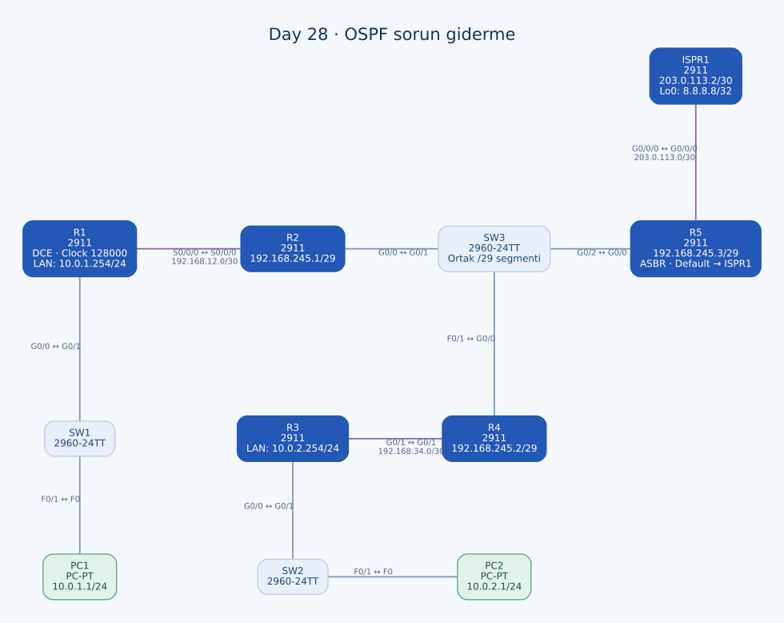

# Day 28 — OSPF Sorun Giderme, Serial Bağlantı ve LSDB

Bu labda hazır adreslenmiş bir ağdaki OSPF sorunlarını giderdim. Yeni serial bağlantıyı etkinleştirdim; R3–R4 arasındaki network type uyumsuzluğunu ve R5'in farklı Hello/Dead zamanlayıcılarını düzelttim. Dış hedefe erişim için R5'e eksik default route'u ekledim ve ortaya çıkan yapıyı LSA türleri üzerinden değerlendirdim.

| Alan | Açıklama |
| --- | --- |
| Lab dosyası | [Day 28 Lab - OSPF (Part 3).pkt](../../labs/Day%2028%20Lab%20-%20OSPF%20%28Part%203%29.pkt) |
| Konu | DCE clock, OSPF network type, Hello/Dead uyumu, ASBR ve LSDB |
| Ortam | Cisco Packet Tracer 9.0.1 |
| Cihazlar | Altı Cisco 2911, üç 2960-24TT ve iki PC |
| İç yönlendirme | R1–R5, process 1, area 0 |
| Dış hedef | ISPR1 Loopback0 — `8.8.8.8/32` |

## Topoloji ve adres planı



| Birinci uç | İkinci uç | Adres / işlev |
| --- | --- | --- |
| R1 S0/0/0 | R2 S0/0/0 | `192.168.12.1/30` ↔ `192.168.12.2/30`, serial |
| R1 G0/0 | SW1 G0/1 | R1 `10.0.1.254/24`, PC1 LAN'ı |
| PC1 F0 | SW1 F0/1 | PC1 `10.0.1.1/24` |
| R2 G0/0 | SW3 G0/1 | R2 `192.168.245.1/29` |
| R4 G0/0 | SW3 F0/1 | R4 `192.168.245.2/29` |
| R5 G0/0 | SW3 G0/2 | R5 `192.168.245.3/29` |
| R4 G0/1 | R3 G0/1 | `192.168.34.2/30` ↔ `192.168.34.1/30` |
| R3 G0/0 | SW2 G0/1 | R3 `10.0.2.254/24`, PC2 LAN'ı |
| PC2 F0 | SW2 F0/1 | PC2 `10.0.2.1/24` |
| R5 G0/0/0 | ISPR1 G0/0/0 | `203.0.113.1/30` ↔ `203.0.113.2/30`, single-mode fiber |

R3–R4 bakır bağlantısı crossover; diğer yedi bakır bağlantı straight-through. SW3, R2/R4/R5'i aynı broadcast Ethernet segmentinde topluyor. `/29` ağın kullanılabilir aralığı `.1`–`.6`, broadcast'i `.7`.

PC1 gateway'i `10.0.1.254`, PC2 gateway'i `10.0.2.254`. Dış hedef ayrı bir fiziksel server değil; ISPR1 üzerindeki loopback adresi. Buradaki ping, simüle lab hedefini kontrol ediyor.

## Sorunları ayırma sırası

| Belirti / görev | İncelediğim katman | Yaptığım değişiklik |
| --- | --- | --- |
| Yeni R1–R2 bağlantısı | Serial IP, idari durum ve DCE clock | İki ucu adresleyip açtım, R1 clock rate'ini 128000 yaptım |
| R1'in OSPF'ye katılması | Arayüz OSPF üyeliği | Serial ve PC LAN arayüzlerini area 0'a aldım |
| `10.0.2.0/24` ağının yayılmaması | OSPF network type / LSDB | R3 G0/1'deki point-to-point zorlamasını kaldırdım |
| R5 ile komşuluk kurulamaması | Hello/Dead zamanlayıcıları | R5'in özel 5/20 değerlerini kaldırdım |
| `8.8.8.8` için çıkış olmaması | Default rota ve ASBR ilan koşulu | R5'e ISPR1 yönünde statik default ekledim |

Tek bir `show ip route` çıktısında eksik prefix görmek, sorunun mutlaka `network` satırı eksikliği olduğu anlamına gelmiyor. Bu labda fiziksel bağlantı, komşuluk uyumu, LSDB ve dış rota koşullarını ayrı ele aldım.

## R1–R2 serial bağlantısı

R1, serial kablonun DCE tarafı. Önce `show controllers Serial0/0/0` ile bu rolü kontrol ettim. Uyguladığım ilgili ayarlar:

```text
! R1
interface Serial0/0/0
 ip address 192.168.12.1 255.255.255.252
 ip ospf 1 area 0
 clock rate 128000
 no shutdown
!
interface GigabitEthernet0/0
 ip address 10.0.1.254 255.255.255.0
 ip ospf 1 area 0
!
router ospf 1
 log-adjacency-changes
```

R2:

```text
interface Serial0/0/0
 ip address 192.168.12.2 255.255.255.252
 ip ospf 1 area 0
 no shutdown
```

R2'nin SW3 tarafındaki OSPF üyeliği önceden router altındaki tam adres eşleşmesiyle tanımlı:

```text
router ospf 1
 network 192.168.245.1 0.0.0.0 area 0
```

Aynı process içinde interface komutu ile `network` eşleşmesinin birlikte bulunması bir çelişki değil; farklı arayüzleri kapsıyorlar.

`clock rate 128000`, DCE'nin bağlantı zamanlamasıyla ilgili. Bunu OSPF'nin `bandwidth` veya `ip ospf cost` ayarıyla aynı işlem gibi kullanmadım. Fiziksel clock değişikliğinden yönlendirme maliyetinin de otomatik olarak aynı oranda değiştiği sonucunu çıkarmamak gerekiyor.

## R3'ün LAN'ı neden diğer router'larda görünmüyordu?

R3'te LAN zaten doğru network eşleşmesine sahip:

```text
router ospf 1
 passive-interface GigabitEthernet0/0
 network 10.0.2.254 0.0.0.0 area 0
 network 192.168.34.1 0.0.0.0 area 0
```

LAN'ın passive olması burada uygun; PC'ye Hello gönderilmesini önler, ilanı kaldırmaz. Sorunu gidermek için passive LAN ayarını silmedim.

Asıl uyumsuzluk R3'ün R4'e bakan G0/1 portundaydı. Başlangıç konfigürasyonu bu Ethernet arayüzünü `point-to-point` yaparken R4 tarafı varsayılan broadcast kullanıyordu. İki uç network tipini farklı yorumladığında LSA bağlantıları SPF açısından tutarsız olabilir; komşuluk görünmesi bile rotanın RIB'e kurulmasını garanti etmez.

Yaptığım düzeltme:

```text
interface GigabitEthernet0/1
 no ip ospf network point-to-point
```

Son dosyada iki Ethernet ucunda da network type'ı zorlayan satır yok; broadcast varsayılanına dönülmüş. R3'teki eski açık `ip ospf priority 1` satırı da son konfigürasyonda yok; varsayılan priority zaten 1 olduğundan bunu ayrı bir priority optimizasyonu olarak değerlendirmedim.

## R5 Hello/Dead uyumsuzluğu

R2, R4 ve R5 aynı `192.168.245.0/29` segmentinde. R5'in başlangıç ayarında:

```text
ip ospf hello-interval 5
ip ospf dead-interval 20
```

R2 ve R4'te ise Ethernet varsayılanları kullanılıyor: Hello 10, Dead 40 saniye. Aynı segmentte bu sürelerin uyumsuz olması komşuluk kurulmasını engeller.

R5'te özel değerleri kaldırdım:

```text
interface GigabitEthernet0/0
 no ip ospf hello-interval
 no ip ospf dead-interval
```

Bu, OSPF'yi arayüzden kaldırmak değil; zamanlayıcıları varsayılanlarına döndürmek. R5'in üyeliği `network 192.168.245.3 0.0.0.0 area 0` ile devam ediyor.

Broadcast segmentinde DR ve BDR seçimi de var. Seçim sonucunu başlatma sırası ve Router ID/priority etkiler; kaydedilmiş canlı seçim çıktısı olmadan R2/R4/R5 için kesin DR/BDR ismi vermedim. İki DROTHER arasında 2-Way durumunun bazı broadcast topolojilerinde normal olabileceğini de Full beklentisinden ayrı tutuyorum.

## Dış hedef ve default route

R5'te `default-information originate` başlangıçta zaten varmış; ancak dış ağa giden statik default eksikmiş. `always` kullanılmadığından aktif routing table'da default bulunması gerekiyor.

Eklediğim rota ve ilgili OSPF ayarı:

```text
ip route 0.0.0.0 0.0.0.0 203.0.113.2
router ospf 1
 network 192.168.245.3 0.0.0.0 area 0
 default-information originate
```

ISPR1 tarafında `8.8.8.8/32` Loopback0 ve R5'e bakan şu dönüş default'u mevcut:

```text
ip route 0.0.0.0 0.0.0.0 203.0.113.1
```

PC1'in gidişi R1 → serial → R2 → SW3 segmenti → R5 → ISPR1 yönünde; PC2'nin gidişi R3 → R4 → SW3 segmenti → R5 → ISPR1 yönünde beklenir. Dönüşte ISPR1 R5'e, R5 de OSPF'nin öğrendiği ilgili LAN'a yönlendirmeli.

`default-information originate` tek başına eksik dış rotayı oluşturmadığından, komşuluk sorunlarını düzeltmek bu sorunun tamamını çözmüyordu.

## LSDB'de beklenen LSA türleri

| LSA türü | Bu topolojide beklenen kullanım |
| --- | --- |
| Type 1 — Router | Area 0'daki R1–R5'in bağlantılarını tanımlaması |
| Type 2 — Network | Uygun komşuluklar kurulduğunda ortak broadcast transit segmentlerini DR'nin tanımlaması |
| Type 5 — AS External | R5'in ilan ettiği `0.0.0.0/0` default |

SW3'ün `/29` segmenti, Type 2 Network-LSA için temel örnek. R3–R4 Ethernet bağlantısı da broadcast modunda ve Full komşuluk koşulları sağlanırsa transit network olarak Type 2 üretebilir. Serial point-to-point bağlantı için ayrı bir Type 2 Network-LSA beklemiyorum.

PC LAN'larının Router-LSA içinde stub link olarak tanımlanması, bunların OSPF stub area olduğu anlamına gelmez. Bu ağ tek normal area 0 kullanıyor; başka area ve ABR bulunmadığından inter-area Type 3/4, NSSA bulunmadığından Type 7 gerektiren bir tasarım yok.

`8.8.8.8/32`, ISPR1'de ve OSPF alanının dışında. Bu prefix'i ayrıca redistribute etmedim; iç router'ların dış erişimi R5'in default ilanı üzerinden. Dolayısıyla dış sunucu adresinin kendisi için ayrı Type 5 ilanını yapılmış gibi yazmadım.

## Kontroller ve kayıt

```text
show controllers Serial0/0/0
show ip interface brief
show ip ospf interface
show ip ospf neighbor
show ip route
show ip ospf database
show ip ospf database router
show ip ospf database network
show ip ospf database external
```

Tam LSDB ve ping çıktıları saklanmış değil; LSA tablosu son konfigürasyonla beklenen türleri açıklıyor. PC'lerden `ping 8.8.8.8`, LAN'lar arasında ping ve yol takibiyle hem gidiş hem dönüş ayrıca doğrulanmalı. Belirli bir başarı yüzdesi veya komşuluk sayısını ölçülmüş sonuç olarak vermedim.

R1/R2'nin yeni serial ve OSPF ayarları, R3'ün network type düzeltmesi ve R5'in timer/default değişiklikleri startup-config'e aktarılmamış. Özellikle yeniden başlatma R3 ve R5'te eski sorunlu ayarları geri getirebilir. Son durum doğrulandıktan sonra değiştirilen router'larda konfigürasyonlar kaydedilmeli.

## Öğrendiklerim

- Serial DCE clock ile IP ve OSPF ayarlarını ayrı kontrol ettim.
- OSPF arayüz komutu ile router altındaki network eşleşmesini birlikte kullandım.
- Eksik rotanın sebebinin network type uyumsuzluğu da olabileceğini gördüm.
- Aynı broadcast segmentinde Hello/Dead sürelerini eşleştirdim.
- ASBR'nin default ilanı için dış routing table koşulunu tamamladım.
- Router-LSA, Network-LSA ve external default'u topolojideki farklı ilişkilerle eşleştirdim.

## Sonuç

R1–R2 serial bağlantısını kurdum; R3/R4 network type ve R5 timer uyumsuzluklarını giderdim. R5'in dış default'unu ekledim. Canlı uç erişimi/LSDB sonuçlarının doğrulanması ve düzeltmelerin startup-config'e kaydedilmesi kalan tamamlama adımları.

## Kaynaklar

- [Cisco — OSPF network type uyumsuzluğu ve route database sorunları](https://www.cisco.com/c/en/us/support/docs/ip/open-shortest-path-first-ospf/7112-26.html)
- [Cisco — OSPF komşu durumları](https://www.cisco.com/c/en/us/support/docs/ip/open-shortest-path-first-ospf/13685-13.html)
- [Cisco — Default route ilanı](https://www.cisco.com/c/en/us/support/docs/ip/open-shortest-path-first-ospf/13692-21.html)

[Önceki lab](day-27-ospf-part-2.md) · [Lab kataloğu](../../README.md) · [Sonraki lab: HSRP](day-29-hsrp-configuration.md)
