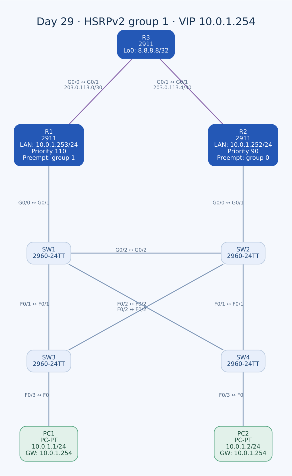

# Day 29 — HSRPv2 ile Yedekli Default Gateway

Bu labda PC'lerin tek bir fiziksel router adresine bağımlılığını azaltmak için HSRPv2 kullandım. R1 ve R2'yi aynı sanal gateway altında topladım; R1'in daha yüksek priority ile tercih edilmesini ayarladım. Sanal IP/MAC, active/standby rolleri ve preemption'ın hangi HSRP grubuna uygulandığını ayrı kontrol ettim.

| Alan | Açıklama |
| --- | --- |
| Lab dosyası | [Day 29 Lab - HSRP Configuration.pkt](../../labs/Day%2029%20Lab%20-%20HSRP%20Configuration.pkt) |
| Konu | First-hop redundancy, VIP, virtual MAC, priority ve preemption |
| Ortam | Cisco Packet Tracer 9.0.1 |
| Cihazlar | Üç Cisco 2911, dört 2960-24TT ve iki PC |
| HSRP | Version 2, group 1 |
| Sanal gateway | `10.0.1.254/24` |
| Dış test hedefi | R3 Loopback0 — `8.8.8.8/32` |

## Topoloji



| Birinci uç | İkinci uç | İşlev / kablo |
| --- | --- | --- |
| R1 G0/1 | R3 G0/0 | Dış yön, crossover |
| R2 G0/1 | R3 G0/1 | İkinci dış yön, crossover |
| R1 G0/0 | SW1 G0/1 | Ortak LAN, straight-through |
| R2 G0/0 | SW2 G0/1 | Ortak LAN, straight-through |
| SW1 G0/2 | SW2 G0/2 | Switch'ler arası crossover |
| SW3 F0/1 | SW1 F0/1 | Crossover |
| SW3 F0/2 | SW2 F0/2 | Crossover |
| SW4 F0/1 | SW2 F0/1 | Crossover |
| SW4 F0/2 | SW1 F0/2 | Crossover |
| PC1 F0 | SW3 F0/3 | Straight-through |
| PC2 F0 | SW4 F0/3 | Straight-through |

Dört switch ortak VLAN 1 LAN'ını taşıyor. Çoklu Layer 2 yolların döngü oluşturmaması STP'nin görevi; HSRP ise PC'lerin Layer 3 gateway'ini yedekliyor. Bunlar farklı arıza alanlarını ele alıyor.

SW1'in VLAN 1 priority'si 24576, SW2'ninki 28672; SW3/SW4 varsayılan 32768 kullanıyor. HSRP active seçimini bu STP priority değerleri belirlemiyor.

## Adres planı

| Cihaz / arayüz | IPv4 / prefix | Rol |
| --- | --- | --- |
| PC1 | `10.0.1.1/24` | Gateway `10.0.1.254` |
| PC2 | `10.0.1.2/24` | Gateway `10.0.1.254` |
| R1 G0/0 | `10.0.1.253/24` | R1'in fiziksel LAN adresi |
| R2 G0/0 | `10.0.1.252/24` | R2'nin fiziksel LAN adresi |
| HSRP group 1 VIP | `10.0.1.254/24` | PC'lerin ortak gateway'i |
| R1 G0/1 | `203.0.113.1/30` | R3 `.2` bağlantısı |
| R3 G0/0 | `203.0.113.2/30` | R1 `.1` bağlantısı |
| R2 G0/1 | `203.0.113.5/30` | R3 `.6` bağlantısı |
| R3 G0/1 | `203.0.113.6/30` | R2 `.5` bağlantısı |
| R3 Loopback0 | `8.8.8.8/32` | Lab test hedefi |

Sanal IP, R1 veya R2'nin fiziksel IP'siyle aynı değil. PC'ler `.253` veya `.252` yerine `.254` kullanıyor. Böylece active router değiştiğinde uç cihazların gateway adresini elle değiştirmem gerekmiyor.

## HSRPv2 konfigürasyonu

R1'in LAN arayüzü:

```text
interface GigabitEthernet0/0
 ip address 10.0.1.253 255.255.255.0
 standby version 2
 standby 1 ip 10.0.1.254
 standby 1 priority 110
 standby 1 preempt
```

R2'nin kayıtlı son ayarı:

```text
interface GigabitEthernet0/0
 ip address 10.0.1.252 255.255.255.0
 standby version 2
 standby 1 ip 10.0.1.254
 standby 1 priority 90
 standby preempt
```

İki router'da version, group ve VIP eşleşiyor. Varsayılan priority 100; R1'i 110'a yükselttim, R2'yi 90'a indirdim. Aynı LAN'da iletişim ve HSRP seçim koşulları sağlandığında R1'in active, R2'nin standby olması beklenir.

### R2'de preemption yanlış gruba uygulanmış

R1'de `standby 1 preempt` doğru grubu seçiyor. R2'de ise grup numarası yazmadan `standby preempt` kullanmışım. IOS'ta grup numarası atlanınca varsayılan **group 0** seçilir; bu satır group 1 preemption'ının karşılığı değil.

Group 1 için görevi tamamlayacak düzeltme:

```text
! R2 — önerilen düzeltme; son dosyada henüz yok.
interface GigabitEthernet0/0
 no standby preempt
 standby 1 preempt
```

İlk satır yanlışlıkla kullanılan group 0 preemption'ını kaldırır; ikinci satır doğru group 1'i etkinleştirir. Group 1'in gerçek ayarı `show standby` ile doğrulanmalı.

Bu eksiklik, R1 tamamen kaybolduğunda R2'nin active olamayacağı anlamına gelmez. Preemption, daha yüksek priority'li bir router'ın mevcut active rolünü geri almasıyla ilgilidir. Active router kaybından sonra standby'ın devralması farklı bir seçim durumu. R1'in group 1 preemption'ı bulunduğundan geri geldiğinde daha yüksek priority ile rolü geri alması beklenir.

## Sanal MAC ve ARP

HSRPv2'nin IPv4 virtual MAC aralığı `0000.0c9f.f000`–`0000.0c9f.ffff`. Group 1 için varsayılan beklenen değer:

```text
10.0.1.254 → 0000.0c9f.f001
```

Bu, yapılandırılan group ve version'dan hesaplanan eşleşme; kaydedilmiş bir PC ARP çıktısının alıntısı değil. PC, kendi subnet'i dışındaki `8.8.8.8` hedefine giderken yerel Ethernet çerçevesini sanal gateway'in MAC adresine yöneltir.

Active router değişiminde VIP ve virtual MAC'in aynı kalması, uçların yeni bir fiziksel gateway IP'sine geçirilmesine ihtiyaç bırakmaz. Sanal MAC ile R1/R2'nin fiziksel arayüz MAC'lerini birbirinden ayırarak `arp -a` sonucunu okumam gerekiyor.

## Gateway yedekliliği ve dış yönlendirme

R1'in default'u:

```text
ip route 0.0.0.0 0.0.0.0 203.0.113.2
```

R2'nin default'u:

```text
ip route 0.0.0.0 0.0.0.0 203.0.113.6
```

Üç router'ın LAN/WAN bağlantıları ve R3 loopback'i OSPF area 0'a dahil edilmiş. R1'de default ilanı da var. HSRP hangi router'ın ilk atlamayı üstleneceğini, IP routing ise paketin bundan sonra nereye gideceğini belirliyor.

R3'ün R2'ye bakan G0/1 arayüzünde ayrıca `ip ospf cost 1000` var; R3'ün reference bandwidth'i 1000 Mbps. Bu yönlendirme maliyeti dönüş yolunu etkileyebilir. HSRP priority 110/90 değerleriyle aynı ölçüm değil. Gidiş ve dönüşün aynı fiziksel router yolunu kullanacağını varsaymadan kontrol etmek gerekiyor.

`8.8.8.8`, R3'ün lab loopback'i. Bu erişimin çalışması gerçek internet hizmetine bağlı değil; labdaki routing ve gateway davranışını sınar.

## Arıza ve geri dönüş senaryosu

| Aşama | Beklenen davranış | Kontrol |
| --- | --- | --- |
| İki router açık, LAN erişimi var | R1 priority/preemption ile active; R2 standby | `show standby brief` |
| R1 kapatılır | R2, active kaybını algıladıktan sonra group 1'i devralır | HSRP durumu ve PC erişimi |
| R1 yeniden açılır | R1 group 1 preemption ve yüksek priority ile active rolünü geri alabilir | HSRP durumu, routing yakınsaması |

Görevde R1 kapatılmadan önce konfigürasyonun kaydedilmesi isteniyor. R1'de `write` komutunu kullandım ve son startup-config, running-config ile eşleşiyor. Son dosyada R1 ve R2'nin ikisi de açık.

Bununla birlikte kaydedilmiş active/standby çıktısı, güç değişim zaman çizelgesi veya PC ping yanıtları yok. Bu yüzden tablodaki beklenen senaryoyu gerçekleşmiş kesinti süresi ya da doğrulanmış failover ölçümü olarak yazmadım.

### Uplink takibinin sınırı

Bu labdaki HSRP ayarında arayüz/object tracking yok. Router'ın tamamen kapatılmasıyla yalnızca dış uplink'inin kaybolması aynı test değil. R1 LAN'da HSRP Hello göndermeye devam ediyorsa, uplink sorunu priority'yi otomatik düşüren bir takip ayarı bulunmuyor. Gateway rolü ile dış yolun sağlığı ayrı kontrol edilmeli.

## Kontroller ve kalıcılık

```text
show standby
show standby brief
show ip interface brief
show ip route
show ip ospf neighbor
```

PC tarafında:

```text
ipconfig
arp -a
ping 8.8.8.8
```

PC gateway'i, VIP'nin ARP eşleşmesi, group 1 durumu ve dış erişim birlikte değerlendirilir. Yalnızca `.254` adresine ping atabilmek, dış hedefe gidiş/dönüş yolunu da kanıtlamaz.

R1'in HSRP konfigürasyonu kayıtlı. R2'nin startup-config'inde ise HSRPv2/VIP/priority ve preemption satırları henüz yok. Group 1 düzeltmesi ve testler tamamlandıktan sonra özellikle R2'de `copy running-config startup-config` yapılmalı.

## Öğrendiklerim

- Fiziksel router IP'si ile sanal gateway IP'sini ayırdım.
- HSRPv2 group 1 için virtual MAC'i hesapladım.
- Priority ile preemption'ın birlikte rol seçiminde nasıl kullanıldığını inceledim.
- Grup numarası atlanan komutun farklı gruba uygulanabileceğini gördüm.
- HSRP devralması, STP yakınsaması ve IP yönlendirmesini ayrı değerlendirdim.
- Router kapanma testiyle uplink tracking testinin farklı kapsamlar olduğunu öğrendim.

## Sonuç

PC'leri ortak `.254` VIP'sine bağladım; R1/R2'de HSRPv2 group 1 ve 110/90 priority düzenini kurdum. R1'in ayarlarını kaydettim. R2'de group 1 preemption düzeltmesi, failover/geri dönüş sonuçlarının doğrulanması ve R2 konfigürasyonunun kaydı açık kalan adımlar.

## Kaynaklar

- [Cisco — HSRPv2 ve virtual MAC aralığı](https://www.cisco.com/c/en/us/td/docs/ios-xml/ios/ipapp_fhrp/configuration/15-mt/fhp-15-mt-book/fhp-hsrp-v2.html)
- [Cisco — Standby preempt ve varsayılan group 0](https://www.cisco.com/c/en/us/td/docs/ios-xml/ios/ipapp_fhrp/command/fhp-cr-book/fhp-s2.html)

[Önceki lab](day-28-ospf-part-3.md) · [Lab kataloğu](../../README.md) · [Sonraki lab: IPv6 — Part 1](day-31-ipv6-configuration-part-1.md)
