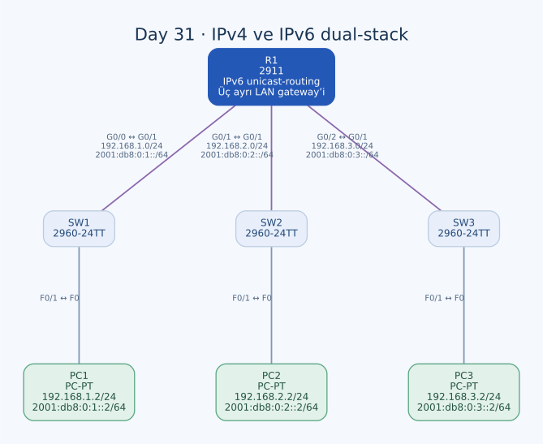

# Day 31 — IPv4/IPv6 Dual-Stack Ağ Yapılandırması

Bu labda IPv4 ayarları hazır üç LAN'a IPv6 ekledim. R1'de IPv6 yönlendirmeyi etkinleştirdim; her LAN'a ayrı `/64` prefix, router'a `::1`, PC'ye `::2` adresini verdim. Aynı arayüzde global kapsamlı ve link-local IPv6 adreslerinin birlikte bulunmasını inceledim.

| Alan | Açıklama |
| --- | --- |
| Lab dosyası | [Day 31 Lab - IPv6 Configuration (Part 1).pkt](../../Day%2031%20Lab%20-%20IPv6%20Configuration%20%28Part%201%29.pkt) |
| Konu | Dual-stack, IPv6 prefix, link-local, gateway ve Neighbor Discovery |
| Ortam | Cisco Packet Tracer 9.0.1 |
| Cihazlar | Bir Cisco 2911, üç 2960-24TT ve üç PC |
| IPv4 LAN'ları | `192.168.1.0/24`, `192.168.2.0/24`, `192.168.3.0/24` |
| IPv6 LAN'ları | `2001:db8:0:1::/64`, `2001:db8:0:2::/64`, `2001:db8:0:3::/64` |

## Topoloji



| Birinci uç | İkinci uç | İşlev |
| --- | --- | --- |
| R1 G0/0 | SW1 G0/1 | LAN1 gateway bağlantısı |
| SW1 F0/1 | PC1 F0 | LAN1 istemcisi |
| R1 G0/1 | SW2 G0/1 | LAN2 gateway bağlantısı |
| SW2 F0/1 | PC2 F0 | LAN2 istemcisi |
| R1 G0/2 | SW3 G0/1 | LAN3 gateway bağlantısı |
| SW3 F0/1 | PC3 F0 | LAN3 istemcisi |

Altı bağlantının tamamı copper straight-through. Her LAN, R1'in ayrı fiziksel arayüzünde sonlanıyor. Layer 2 switch'ler hem IPv4 hem IPv6 trafiğinin Ethernet çerçevelerini taşıyor.

## Dual-stack adres planı

| LAN | Router / IPv4 | Router / IPv6 | PC / IPv4 | PC / IPv6 |
| --- | --- | --- | --- | --- |
| LAN1 | G0/0 — `192.168.1.1/24` | `2001:db8:0:1::1/64` | PC1 — `192.168.1.2/24` | `2001:db8:0:1::2/64` |
| LAN2 | G0/1 — `192.168.2.1/24` | `2001:db8:0:2::1/64` | PC2 — `192.168.2.2/24` | `2001:db8:0:2::2/64` |
| LAN3 | G0/2 — `192.168.3.1/24` | `2001:db8:0:3::1/64` | PC3 — `192.168.3.2/24` | `2001:db8:0:3::2/64` |

IPv4 ve IPv6 adresleri aynı fiziksel arayüzlerde birlikte bulunuyor. IPv4 paketleri IPv4 routing table, IPv6 paketleri IPv6 routing table üzerinden değerlendirilir. Bir protokolde başarılı ping, diğer protokolün de çalıştığını tek başına göstermez.

`2001:db8::/32`, dokümantasyon ve örnek ağlar için ayrılmış blok. Buradaki adresler lab prefix'leri; gerçek bir internet bağlantısı veya sağlayıcıdan alınmış prefix iddiası taşımıyor.

## IPv6 gösterimi ve `/64`

IPv6 adresi 128 bit; normal gösterim sekiz adet 16 bit hex gruptan oluşur. Baştaki sıfırlar kısaltılabilir; arka arkaya gelen sıfır grupları bir kez `::` ile gösterilebilir.

Örneğin LAN1'in router adresi:

```text
2001:0db8:0000:0001:0000:0000:0000:0001
2001:db8:0:1::1
```

İki gösterim aynı adresi anlatıyor. `/64`, ilk 64 bitin ağ prefix'i olduğunu belirtiyor. Burada LAN'ları dördüncü gruptaki 1/2/3 ile ayırdım. IPv6'daki son `::1` adresini IPv4'teki broadcast hesabıyla değerlendirmiyorum; IPv6 broadcast kullanmıyor.

## R1 konfigürasyonu

```text
ipv6 unicast-routing
!
interface GigabitEthernet0/0
 ip address 192.168.1.1 255.255.255.0
 ipv6 address 2001:DB8:0:1::1/64
 no shutdown
!
interface GigabitEthernet0/1
 ip address 192.168.2.1 255.255.255.0
 ipv6 address 2001:DB8:0:2::1/64
 no shutdown
!
interface GigabitEthernet0/2
 ip address 192.168.3.1 255.255.255.0
 ipv6 address 2001:DB8:0:3::1/64
 no shutdown
```

IPv4 adresleri başlangıçta hazırdı. Eklediğim temel ayarlar `ipv6 unicast-routing` ve üç IPv6 adresi. İlk adres denemesinde `ipv6 2001:...` şeklinde eksik komut yazmıştım; doğru sözdizimi `ipv6 address .../64`.

Arayüze IPv6 adresi vermekle router'ın arayüzler arasında IPv6 iletmesini etkinleştirmek ayrı adımlar. Üç IPv6 ağı da R1'e doğrudan bağlı olduğundan bu LAN'lar arasında ayrıca statik veya dinamik IPv6 rota tanımlamadım. Arayüzler çalıştığında bağlı `/64` ve yerel `/128` rotalar beklenir.

## PC adresleri ve gateway'ler

| PC | IPv4 gateway | IPv6 gateway | IPv6 adres / prefix |
| --- | --- | --- | --- |
| PC1 | `192.168.1.1` | `2001:db8:0:1::1` | `2001:db8:0:1::2/64` |
| PC2 | `192.168.2.1` | `2001:db8:0:2::1` | `2001:db8:0:2::2/64` |
| PC3 | `192.168.3.1` | `2001:db8:0:3::1` | `2001:db8:0:3::2/64` |

Bu dosyada PC'lerin IPv6 adresleri ve gateway'leri elle tanımlanmış. Global IPv6 gateway olarak her LAN'ın R1 `::1` adresini kullandım. Router advertisement ile öğrenilen link-local default-router modeli de IPv6'nın bir parçası; burada kaydedilmiş uç ayarları yukarıdaki global adresleri gösteriyor.

Adreslerin `::1` ve `::2` şeklinde kısa olması otomatik EUI-64 veya SLAAC ile oluşturulduklarını göstermiyor. Bu global adreslerde seçtiğim interface ID'ler sabit ve açıkça yazılmış.

## Link-local adresler

R1'de global adreslerin yanında aşağıdaki link-local adresler de mevcut:

| Arayüz | Global IPv6 | Link-local |
| --- | --- | --- |
| R1 G0/0 | `2001:db8:0:1::1` | `fe80::201:97ff:fe9a:ac01` |
| R1 G0/1 | `2001:db8:0:2::1` | `fe80::201:97ff:fe9a:ac02` |
| R1 G0/2 | `2001:db8:0:3::1` | `fe80::201:97ff:fe9a:ac03` |

PC'lerin kayıtlı link-local adresleri:

| PC | Link-local |
| --- | --- |
| PC1 | `fe80::200:cff:fe44:7047` |
| PC2 | `fe80::2d0:97ff:fe12:77e2` |
| PC3 | `fe80::230:a3ff:feb0:ac87` |

Link-local kapsam `fe80::/10`. Aynı linkteki Neighbor Discovery ve yerel iletişim için kullanılır; router bunu başka LAN'a normal yönlendirme ile taşımaz. Global bir adres tanımlandığında otomatik link-local oluşabilmesi, tek arayüzde birden fazla IPv6 adresinin bulunmasını açıklıyor.

Bu tablolar dosyadaki adresleri gösteriyor; canlı komut çıktısı alıntısı değil. `show ipv6 interface brief` ile adresleri, ayrıntılı arayüz komutuyla link durumunu ve multicast üyeliklerini ayrıca incelemek gerekiyor.

## IPv6 paket yolu ve Neighbor Discovery

PC1, PC3'ün `2001:db8:0:3::2` adresini kendi `2001:db8:0:1::/64` prefix'i dışında görür. Paket ilk hop olarak R1'in LAN1 adresine gider. R1 bağlı LAN3 rotasını seçip G0/2 üzerinden PC3'e iletir. Yanıt PC3'ün LAN3 gateway'i üzerinden geri döner.

IPv4 tarafında yerel next hop'un MAC adresini öğrenmek için ARP kullanılır. IPv6 tarafında Neighbor Discovery'nin ICMPv6 Neighbor Solicitation/Advertisement mesajları bu ilişkiyi sağlar. IPv6'da broadcast yerine uygun multicast/tekil iletişim mekanizmaları kullanıldığından ARP yayınını birebir aynı paket olarak aramıyorum.

## Kontroller

R1 üzerinde:

```text
show ip interface brief
show ip route
show ipv6 interface brief
show ipv6 interface GigabitEthernet0/0
show ipv6 route
show ipv6 neighbors
```

PC1'den örnek hedefler:

```text
ping 192.168.2.2
ping 192.168.3.2
ping 2001:db8:0:2::2
ping 2001:db8:0:3::2
```

| Kontrol | Neyi ayırıyorum? |
| --- | --- |
| Kendi LAN gateway'ine ping | Yerel adresleme, maske/prefix ve next-hop erişimi |
| Diğer LAN'ın router adresine ping | R1'in arayüz ve routing davranışı |
| Diğer LAN'daki PC'ye ping | Uç adresi, gateway ve dönüş yolu |
| IPv4 / IPv6 karşılaştırması | İki protokolün bağımsız yapılandırma ve iletim durumu |

Son dosyada üç router IPv6 adresi, `ipv6 unicast-routing`, üç PC'nin IPv6 adres/gateway bilgisi mevcut. R1'de `show ipv6 interface brief` denemesi de var. Tam ping yanıtları ve neighbor/route çıktıları saklanmadığından uçlar arası erişim için sayısal başarı sonucu yazmadım.

## Kalıcılık

R1'in startup-config'inde IPv4 arayüz ayarları var; eklediğim IPv6 adresleri ve `ipv6 unicast-routing` henüz yok. Kontrollerden sonra:

```text
end
copy running-config startup-config
show startup-config
```

PC adresleri lab dosyasında tanımlı olsa da router'ın yeni IPv6 çalışma ayarlarının ayrıca başlangıç konfigürasyonuna aktarılması gerekiyor.

## Öğrendiklerim

- Aynı arayüzde IPv4 ve IPv6 adreslerini birlikte kullandım.
- IPv6 adresi ile `/64` ağ prefix'ini ayırdım.
- Global ve link-local adreslerin farklı kapsamlarda kullanılmasını gördüm.
- Global adres atama ile IPv6 yönlendirme etkinleştirmesini ayrı yaptım.
- PC'lerin IPv4 ve IPv6 gateway'lerini bağımsız kontrol ettim.
- IPv6 next-hop keşfini ARP yerine Neighbor Discovery üzerinden değerlendirdim.

## Sonuç

Üç LAN'ı dual-stack olacak şekilde adresledim; R1'de IPv6 yönlendirmeyi açtım ve PC'lere uygun IPv6 gateway'leri verdim. Adresleme dosyada tamamlanmış durumda. Uçtan uca IPv4/IPv6 test sonuçlarının doğrulanması ve R1'in IPv6 ayarlarının kaydı açık kalan adımlar.

## Kaynaklar

- [Cisco — IPv6 adresleme, link-local ve Neighbor Discovery](https://www.cisco.com/c/en/us/td/docs/routers/connectedgrid/cgr1000/1_0/software/configuration/guide/unicast/Unicast_Book/l3_ipv6_cgr1000.html)
- [RFC 3849 — IPv6 dokümantasyon prefix'i](https://www.rfc-editor.org/rfc/rfc3849.html)

[Önceki lab](day-29-hsrp-configuration.md) · [Lab kataloğuna dön](../../README.md)
